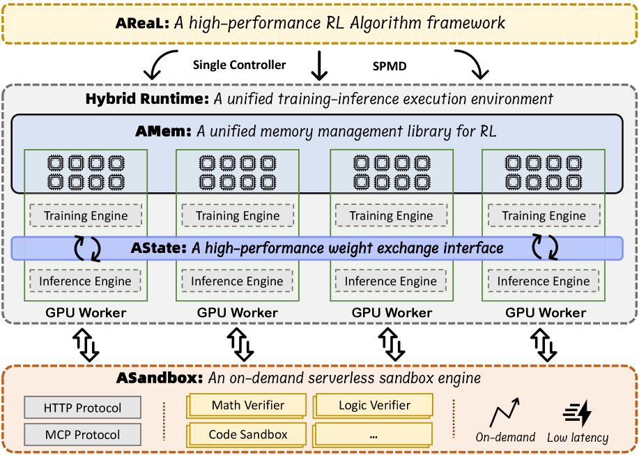

# IcePop: Two-sided train–inference mismatch masking

<!-- source-sha256: 0779fcae6dcb919e1fd302521c5ba6890ab185e0c6ecf0250154847aaefa1368 -->

[简体中文](README.md)

> Candidate-policy RL mechanism, not trillion-parameter MoE.

## Paper information

| Field | Details |
|---|---|
| Paper | [Paper or original source](https://arxiv.org/abs/2510.18855) |
| Institution | Ant Group / Inclusion AI. |
| First public release | 2025-10-21 |
| Author code | No standalone IcePop algorithm source found or released. |
| Local adapter or method key | `icepop` |
| Local reproduction code | [`src/auto_research/post_training/`](https://github.com/daiwk/auto-research/tree/main/src/auto_research/post_training/) |

## Paper method and evidence

MoE routing amplifies numerical differences between training and rollout engines. One-sided TIS may retain very small mismatched ratios. Mask ratios outside a fixed two-sided interval and retain original corrections inside.


<!-- paper-figure:start -->
### Original paper figure

[](https://ar5iv.labs.arxiv.org/html/2510.18855/assets/x14.png)

The original figure shows mismatch handling. From the [original paper](https://arxiv.org/abs/2510.18855); copyright remains with the authors.
<!-- paper-figure:end -->

### Core equation

$$
\rho_t^{\rm TI}=\frac{\pi_{\rm train}(a_t\mid s_t)}{\pi_{\rm rollout}(a_t\mid s_t)},\qquad m_t=\mathbf1[c_{\rm low}\le\rho_t^{\rm TI}\le c_{\rm high}],\qquad \mathcal L=-\mathbb E[m_t\rho_t^{\rm TI}r_t^{\rm policy}A_t].
$$

### Reported results

Ring-1T uses IcePop with C3PO++ and ASystem for trillion-parameter MoE RL and reports AIME 2025 and other scores, without an isolated production IcePop A/B.

## Local reproduction

Same candidate policy and mismatch simulation as TIS. Use `[0.5, 5.0]` and zero gradients for out-of-range actions while preserving PPO ratio/clipping against old rollout policy. [Metrics](../../experiments/rl-papers-summary-seed42.json). No real MoE routing or async cluster.

```bash
auto-research post-train --algorithm icepop --dataset gsm8k-candidate --maximum-examples 256 --steps 120 --seed 42
```
