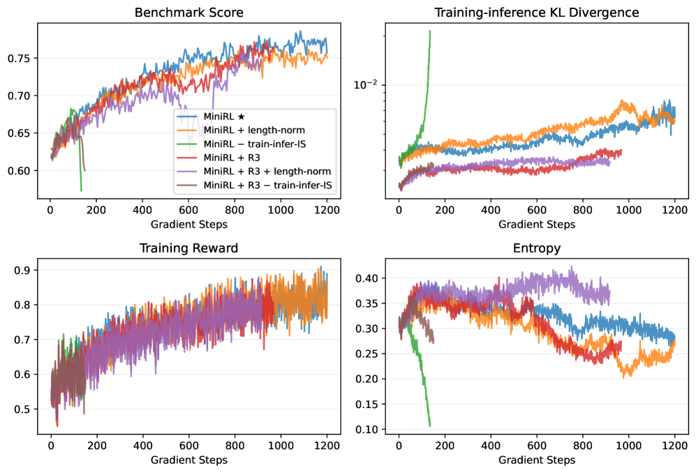

# Stabilizing Reinforcement Learning with LLMs

<!-- source-sha256: 2f5c7c775583a2308fc2e2162eae2955aeb553a76e875514184451d4bd0cf3c3 -->

[简体中文](README.md)

> **Core mechanism evidence.** Paper and local evaluation are separate.

## Paper information

| Field | Value |
| --- | --- |
| Paper | [Stabilizing Reinforcement Learning with LLMs (arXiv 2512.01374)](https://arxiv.org/abs/2512.01374) |
| Affiliations | Qwen Team, Alibaba Inc. |
| First public release | 2025-12-01 (arXiv v1) |
| Authors' code | No official author repository found or released. |
| Adapter / method | `minirl` |
| Local code | [`src/auto_research/post_training/`](https://github.com/daiwk/auto-research/tree/main/src/auto_research/post_training/) |

## Original paper

### Background and contribution

Separate train–inference mismatch from policy staleness. Use on-policy importance correction and combine off-policy clipping with MoE Routing Replay.


<!-- paper-figure:start -->
### Key figure from the paper

[](https://ar5iv.labs.arxiv.org/html/2512.01374/assets/x1.png)

Original Figure 1: Stabilizing Reinforcement Learning with LLMs. From the [paper](https://arxiv.org/abs/2512.01374); copyright belongs to the authors. Not a local result.
<!-- paper-figure:end -->

### Core mechanism

$$
\rho_t=\pi_\theta/\pi_{rollout},\quad \mathcal L=-\mathbb E[\operatorname{clip}(\rho_t)A_t\log\pi_\theta],\quad z_t=z_t^{rollout}.
$$

### Paper results

30B MoE experiments use hundreds of thousands of GPU hours; after stabilization, cold starts end similarly. No production A/B.

## Local reproduction

Arithmetic candidate suite, 120 steps, seed 42: accuracy 0.2344→0.5000 (+113.33%). [Metrics](../../experiments/global-p1-20260808-seed42.json).

```bash
auto-research post-train --algorithm minirl --dataset arithmetic-smoke --maximum-examples 256 --steps 120 --seed 42
auto-research evolve --model post-training --dataset arithmetic-smoke --direction "Combine minirl with installed paper operators" --generations 2 --population 4
```

## Reproduction limits

Only defining objective, update, or protocol on a mini-suite; not large-scale model or multi-GPU benchmark reproduction.
