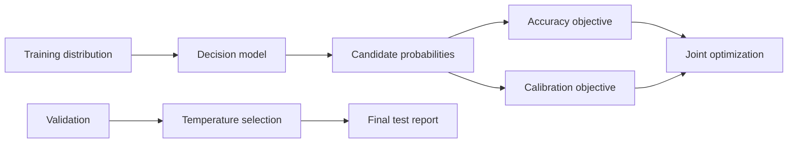
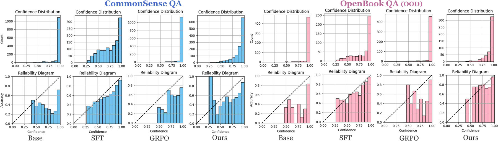

# Calibration-Aware RL: calibrating decision probabilities directly

<!-- source-sha256: 3fed6bb531140f97829ae7558703e20b260fb1b4f92c65e724b4700058371941 -->

[简体中文](README.md)

## Paper information

| Field | Details |
|---|---|
| Paper | [arXiv 2601.13284](https://arxiv.org/abs/2601.13284) |
| Organization | University of Southern California / AWS AI Labs, as listed in the paper |
| First public release | 2026-01-19 (arXiv v1) |
| Authors' code | No public author implementation was found as of 2026-09-20. |
| Adapter / method | `system-one:rival-hybrid` |
| Local reproduction code | `src/auto_research/system_one/` |

## Original paper

### Motivation and method

RLVR can improve decision accuracy while making decision tokens severely overconfident. The paper adjusts decision-token probabilities directly to reduce ECE without sacrificing accuracy. The repository reports accuracy alongside Brier score and ECE, fits temperature only on validation, and forbids test-set tuning.

The local implementation covers decision-probability calibration and its evaluation protocol, not the paper's full RLVR pipeline.

<!-- paper-figure:start -->
### Key figure from the paper

> **Figure 1:** Overview of the paper's method and key components. From the [original paper](https://arxiv.org/abs/2601.13284); copyright remains with the authors.
<!-- paper-figure:end -->

### Core computation

Choose temperature `T` by validation NLL and use Brier score and ECE to check the probabilities from `softmax(z/T)`. Test does not select `T`.

### Paper results

The paper reports a reduction of up to roughly nine ECE points while retaining RLVR accuracy. This is not a measured result of the local small model.

## Reproduction boundaries

Only decision-probability calibration, data isolation, and common reporting are implemented. Full RLVR training was not reproduced.
