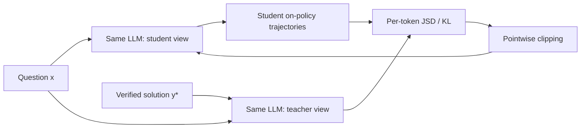
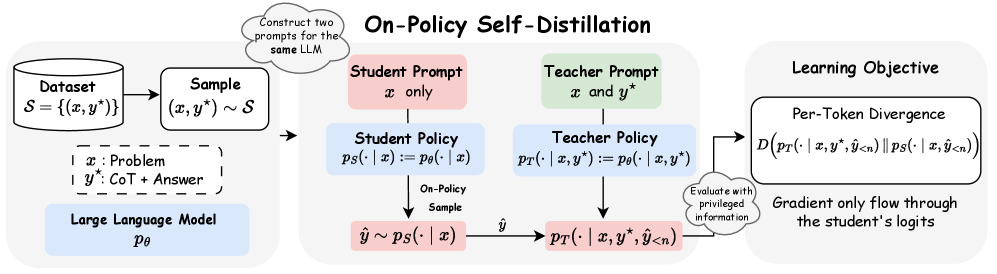

<!-- source-sha256: 8082928a5bc28763d2b28f8f7f640f9498cf8516f2e58f3841760950f405df74 -->

[简体中文](README.md) · English

# OPSD: Self-teaching from privileged solution information

> Implements shared-parameter teacher and student views, on-policy student rollouts, privileged answer conditioning, dense distribution supervision and pointwise divergence clipping. This is a candidate-policy mechanism, not Qwen3 parameter training.

## Paper information

| Field | Details |
| --- | --- |
| Paper | [Self-Distilled Reasoner: On-Policy Self-Distillation for Large Language Models](https://arxiv.org/abs/2601.18734) |
| Institution | UCLA / HKU / Meta Superintelligence Labs |
| First public release | 2026-01-26 |
| Author code | Yes: [siyan-zhao/OPSD](https://github.com/siyan-zhao/OPSD). |
| Local adapter or method key | `opsd` |
| Local reproduction code | [`src/auto_research/post_training/`](https://github.com/daiwk/auto-research/tree/main/src/auto_research/post_training) |

## Original paper summary

### Background and main changes

Ordinary OPD needs a separate teacher. OPSD uses one model under two contexts: the student sees the question and the teacher also sees a verified derivation or answer. The student generates trajectories, and the teacher gives full-vocabulary supervision only at visited prefixes. Per-token pointwise divergence clipping keeps style tokens from dominating.



<!-- paper-figure:start -->
### Key figure from the paper

[](https://arxiv.org/html/2601.18734v3/x1.png)

> **Figure 1:** Ordinary and privileged contexts form student and teacher views of one model for distillation on student trajectories. From the [paper](https://arxiv.org/abs/2601.18734); copyright belongs to the authors. Click for the source.
<!-- paper-figure:end -->

### Core equations

$$
\mathcal L_{\mathrm{OPSD}}=
\mathbb E_{(x,y^*)}\mathbb E_{\hat y\sim p_S(\cdot|x)}
\frac1{|\hat y|}\sum_n
D\!\left(p_T(\cdot|x,y^*,\hat y_{<n})\Vert
p_S(\cdot|x,\hat y_{<n})\right).
$$

### Offline and online results

The paper beats SFT and off-policy distillation on AIME24, AIME25 and HMMT25, with approximately 4–8× the token efficiency of GRPO at comparable or better scores. No production A/B.

## Local reproduction

```bash
auto-research post-train --algorithm opsd \
  --dataset gsm8k-candidate --maximum-examples 128 \
  --steps 120 --seed 42
```

| Metric | Untrained policy | OPSD |
|---|---:|---:|
| Validation accuracy | 0.2500 | **0.9062** |
| Mean reward | 0.3732 | **0.9009** |
| Student rollouts / dense teacher calls | — | 480 / 480 |

See [stable metrics](../../experiments/omitted-agentic-rl-opd-seed42.json).

## Scope

Construct the privileged teacher from the current policy and verified candidates, and update actual candidate-policy parameters. No Qwen3 training or contest-math rerun. This checks the dual-view data flow, divergence and clipping only.
