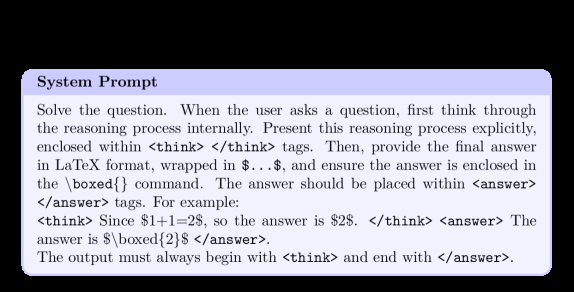

# LUSPO: Length-Unbiased Sequence Policy Optimization

<!-- source-sha256: 65c66a561c437a1b3b98ff992a9f87abf9fa71bb405b5002263f4e1805208d1b -->

[简体中文](README.md)

> **Core mechanism evidence.** Paper and local evaluation are separate.

## Paper information

| Field | Value |
| --- | --- |
| Paper | [Length-Unbiased Sequence Policy Optimization](https://arxiv.org/abs/2602.05261) |
| Affiliations | Meituan |
| First public release | 2026-02-05 |
| Authors' code | No separate official repository found or released. |
| Adapter / method | `luspo` |
| Local code | `src/auto_research/post_training/` |

## Original paper

### Background and contribution

Decompose RLVR objectives to explain different response length trajectories. GSPO still carries length bias; normalize sequence log-probabilities to prevent collapse.


<!-- paper-figure:start -->
### Key figure from the paper

[](https://ar5iv.labs.arxiv.org/html/2602.05261/assets/x3.png)

Original Figure 3: LUSPO. From the [paper](https://arxiv.org/abs/2602.05261); copyright belongs to the authors. Not a local result.
<!-- paper-figure:end -->

### Core mechanism

$$
\bar\ell_\theta(y|x)=\frac{1}{|y|}\sum_{t=1}^{|y|}
\log\pi_\theta(y_t|x,y_{<t}),\qquad
\rho=\exp(\bar\ell_\theta-\bar\ell_{\rm ref}).
$$

### Paper results

Paper results on math and multimodal reasoning beat GRPO and GSPO and avoid response-length collapse. No production A/B.

## Local reproduction

Sample entire responses freely, score with exact-answer verifier, update using length-normalized sequence ratio and group advantage, and record length/reward correlation. [Metrics](../../experiments/free-generation-post-training-seeds42-44.json).

```bash
auto-research post-train --algorithm luspo --dataset arithmetic-generate \
  --maximum-examples 48 --steps 6 --seeds 42,43,44 --offline
```

## Reproduction limits

Actual free generation and sequence objective, but short arithmetic does not test long-CoT length dynamics.
