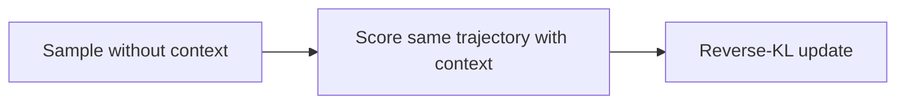
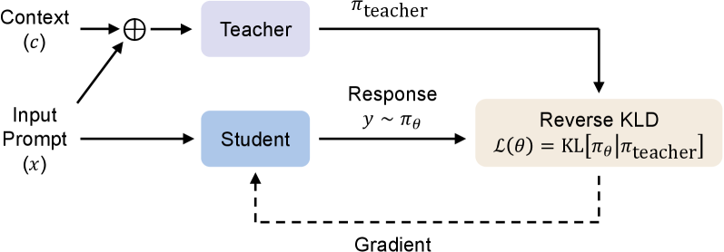

# OPCD: Distill in-context experience into model parameters

<!-- source-sha256: 8b236d0a1786b547d76b657c05f447322ec70892dd78e12582424ab45963d39a -->

[简体中文](README.md)

> Core candidate-policy context distillation, not original Qwen3/VeRL training.

## Paper information

| Field | Details |
|---|---|
| Paper | [Paper or original source](https://arxiv.org/abs/2602.12275) |
| Institution | Microsoft Research. |
| First public release | 2026-02-12 |
| Author code | [microsoft/LMOps/opcd](https://github.com/microsoft/LMOps/tree/main/opcd). |
| Local adapter or method key | `opcd` |
| Local reproduction code | [`src/auto_research/post_training/`](https://github.com/daiwk/auto-research/tree/main/src/auto_research/post_training) |

## Paper method and evidence

An unconditioned student generates a rollout. A teacher with experience or a system prompt scores that same rollout, using reverse KL to internalize context-dependent behavior. The method covers experience and system prompt distillation and supports different teacher sizes.



<!-- paper-figure:start -->
### Original paper figure

[](https://arxiv.org/html/2602.12275v2/x2.png)

The original figure shows context-free rollout and context-aware scoring. From the [original paper](https://arxiv.org/abs/2602.12275); copyright remains with the authors.
<!-- paper-figure:end -->

### Core equation

$$
\mathcal L_{\mathrm{OPCD}}=
\mathbb E_{y\sim\pi_\theta(\cdot|x)}
\sum_t D_{\mathrm{KL}}\!\left(
\pi_\theta(\cdot|x,y_{<t})
\Vert \pi_T(\cdot|x,c,y_{<t})\right).
$$

### Reported results

Filtered experience gives Qwen3-8B math **75.0→80.9** and FrozenLake **6.3→38.3**, above off-policy context distillation **35.2**. No production A/B.

## Local reproduction

Validation accuracy **0.2500→0.9688**, mean reward **0.3732→0.9509**, **480/480** student rollout/context-teacher calls. [Metrics](../../experiments/omitted-agentic-rl-opd-seed42.json). Local context is an auditable distribution from verified answers, not a long system prompt. No FrozenLake, Sokoban, medical or safety tasks; local accuracy is not comparable.

```bash
auto-research post-train --algorithm opcd \
  --dataset gsm8k-candidate --maximum-examples 128 \
  --steps 120 --seed 42
```
