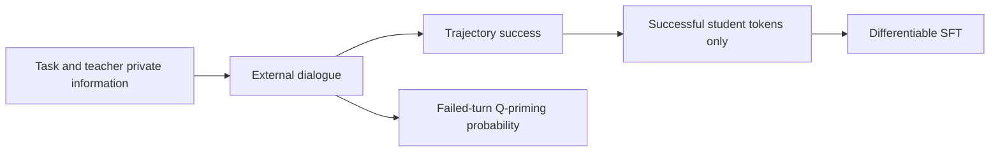
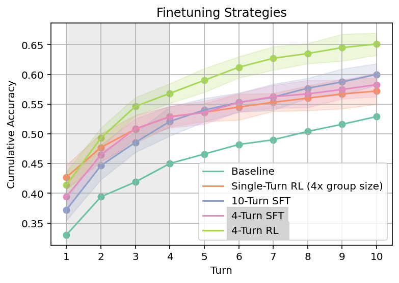

<!-- source-sha256: 9101cef8e8f0469b3619e4e6635307dce6b7a4a948c2feaffdd15a46eb92f143 -->
# Social Meta-Learning: student-only training on successful dialogues

[简体中文](README.md)

> **component_only/L1 mechanism diagnostics, not full-model or agent capability.** The full experiment is not reproduced because of cost (review DONE); only the explicitly bounded components below execute.

## Paper information

| Field | Value |
| --- | --- |
| Paper | [Learning to Learn from Language Feedback with Social Meta-Learning](https://arxiv.org/abs/2602.16488v1), [fixed v1](https://arxiv.org/html/2602.16488v1) |
| Institution | First author Jonathan Cook, Google DeepMind; verified priority affiliations: Google DeepMind. Collaboration does not replace the first-listed affiliation |
| Original publication | **2026-02-18 14:22:13 UTC**; a historical repair, not a November13 first release |
| Authors' code | No verifiable dedicated author source release was found in fixed v1 or bounded official-entry checks; cited libraries and third-party replicas are not counted |
| Local adapter / key | `social-meta-learning`; `adapter=null`; no Evolve integration |
| Local code | `src/auto_research/post_training/social_meta_learning.py` |

## Original paper

### Motivation and changes

SML turns static tasks into teacher–student dialogue. The teacher holds extra knowledge or verifier outputs; the student sees only public conversation and learns to enquire or revise. The inner loop adapts through context; only the outer loop updates weights.

The paper includes offline SFT on successful dialogues and online GRPO with trajectory-level rewards. Q-priming injects questions after failures with probability 0.75^t. Local code implements the precisely specified offline student-only objective and probability kernel, not a generic GRPO label presented as complete SML.

### Architecture



<!-- paper-figure:start -->
### Key original figure

[](https://arxiv.org/html/2602.16488v1/figures/single_fig_1.png)

From the [original paper](https://arxiv.org/html/2602.16488v1#S6.F1); copyright remains with the original authors. These are official HTML PNG bytes without cropping, redrawing or PDF rendering. Original full-training results, not local training curves or a local architecture.
<!-- paper-figure:end -->

### Core equations

$$
\mathcal D_{train}=\{\tau:G(\tau)=1\},\qquad
L_{local}=-\frac1{|M|}\sum_{(b,t)\in M}\log p_\theta(y_{bt}\mid c_{bt}),\qquad
P_Q(t)=0.75^t\mathbf1[incorrect_t].
$$

M contains only student tokens in successful trajectories. Token-mean reduction is an explicit local batching choice: the paper specifies filtering and student turns, not one unique reduction. t is the supplied nonnegative exponent. An empty set of successful student tokens is rejected, not treated as fake zero-loss training.

### Author results

Authors train on Omni-MATH/OpenCodeInstruct and evaluate transfer to LiveCodeBench and Lost-in-Conversation, reporting improved use of feedback and cross-domain transfer. Those full-model results are not local capability measurements. Local checks cover losses and gradients. No production-user A/B is reported.

## Local reproduction

### Protocol and code mapping

successful_student_loss computes actual tensor CE, with zero gradient for teacher tokens and failed dialogues. Shapes, masks, devices, selected targets and finite logits are validated. q_priming_probability does not generate questions. Private teacher knowledge used to generate offline training questions is not permission to reveal gold to evaluated students.

```bash
PYTHONPATH=src python -c 'from auto_research.post_training.social_meta_learning import diagnostic; print(diagnostic(42))'
PYTHONPATH=src python -m pytest tests/test_nov13_colm_agent_components.py -q
```

### Evidence and controls

Fixed-logit losses are checked against analytic CE; backpropagation verifies successful-student gradients and excluded teacher/failed-dialogue positions. CPU and CUDA execute the same actual operations. CUDA requires an A100/A30 receipt before acceptance.

Three-seed mechanism receipts are in [CPU metrics](metrics/component-cpu-seeds42-44.json) and [CUDA metrics](metrics/component-cuda-seeds42-44.json) and the batch's frozen record. Fixed-input diagnostics are not full training, capability gain or online benefit. GPU acceptance requires actual A100/A30 evidence.

## Boundaries

No teacher, backbone, dialogue generator, question synthesis, GRPO, turn discounting or public-benchmark training is supplied. The component does not invent underspecified multi-turn credit assignment. Differentiable arithmetic is not a completed training or capability reproduction.

### Full experiment not reproduced

The full configuration uses Gemma3-12B-IT/Qwen3-8B,2000 training problems per domain, g=8 GRPO groups, multi-turn teachers and three seeds. This paper/upstream configuration exceeds the current single-A100/A30-or-Mac budget. It is a source-reported configuration, not local training measurement. No cost probe, paid API, checkpoint download or full experiment was attempted. **Too costly; not reproduced (review DONE)**. Automatic retry and implementation queues remain disabled.
