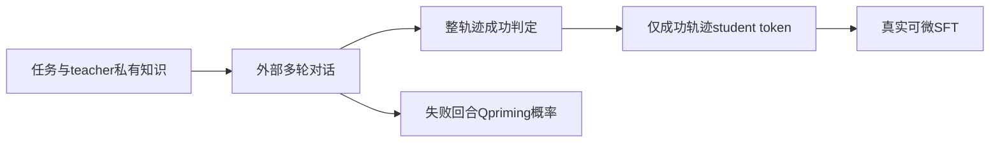
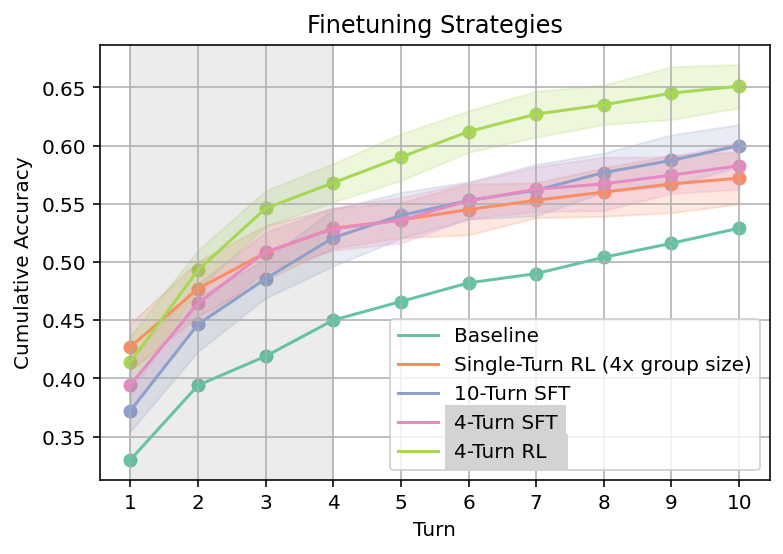

# Social Meta-Learning：成功对话中的 student-only 训练目标

[English](README-en.md)

> **component_only／L1机制诊断，不是完整模型或Agent能力复现。** 完整实验成本过高，不复现（审查 DONE）；仅以下精确定义子组件可执行。

## 论文信息

| 字段 | 内容 |
| --- | --- |
| 论文链接 | [Learning to Learn from Language Feedback with Social Meta-Learning](https://arxiv.org/abs/2602.16488v1)，[固定 v1 原文](https://arxiv.org/html/2602.16488v1) |
| 公司 / 机构 | 一作 Jonathan Cook，Google DeepMind；已核优先署名：Google DeepMind，合作属性不覆盖第一署名机构 |
| 首次公开日期 | **2026-02-18 14:22:13 UTC**；历史补漏，不是2026-11-13新首发 |
| 原作者代码 | 固定v1与本轮有界官方入口检索未找到可核实专属源码；未把引用库或第三方复刻算作作者代码 |
| 本地 adapter / key | `social-meta-learning`；`adapter=null`；未接入Evolve |
| 本地复现代码 | `src/auto_research/post_training/social_meta_learning.py` |

## 原始论文总结

### 背景与主要改动

SML 把静态题目改成 teacher–student 多轮互动。Teacher 持有额外知识或验证结果，student 只看公开对话，逐步提问或修正答案。内循环是上下文学习；外循环才更新模型，二者不能混称在线权重更新。

论文包含只保留成功对话的离线 SFT，以及以整段成功 reward 做分组的在线 GRPO。Q-priming 在失败回合按 0.75^t 概率注入问题作为预训练数据。本地选择可精确执行的离线 student-only loss 和概率核，不用现成通用 GRPO 名称冒充完整社会元学习。

### 架构与流程



<!-- paper-figure:start -->
### 原论文关键图

[](https://arxiv.org/html/2602.16488v1/figures/single_fig_1.png)

图片来自[原论文](https://arxiv.org/html/2602.16488v1#S6.F1)，版权归原作者所有。保存官方HTML原PNG字节，未裁剪、重画或PDF渲染。原文完整训练结果图，不是本地训练曲线或本地架构图。
<!-- paper-figure:end -->

### 核心公式

$$
\mathcal D_{train}=\{\tau:G(\tau)=1\},\qquad
L_{local}=-\frac1{|M|}\sum_{(b,t)\in M}\log p_\theta(y_{bt}\mid c_{bt}),\qquad
P_Q(t)=0.75^t\mathbf1[incorrect_t].
$$

M 只包含成功轨迹的 student token。Token-mean 是明示局部 batching 约定；原文指定成功过滤和 student turns，并未唯一规定 batching reduction。Q-priming 的 t 是调用方提供的非负指数，不偷偷改成另一轮次起点。没有成功 student token 时拒绝训练，而不是产生假零 loss。

### 论文离线与线上效果

作者在 Omni-MATH／OpenCodeInstruct 训练并跨到 LiveCodeBench 和 Lost-in-Conversation，报告多轮反馈利用与跨领域迁移。没有把这些完整模型结果搬成本地能力分数；本地只测 loss 与梯度屏蔽。未报告生产流量线上 A/B。

## 本地复现

### 数据协议与代码映射

`successful_student_loss` 在真实 tensor 上计算 CE，teacher token 与失败轨迹梯度严格为零；非法 shape、mask、设备、selected label 和非有限 logits 被拒绝。`q_priming_probability` 只给原文概率，不生成问题。原文训练数据生成阶段用 teacher 私有知识合成问题，不意味着评测时可把 gold 直接给 student。

```bash
PYTHONPATH=src python -c 'from auto_research.post_training.social_meta_learning import diagnostic; print(diagnostic(42))'
PYTHONPATH=src python -m pytest tests/test_nov13_colm_agent_components.py -q
```

### 结果与负控

固定 logits 的 loss 可与解析 CE 对照，反向传播检查成功 student 有梯度、teacher 和失败对话为零。CPU 与 CUDA 都走真实相同 tensor 运算；CUDA 路径必须有 A100/A30 回执后才标验收。

三seed机制执行回执见[CPU组件指标](metrics/component-cpu-seeds42-44.json)与[CUDA组件指标](metrics/component-cuda-seeds42-44.json)及本轮冻结记录；它是固定输入机制诊断，不是完整训练、能力提升或线上收益。GPU验收仅以真实A100/A30回执为准。

## 复现边界

没有 teacher、student backbone、真实对话、问题生成、GRPO、turn discounting 或公开 benchmark 训练。本地不猜原文未详细展开的多轮 GRPO credit assignment。可微算子是组件，不是完整训练或能力复现。

### 高成本完整实验

Gemma3-12B-IT/Qwen3-8B、2000训练问题/domain、g8 GRPO、teacher多轮、3seed，完整模型训练与跨域benchmark高成本不复现。 这是论文／上游配置成本依据，不是本地训练测量。没有为估价试训、调用收费API或下载checkpoint。**成本过高，不复现（审查 DONE）**；不进入自动重试或自动实现队列。
