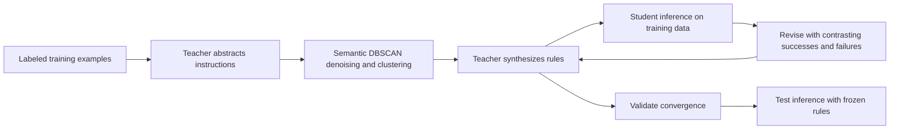
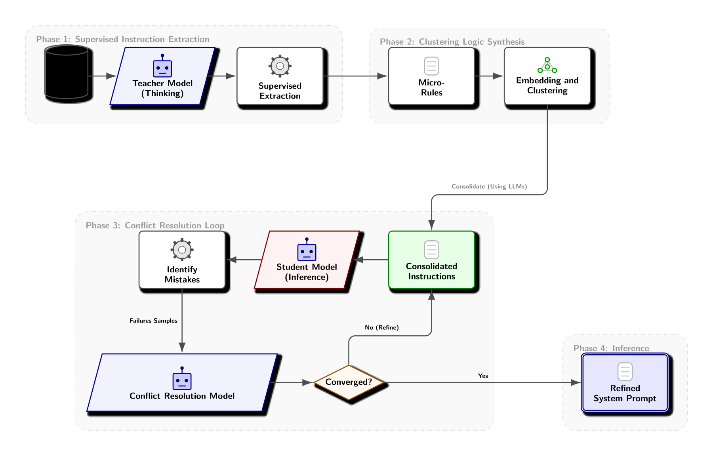

<!-- source-sha256: d5f1fe6095b43382fd90888f83040a1f09b61f8eaf79934ecbd6a285797bc09a -->

[简体中文](README.md) · English

# PLD: Compiling teacher reasoning into readable student instructions

> High-priority historical literature record. **Too costly; not reproduced (review DONE).** No local capability results or executable Evolve operator.

## Paper information

| Field | Details |
| --- | --- |
| Paper | [arXiv 2602.21103v1](https://arxiv.org/abs/2602.21103v1); [pinned full text](https://arxiv.org/html/2602.21103v1) |
| Institution | First author Sanket Badhe and coauthor Deep Shah both list Google (Mountain View). |
| First public release | 2026-02-24 17:03:21 UTC (arXiv v1); institution catalog dates do not override it |
| Author code | No author implementation repository was found in the source reviewed. Not finding it does not prove it was never released. |
| Local adapter or method key | `prompt-level-distillation` (research reference only); `adapter: null` |
| Local reproduction code | None. This document and `src/auto_research/paper_specs/catalog/post-training/prompt-level-distillation.json` only. |

## Original paper summary

### Background and main changes

PLD does not fine-tune student parameters. It abstracts teacher reasoning into reviewable system instructions: extract micro-rules from labeled training examples, denoise them using DBSCAN on semantic vectors, synthesize rules, then revise conflicts using training errors. The student uses the resulting instructions without reading test answers.

Diagram redrawn from the paper's Figure 1. See [original workflow](https://arxiv.org/html/2602.21103v1).

<!-- paper-figure:start -->
### Key figure from the paper

> **Figure 1:** Supervised instruction extraction, clustering and synthesis, conflict repair, and frozen-prompt inference. Both teacher and student are the paper's configurations, not local runs. From the [original paper](https://arxiv.org/abs/2602.21103v1), copyright the authors. The authors' SVG is rendered as PNG here, distinct from the Mermaid redraw above. Click for the original.
<!-- paper-figure:end -->

### Core equations and data protocol

The rule compilation in §3 can be expressed as:

$$
I_i=T_{\rm extract}(x_i,y_i),\quad
\mathcal C={\rm DBSCAN}({\rm embed}(I_i)),\quad
\hat y=S(x;I_{\rm consolidated}).
$$

The teacher sees training labels; clustering discards noise points. Conflict revisions preserve successful examples to avoid regression. Validation determines when to stop. Test labels must not participate in rule generation, clustering, conflict repair, or stopping. This is a workflow summary, not a separately named new loss.

### Offline and online results

Pinned v1 Table 1 reports Gemma-3 4B StereoSet Macro-F1 rising from 0.57 to 0.90 and Contract-NLI from 0.67 to 0.83. The tasks and students must be compared separately; these results do not show general reasoning at frontier-teacher quality. v2 was confirmed updated on 2026-06-02, but this page does not claim a section-by-section review of that revision. No production A/B is reported.

## Local reproduction and cost

Section 4.1 uses Gemini 3 Flash thinking for extraction, Gemini 3 Pro thinking for synthesis and repair, and Gemini Embedding for clustering. Students include Gemma-3 4B and Gemini 2 Flash. Multi-stage closed-model calls and a full multi-task evaluation cannot be pinned cheaply. **Too costly; not reproduced (review DONE).** No model downloads were made to probe cost.

No author implementation repository was found in the paper or official materials reviewed. This is a literature record only, with no rule compiler, real teacher outputs, student evaluation, GPU run, or Evolve integration. Handwritten rules are not prompt distillation, and PLD is not on-policy parameter distillation.
