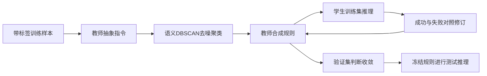
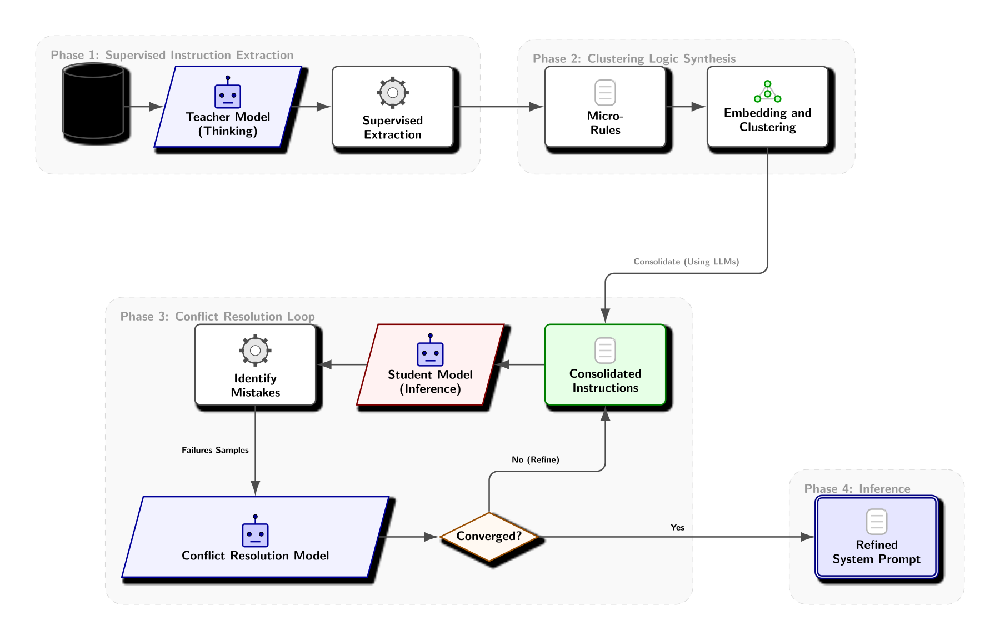

# PLD：把教师推理编译成学生的可读指令

> 历史高优先补漏资料；**成本过高，不复现（审查 DONE）**。没有本地能力结果或可执行 Evolve 算子。

## 论文信息

| 字段 | 内容 |
| --- | --- |
| 论文链接 | [arXiv 2602.21103v1](https://arxiv.org/abs/2602.21103v1)；[固定正文](https://arxiv.org/html/2602.21103v1) |
| 公司 / 机构 | 一作 Sanket Badhe 与共同作者 Deep Shah 均署名 Google（Mountain View） |
| 首次公开日期 | 2026-02-24 17:03:21 UTC（arXiv v1，不用机构目录日期覆盖） |
| 原作者代码 | 所读原文未找到作者实现仓库；未找到不表示已证明未发布 |
| 本地 adapter / 稳定键 | `prompt-level-distillation`（仅资料键）；`adapter: null` |
| 本地复现代码 | 无；仅本文及 `src/auto_research/paper_specs/catalog/post-training/prompt-level-distillation.json` |

## 原始论文总结

### 背景与主要改动

PLD 不微调学生参数，而把教师推理抽象为可审查的系统指令：先用带标签训练样本提取微规则，经语义向量 DBSCAN 去掉噪声、合成规则，再根据训练错误修订冲突。学生最终使用整理后的规则，不读取每个测试样本的答案。

图按原文 Figure 1 重绘。[原始流程图](https://arxiv.org/html/2602.21103v1)。

<!-- paper-figure:start -->
### 原论文关键图

> **原论文 Figure 1**：监督指令抽取、聚类合成、冲突修复与冻结提示推理四阶段；教师与学生均为原论文配置，不是本地实跑。 图片来自[原论文](https://arxiv.org/abs/2602.21103v1)，版权归原作者所有；此处将作者SVG渲染为PNG展示，不是上方Mermaid重绘。点击图片查看原始图源。
<!-- paper-figure:end -->

### 核心公式与数据协议

可将 §3 的规则编译过程写为：

$$
I_i=T_{\rm extract}(x_i,y_i),\quad
\mathcal C={\rm DBSCAN}({\rm embed}(I_i)),\quad
\hat y=S(x;I_{\rm consolidated}).
$$

教师看到的是训练标签，聚类噪声点舍弃；冲突修订同时保留成功案例以防退化。验证集用于停止判断，测试标签不可参与规则生成、聚类、冲突修复或终止选择。这是流程摘要，不是原文单独命名的新 loss。

### 论文离线与线上效果

固定 v1 Table 1：Gemma-3 4B 的 StereoSet Macro-F1 从 0.57 到 0.90，Contract-NLI 从 0.67 到 0.83。两种任务、不同学生须分别比较，不能外推为通用推理能力都达到前沿教师。已确认 v2 在 2026-06-02 更新，本文不声称逐段核验该修订；未报告生产 A/B。

## 本地复现与成本判断

§4.1 使用 Gemini 3 Flash thinking 提取、Gemini 3 Pro thinking 合成和修复、Gemini Embedding 聚类，学生含 Gemma-3 4B / Gemini 2 Flash。多阶段闭源调用与完整多任务评测成本无法廉价固定，**成本过高，不复现（审查 DONE）**，不下载模型探成本。

所读原文及官方详情未找到作者实现仓库。本轮仅资料收录，没有规则编译器、真实教师输出、学生评测或 GPU 实跑，未接入 Evolve。不能用人工写好的规则当作已完成提示蒸馏；也不能称其 on-policy 参数蒸馏。
