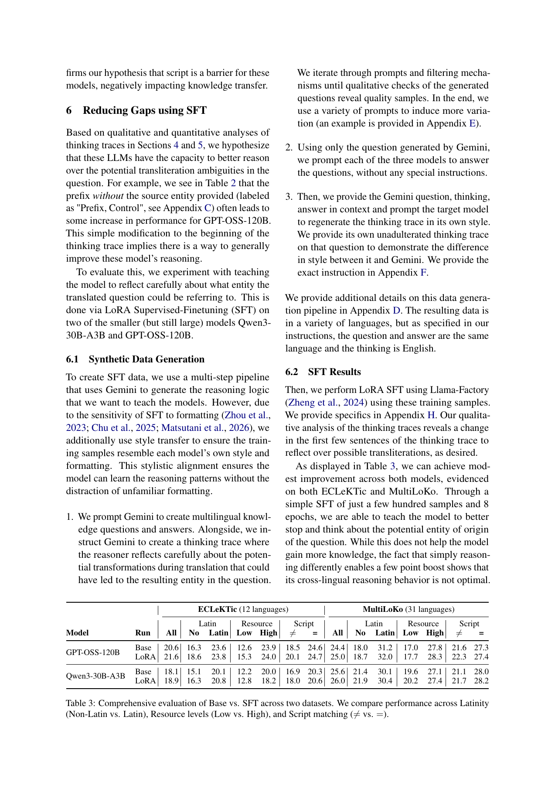

<!-- source-sha256: ca06079e366e0abcde360999dfa35a8ec136fb38e0e7f967a88dcf8a2a8b5b1a -->

[简体中文](README.md) · English

# Large Reasoning Models Struggle to Transfer Parametric Knowledge Across Scripts

ECLeKTic/MultiLoKo regressions distinguish language and writing-system barriers to knowledge transfer. Source-language entity prefixes, Gemini-generated transliteration reflection traces, style transfer to the model's own reasoning, and LoRA SFT improve cross-script reasoning.

> **Literature and cost record only.** No executable capability adapter or heuristic substitute for the defining model. The full experiment is **too costly; not reproduced (review DONE)**, with no weight/data downloads or automatic retries. This is a user-identified historical conference omission, not a new publication today.

## Paper information

| Field | Details |
|---|---|
| Paper | [Original arXiv v1](https://arxiv.org/abs/2603.17070v1) |
| Pinned method version | [v2 full text](https://arxiv.org/html/2603.17070v2); the original release date follows v1, not the update |
| Institution | All authors list Google Research as their primary affiliation on the pinned v2 front page. First author Lucas Bandarkar additionally lists the University of California, Los Angeles, marked §. Trevor Cohn additionally lists the University of Melbourne. Catalog grouping uses Google Research and retains the secondary UCLA affiliation. |
| First public release | **2026-03-17 18:57:26 UTC**, arXiv v1 |
| Author code | No author code link in the pinned v2 or abstract. Llama-Factory is upstream training tooling, not this paper's author implementation. |
| Author code license | No verified author repository, so source license and pinned SHA are not applicable. Paper and figure license: CC BY-SA 4.0. |
| Local adapter or method key | `cross-script-knowledge-transfer`; `adapter=null`; `promotion_eligible=false`; `evolve_integrated=false` |
| Local reproduction code | None. The full method is not implemented; no fake capability entry point. |
| Local verification | Not applicable: review and documentation only; no training, GPU receipts, or invented metrics. |

## Original paper summary

### Background and main changes

Sections 4–6 and Appendices A/H define the key workflow: observational regression, a training-only entity hint intervention, and real LoRA. Regex transliteration, manual prompt injection, or a small classifier cannot replace LLM knowledge retrieval. The work does not propose a new closed-form RL loss. This batch records the paper only, without inventing an operator.

<!-- paper-figure:start -->
### Key figure from the paper

Table 3 from its original page in the pinned v2 PDF, including the original table/figure and context. From the [paper](https://arxiv.org/html/2603.17070v2#S5.T3), copyright the authors, CC BY-SA 4.0. See `assets/provenance.json` for source, SHA256, and visual verification.
<!-- paper-figure:end -->

### Core equations

$$
D_{SFT}=StyleTransfer(Question,Think_{Gemini},Answer,Think_{model}),\quad\theta'=LoRA\text{-}SFT(\theta,D_{SFT}).
$$

The formula explains the method, not an implemented training pipeline or large-model semantic module.

### Offline and online results

Table 3 reports modest gains, not a complete solution to cross-language knowledge transfer: ECLeKTic goes from 20.6 to 21.6 for GPT-OSS120B and 18.1 to 18.9 for Qwen30B. Gains favor low-resource and cross-script cases. Observational regression is not causal proof, and the paper acknowledges translation and transliteration ambiguities. No production internet A/B is reported; offline analyses and local numerical tests are not online gains.

## Local reproduction

This batch provides no runnable model, loss wrapper, or fake test. Generic KL, RL, and statistics tools in the repository do not constitute the defining workflow. Handwritten rules cannot replace semantic models, multi-turn API generation, or large-scale training. Only the verified method, resources, source status, and original figure are recorded. Terminal status is `not_reproduced_high_cost`; do not automatically move it back into the training queue.

### High-cost full experiment

Sec. 6 and Appendix H use GPT-OSS-120B and Qwen3-30B-A3B, 599/387 samples, 8 epochs, LoRA rank 32, Gemini generation and filtering, and model style transfer, plus evaluations across 12/31 languages. Model size and long multilingual inference are expensive, so no downloads or trials are made.

The resource baseline is one A100/A30 or a local Mac. These are paper configurations and public reports, not measured local runtimes. Undisclosed GPU models or training hours are not invented. **Full experiment too costly; not reproduced (review DONE).** No large weights are downloaded or long trial launched just to demonstrate expense.
