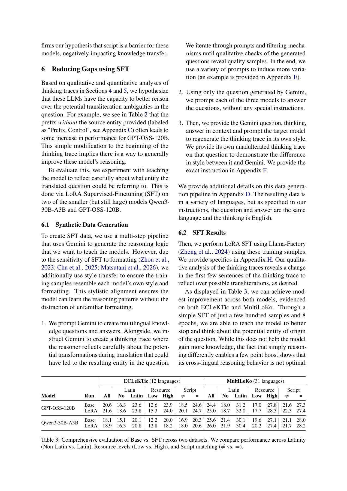

# Large Reasoning Models Struggle to Transfer Parametric Knowledge Across Scripts

通过ECLeKTic/MultiLoKo回归分析区分语言和文字系统的知识迁移障碍，再用源语言实体前缀与Gemini合成的音译反思轨迹、模型自身风格迁移、LoRA SFT改善跨script推理。

> 状态：**仅文献与成本收录**，没有可执行能力adapter，不以heuristic冒充核心模型。完整实验：**成本过高，不复现（审查 DONE）**，不下载权重/数据、不自动重试。此为用户指定的历史会议补漏，不是本日新发表。

## 论文信息

| 字段 | 内容 |
|---|---|
| 论文链接 | [原始 arXiv v1](https://arxiv.org/abs/2603.17070v1) |
| 固定方法版本 | [v2正文](https://arxiv.org/html/2603.17070v2)；原始发布日期仍按v1，不把更新版日期当首发 |
| 公司 / 作者机构 | 固定v2首页所有作者主机构为Google Research；一作Lucas Bandarkar另以§列University of California, Los Angeles，Trevor Cohn另列University of Melbourne。按Google Research主机构聚合，保留UCLA次级标注。 |
| 原始发布日期 | **2026-03-17 18:57:26 UTC**，arXiv v1 |
| 原作者代码 | 固定v2正文与摘要未找到作者代码链接；Llama-Factory为上游训练工具，不记为该论文作者实现。 |
| 原作者代码许可 | 未核实作者源码仓库，源码许可与固定SHA不适用。论文/原图许可：CC BY-SA 4.0 |
| 本地 Adapter / key | `cross-script-knowledge-transfer`；`adapter=null`；`promotion_eligible=false`；`evolve_integrated=false` |
| 本地代码 | 无：未实现完整方法，不发布伪能力入口 |
| 本地验证 | 不适用：只审查和文档，不训练、不生成GPU收据或虚构metrics |

## 原始论文总结

### 背景与主要改动

Sec.4–6与Appendix A/H：观察性回归、训练专用entity提示干预和真实LoRA是定义性路径。不能把正则音译、手工插提示或小分类器当成其LLM知识检索机制。本文不是新闭式RL loss；本轮仅文献收录，不强造operator。

<!-- paper-figure:start -->
### 原论文关键图

Table 3取自固定v2的原始PDF对应页，包含原表/图及上下文。图片来自[原论文](https://arxiv.org/html/2603.17070v2#S5.T3)，版权归原作者所有。许可 CC BY-SA 4.0。来源、SHA256与实际目视核验见 `assets/provenance.json`。
<!-- paper-figure:end -->

### 核心公式

$$
D_{SFT}=StyleTransfer(Question,Think_{Gemini},Answer,Think_{model}),\quad\theta'=LoRA\text{-}SFT(\theta,D_{SFT}).
$$

上述公式仅解释原方法，不表示已经实现该训练或大模型语义模块。

### 论文离线与线上效果

Table3为轻微而非跨语言知识彻底解决：GPT-OSS120B ECLeKTic20.6→21.6，Qwen30B18.1→18.9，改善偏向低资源/跨script。观察性回归不是因果证明，原文也承认翻译/音译歧义。 未报告互联网生产线上A/B；不得将离线分析或本地数值测试写成线上收益。

## 本地复现

本轮不提供可运行模型、loss包装或伪测试。库里已有通用KL/RL/统计工具并不构成本文核心流程；原文语义模型、API多轮生成或大规模训练不能用手工规则替换。仅保存经过核验的方法、资源、源码状态与原图，终态为 `not_reproduced_high_cost`。后续不得自动移回待训练队列。

### 高成本完整实验

Sec.6 / Appendix H：GPT-OSS-120B与Qwen3-30B-A3B，599/387样本、8epochs、LoRA rank32，Gemini生成并过滤+模型风格迁移，另有12/31语言评测。模型参数和多语言长推理成本高，不下载、不试跑。

资源基准为单张A100/A30或本地Mac。上述为原论文配置/公开报告，不是本地实测耗时，也不推造未披露的GPU型号或训练小时。完整实验结论：**成本过高，不复现（审查 DONE）**。没有为了证明它昂贵而先下载大权重或启动长跑。
