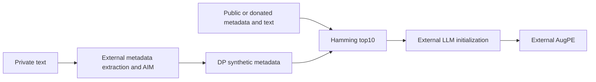
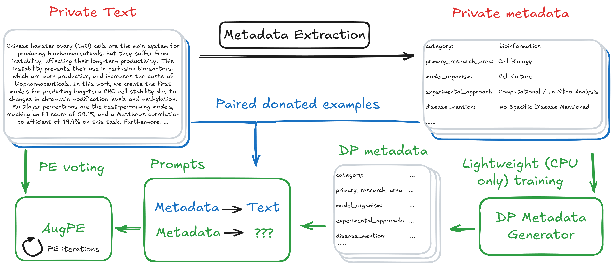

<!-- source-sha256: 2762218a95bffd8819414d30cb486e7bcb699856a579f3309db608d99bb3524b -->
# MAPLE: categorical-metadata selection of donated ICL examples

[简体中文](README.md)

> **component_only/L1 mechanism diagnostics, not full-model or agent capability.** The full experiment is not reproduced because of cost (review DONE); only the explicitly bounded components below execute.

## Paper information

| Field | Value |
| --- | --- |
| Paper | [MAPLE: Metadata Augmented Private Language Evolution](https://arxiv.org/abs/2603.19258v1), [fixed v1](https://arxiv.org/html/2603.19258v1) |
| Institution | First author Eli Chien, National Taiwan University; verified priority affiliations: Google Research / Meta. Collaboration does not replace the first-listed affiliation |
| Original publication | **2026-02-26 14:18:36 UTC**; a historical repair, not a November13 first release |
| Authors' code | [Verified public repository](https://github.com/elichien-google/MAPLE); presence does not mean the full system ran locally |
| Local adapter / key | `maple-icl`; `adapter=null`; no Evolve integration |
| Local code | `src/auto_research/post_training/maple_icl.py` |

## Original paper

### Motivation and changes

Private Evolution struggles when initial synthetic text is off-domain. MAPLE extracts fixed-schema metadata, privatizes it with AIM, uses non-private donated metadata/text pairs to initialize generation, and then runs AugPE.

The affordable independent step selects the ten nearest examples among fifty donations by categorical Hamming distance. Fields include strings and discrete word-count bins; numerical bins are categories, not Euclidean distances. Local code replaces neither AIM nor the generator and releases no DP metadata.

### Architecture



<!-- paper-figure:start -->
### Key original figure

[](https://arxiv.org/html/2603.19258v1/Figs/maple_fig.png)

From the [original paper](https://arxiv.org/html/2603.19258v1#S1.F2); copyright remains with the original authors. These are official HTML PNG bytes without cropping, redrawing or PDF rendering. The full MAPLE workflow; local code supplies example selection only, not DP or text generation.
<!-- paper-figure:end -->

### Core equations

$$
d_H(m,m')=\sum_{j=1}^{p}\mathbf1[m_j\ne m'_j],\qquad
E(m)=\operatorname{TopKSmallest}_{e\in E_{donated}}d_H(m,m_e),\quad K=10.
$$

Hamming counts and counts divided by the common field count produce the same ranking. The kernel returns counts. Since the paper does not specify ties, input order is stable locally. Fields must exactly match the public schema, with values in their categorical domains. Missing values are not silently equal or mapped to Other.

### Author results

Authors compare MAUVE, metadata JSD and downstream utility on bioRxiv/OpenReview, finding metadata plus ICL more useful than either alone and faster full MAPLE convergence than AugPE. Initialization alone does not match the full procedure; several PE rounds remain important. No production-user A/B is reported. Local code measures neither privacy nor utility.

## Local reproduction

### Protocol and code mapping

Donation requires an ID, metadata, original text and external consent_ref; select_examples actually ranks Hamming distances. A consent reference and typed synthetic metadata do not establish consent or DP: callers own that provenance. There is no raw-private-corpus parameter or LLM call.

```bash
PYTHONPATH=src python -c 'from auto_research.post_training.maple_icl import diagnostic; print(diagnostic(42))'
PYTHONPATH=src python -m pytest tests/test_nov13_colm_agent_components.py -q
```

### Evidence and controls

Checks cover exact matches, non-Euclidean categorical bins, stable ties, unchanged donated text and rejection of missing/out-of-domain fields. Explicit public toy examples are not privacy-mechanism outputs and cannot establish ε-DP.

Three-seed mechanism receipts are in [CPU metrics](metrics/component-cpu-seeds42-44.json) and the batch's frozen record. Fixed-input diagnostics are not full training, capability gain or online benefit. GPU acceptance requires actual A100/A30 evidence.

## Boundaries

Private extraction, AIM, budget composition, embeddings, AugPE, Qwen generation and downstream training are absent. Output must not be called DP synthetic data. This is deterministic ICL selection under external DP and donation assumptions.

### Full experiment not reproduced

Upstream recommends at least two40GB A100s. The full procedure uses Qwen2.5-7B, AIM,2k/5k long synthetic texts, AugPE, multiple privacy budgets and downstream training. This paper/upstream configuration exceeds the current single-A100/A30-or-Mac budget. It is a source-reported configuration, not local training measurement. No cost probe, paid API, checkpoint download or full experiment was attempted. **Too costly; not reproduced (review DONE)**. Automatic retry and implementation queues remain disabled.
