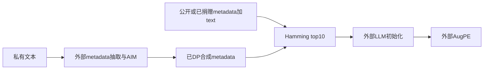
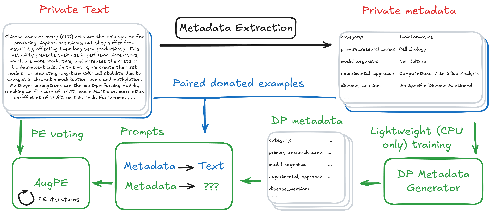

# MAPLE：按分类元数据选择已捐赠 ICL 示例

[English](README-en.md)

> **component_only／L1机制诊断，不是完整模型或Agent能力复现。** 完整实验成本过高，不复现（审查 DONE）；仅以下精确定义子组件可执行。

## 论文信息

| 字段 | 内容 |
| --- | --- |
| 论文链接 | [MAPLE: Metadata Augmented Private Language Evolution](https://arxiv.org/abs/2603.19258v1)，[固定 v1 原文](https://arxiv.org/html/2603.19258v1) |
| 公司 / 机构 | 一作 Eli Chien，National Taiwan University；已核优先署名：Google Research / Meta，合作属性不覆盖第一署名机构 |
| 首次公开日期 | **2026-02-26 14:18:36 UTC**；历史补漏，不是2026-11-13新首发 |
| 原作者代码 | [已核公开仓库](https://github.com/elichien-google/MAPLE)；不代表本地已运行完整系统 |
| 本地 adapter / key | `maple-icl`；`adapter=null`；未接入Evolve |
| 本地复现代码 | `src/auto_research/post_training/maple_icl.py` |

## 原始论文总结

### 背景与主要改动

Private Evolution 的初始合成文本若偏离目标领域，后续多轮演化难以纠正。MAPLE 先从私有文本抽取固定 schema 的分类 metadata，用 AIM 生成 DP 表格 metadata，再结合非私有已捐赠的 metadata–text 示例初始化文本，最后继续 AugPE。

局部可独立执行的步骤是：对每条 synthetic metadata，按分类 Hamming 距离从 50 条 donated 示例选最近 10 条。原文包含字符串分类与离散 word-count 桶，数值桶也按类别相等比较，不按欧氏数值差；本地不替代 AIM、不发布 DP metadata，也不造模型文本。

### 架构与流程



<!-- paper-figure:start -->
### 原论文关键图

[](https://arxiv.org/html/2603.19258v1/Figs/maple_fig.png)

图片来自[原论文](https://arxiv.org/html/2603.19258v1#S1.F2)，版权归原作者所有。保存官方HTML原PNG字节，未裁剪、重画或PDF渲染。完整 MAPLE 流程图；本地仅初始化中的示例选择，不包含DP或文本生成。
<!-- paper-figure:end -->

### 核心公式

$$
d_H(m,m')=\sum_{j=1}^{p}\mathbf1[m_j\ne m'_j],\qquad
E(m)=\operatorname{TopKSmallest}_{e\in E_{donated}}d_H(m,m_e),\quad K=10.
$$

用 Hamming 计数或除以相同字段数 p 的归一化距离，近邻次序相同；本地返回计数，避免单位含糊。原文未规定并列，局部按 donated 输入顺序稳定选择。字段必须完全匹配公开 schema，值属于该字段的固定分类域；不把缺值视作自动相等或填充 Other。

### 论文离线与线上效果

作者在 bioRxiv／OpenReview 比较 MAUVE、metadata JSD 与下游任务；报告 metadata+ICL 优于只用其一，完整 MAPLE 的演化收敛也比 AugPE 更快。初始化不等于完整最优结果，少量 PE 轮仍重要。未报告生产流量线上 A/B。本地不测隐私／效用。

## 本地复现

### 数据协议与代码映射

`Donation` 要求显式示例 ID、metadata、原文本和外部 consent_ref；`select_examples` 实际按 Hamming 取 k 项。consent_ref 和 synthetic_metadata 的类型不证明已获捐赠同意或已满足 DP，调用方必须提供真实来源。没有 raw-private-corpus 参数，排序不会调用 LLM。

```bash
PYTHONPATH=src python -c 'from auto_research.post_training.maple_icl import diagnostic; print(diagnostic(42))'
PYTHONPATH=src python -m pytest tests/test_nov13_colm_agent_components.py -q
```

### 结果与负控

测试精确匹配、数值桶不按数值远近排序、并列稳定、返回原始 donated 文本、字段缺漏或越域拒绝。所有示例是明示公开 toy 数据，不是隐私机制输出，不能用样本测试声明 ε-DP。

三seed机制执行回执见[CPU组件指标](metrics/component-cpu-seeds42-44.json)及本轮冻结记录；它是固定输入机制诊断，不是完整训练、能力提升或线上收益。GPU验收仅以真实A100/A30回执为准。

## 复现边界

没有私有metadata抽取、AIM、隐私预算组合、embedding、AugPE、Qwen生成或下游训练。不得把本组件输出称DP合成数据；它只是依赖外部DP与捐赠前提的确定性ICL选择。

### 高成本完整实验

上游建议至少2×A10040GB；Qwen2.5-7B、AIM、2k/5k长文本合成、AugPE、多隐私预算和下游训练；完整实验高成本不复现。 这是论文／上游配置成本依据，不是本地训练测量。没有为估价试训、调用收费API或下载checkpoint。**成本过高，不复现（审查 DONE）**；不进入自动重试或自动实现队列。
