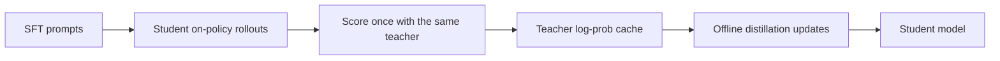
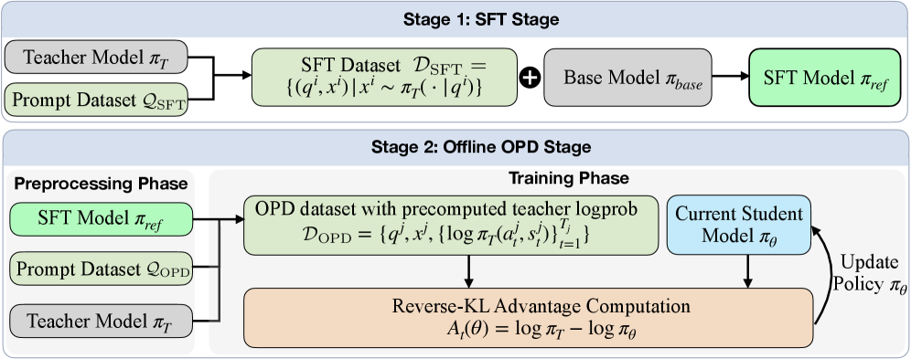

<!-- source-sha256: 92530c8f3ad78ff5745d936a48bc1059a43b1bb7d696b789ce32614acab1954d -->

[简体中文](README.md) · English

# Lightning OPD: On-policy distillation with an offline teacher cache

> **Fidelity:** Reproduces teacher prefilling, teacher consistency, and zero online teacher calls during training. A candidate policy verifies the mechanism; this is not the paper's full-parameter Qwen3 training.

## Paper information

| Field | Details |
| --- | --- |
| Paper | [Lightning OPD (arXiv 2604.13010)](https://arxiv.org/abs/2604.13010) |
| Institution | MIT HAN Lab / Jet AI |
| First public release | 2026-04-14 |
| Author code | [jet-ai-projects/Lightning-OPD](https://github.com/jet-ai-projects/Lightning-OPD) |
| Local adapter or method key | `lightning-opd` |
| Local reproduction code | [`src/auto_research/post_training/`](https://github.com/daiwk/auto-research/tree/main/src/auto_research/post_training) |

## Original paper summary

### Background and main changes

Conventional online distillation calls the teacher at each training step, making throughput and cost depend on teacher inference. Lightning OPD first generates student on-policy rollouts on SFT data. The same teacher computes token distributions once and caches them. Training reads only the cache, preserving distillation on the student distribution without an online teacher during training.



<!-- paper-figure:start -->
### Key figure from the paper

[](https://arxiv.org/html/2604.13010v2/x3.png)

> **Figure 2:** The training pipeline and key optimization stages in the paper. From the [paper](https://arxiv.org/abs/2604.13010); copyright belongs to the authors. Click for the source.
<!-- paper-figure:end -->

### Core equations

$$
\mathcal{L}_{\mathrm{OPD}}
=-\mathbb{E}_{x,y\sim\mathcal{D}_{\mathrm{SFT}}}
\sum_t p_T(y_t\mid x,y_{<t})\log p_\theta(y_t\mid x,y_{<t}).
$$

Rollouts and offline labels must use a consistent teacher configuration to avoid a teacher mismatch.

### Offline and online results

The paper reports 69.9% on AIME 2024 with Qwen3-8B Base, about 30 GPU hours total, and roughly 4× higher training efficiency. Qwen3-30B-A3B reaches 71.0% on AIME 2024 on one 8×H100 node. These are offline benchmarks; no production A/B test is reported.

## Local reproduction

The implementation caches teacher probabilities for all training candidates and records `teacher_prefill_calls` and `teacher_cache_entries`. During updates, it enforces `online_teacher_calls=0`. Policy updates, KL, and evaluation use the same split as DPO/GRPO.

```bash
auto-research post-train --algorithm lightning-opd \
  --dataset gsm8k-candidate --maximum-examples 512 \
  --steps 300 --seed 42
```

| Metric | Untrained policy | Lightning OPD |
|---|---:|---:|
| GSM8K candidate accuracy | 0.1641 | **0.8359** |
| Mean reward | 0.3126 | **0.8561** |
| KL(reference) | 0.0000 | 0.8269 |
| Online teacher calls | — | 0 |

Stable metrics: [`post-training-gsm8k-candidate-seed42.json`](../../experiments/post-training-gsm8k-candidate-seed42.json).

## Scope

The run does not train real Qwen3, use token-level vocabulary distributions, or rerun AIME. It establishes only the cached OPD data flow and teacher-call constraint. Local accuracy is not comparable to the paper's AIME results.
