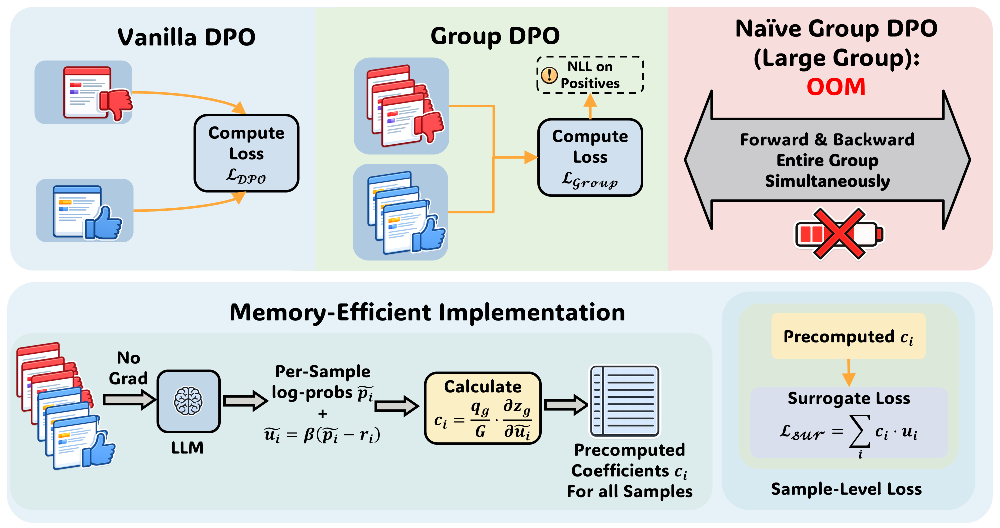

# GroupDPO: Exact group gradients with per-response backpropagation

<!-- source-sha256: a448988b89e8bd6ded19bf5b7d6aa479b86b94725e77cce617eb7deae8c3d1de -->

[简体中文](README.md)

> **L1 exact mechanism component, diagnostic only.** This is neither a full LLM reproduction nor eligible for Evolve or promotion. **Full experiments are too costly and are not reproduced (review DONE).** Google's conference listing surfaced this historical omission; it is not an October 25 publication.

## Paper information

| Field | Details |
|---|---|
| Paper | [arXiv 2604.15602v1](https://arxiv.org/abs/2604.15602v1); [pinned v2 full text](https://arxiv.org/html/2604.15602v2) |
| Institution | First author Jixuan Leng's primary affiliation is Carnegie Mellon University; work performed during a Google internship, with Google/Google DeepMind coauthors. The affiliation category remains CMU. |
| First public release | 2026-04-17 00:56:59 UTC (arXiv v1); v2 was posted 2026-09-01 19:34:39 UTC |
| Author code | No verified training code in the pinned paper, [Google's paper page](https://research.google/pubs/groupdpo-memory-efficient-group-wise-direct-preference-optimization/) or [the first author's publications page](https://jixuanleng.com/publications/). No verified SHA/license; no unattributed code reused. |
| Adapter / key | `group-dpo`; `adapter: null` (standalone loss/backpropagation component) |
| Local code | `src/auto_research/post_training/group_dpo.py` |
| Entry points | `group_objective`, `precompute_coefficients`, `positive_nll_weights`, `backward_microbatched`, `diagnostic(seed, device)` |
| Artifacts | `metrics/component-cuda-seeds42-44.json`; CPU record: `docs/research-audits/oct25-priority-components/raw-cpu.json` |

## Paper method and evidence

GroupDPO computes no-grad derivatives across all responses at the current parameter point. Holding those coefficients fixed, it replays one response microbatch at a time. Multiple positives/negatives can share a prompt without simultaneously storing activation graphs for an entire group. This preserves first-order gradients, not the surrogate loss value or Hessian. Section 4, Algorithm 1 and Table 1 in v1/v2 were reviewed; no material difference was found for these objectives. The implementation follows pinned v2, including accumulation for responses shared across groups.

<!-- paper-figure:start -->
### Original paper figure



The unredrawn, uncropped 4000×2112 PNG from [v2 Figure 1](https://arxiv.org/html/2604.15602v2#S1.F1) compares pairwise DPO, the activation bottleneck of group objectives, and the two-pass method. Its source and SHA-256 are in `assets/provenance.json`; the arXiv perpetual non-exclusive license is not a CC license. Copyright remains with the authors of the [original paper](https://arxiv.org/abs/2604.15602v2).
<!-- paper-figure:end -->

### Core equations

For the batch of groups $\mathcal G$, each group has nonempty unordered positive/negative sets $P_g,N_g$. Let $p_i,r_i$ be response-length-normalized policy and frozen reference log-probabilities.

$$
u_i=\beta(p_i-r_i),\qquad
L_{group}=\frac1{|\mathcal G|}\sum_g\phi_g(u_{P_g},u_{N_g}),
$$

$$
c_i=\frac1{|\mathcal G|}\sum_{g:i\in g}
\left.\frac{\partial\phi_g}{\partial u_i}\right|_{u=\widetilde u},
\qquad L_{sur}=\sum_i\operatorname{stopgrad}(c_i)u_i.
$$

Table 1's Margin, MPO, Softmax and All-Pairs objectives are retained, rather than reducing each group to an arbitrary pair. MPO uses log-sum-exp/softmax to avoid division by a tiny positive-set probability. By default, positive-response NLL averages within each group and then across the **whole batch** with $\alpha=1$. Recompute coefficients after every parameter update. A microbatch uses only its own response terms; no local coefficient recalculation or normalization by the microbatch count or local groups.

### Reported results

Table 2 (OLMo-3-7B-it-sft) reports Math Avg 46.5 for pairwise DPO and 52.2 for All-Pairs+; General Avg is 49.8 and 51.8. Not every task improves. “+” denotes the surrogate implementation of the same objective, not a different algorithm. The online DAPO-Math-17k experiment is on-policy training, not production A/B.

## Local reproduction

`backward_microbatched` first scores chunks without gradients and gathers scalar scores for full-group coefficients and positive NLL weights. It replays each chunk and immediately calls `backward()` without `retain_graph`. The caller takes one optimizer step after accumulating all gradients. Shared response contributions sum; duplicate responses in a group or positive/negative overlap are rejected.

`score_fn(indices)` must return deterministic, response-independent **mean** log-probabilities; disable dropout and batch-dependent state. The component checks replay scores against the no-grad pass. On mismatch, the caller must clear all partial gradients and must not update. Tokenization, token masking, rollout engines, FSDP and a full trainer are out of scope.

No model/data downloads. A genuine small linear model compares joint group backpropagation with microbatches across four objectives, SGD/AdamW and three updates. The reference is frozen. Tests include imbalanced groups, shared responses, extreme scores, positive weights, stale coefficients and incorrect local normalization. CPU seeds 42/43/44 give maximum gradient error about $6.7\times10^{-16}$ and multi-step parameter error about $1.2\times10^{-16}$. The CUDA diagnostic uses the same code but its results and hardware receipt are separate; these CPU numbers are not CUDA measurements. There is no task accuracy, capability or peak-memory claim; `max_forward_microbatch` measures the call boundary.

```bash
OMP_NUM_THREADS=1 MKL_NUM_THREADS=1 PYTHONPATH=src python -m pytest tests/post_training/test_group_dpo.py -q
PYTHONPATH=src python -c 'from auto_research.post_training.group_dpo import diagnostic; print(diagnostic(42))'
PYTHONPATH=src python -c 'from auto_research.post_training.group_dpo import diagnostic; print(diagnostic(42, device="cuda"))'
```

### Full experiment not reproduced

v2 Appendix A.3/Table 7 uses 8 H100 80GB GPUs each for offline 4B/7B and 32 for 32B, 1,139 steps. Online Qwen3-4B uses 8 training and 16 rollout GPUs, an 8B reward model, multi-response generation and up to 8,192 training tokens. This is not a fit for one A100/A30 or a local Mac. No single-GPU time estimate, large downloads or automatic retries. Only the independently checkable component is delivered.
