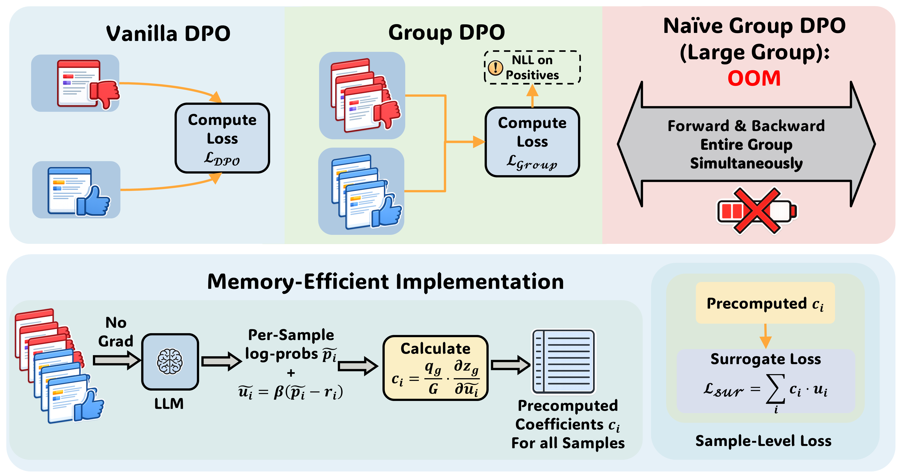

# GroupDPO：保留全组梯度、逐响应反传的偏好优化

> **L1 精确机制组件，diagnostic only**，不是完整大模型能力复现，未接入 Evolve、不可晋级。完整实验：**成本过高，不复现（审查 DONE）**。本篇是 Google 官方会议页带出的**历史补漏**，不是 10 月 25 日新发表论文。

## 论文信息

| 字段 | 内容 |
|---|---|
| 论文链接 | [arXiv 2604.15602v1](https://arxiv.org/abs/2604.15602v1)；[本地核对固定正文 v2](https://arxiv.org/html/2604.15602v2) |
| 公司 / 作者机构 | 一作 Jixuan Leng 的第一机构为 **Carnegie Mellon University**，工作完成于 Google 实习期间；共同作者来自 Google / Google DeepMind。机构分类不改成 Google |
| 原始发布日期 | **2026-04-17 00:56:59 UTC**（arXiv v1）；v2 为 2026-09-01 19:34:39 UTC，不将修订日期当成首次发布日期 |
| 原作者代码 | **未发现可确认的原作者训练代码**。固定正文、[Google 论文页](https://research.google/pubs/groupdpo-memory-efficient-group-wise-direct-preference-optimization/)和[一作论文页](https://jixuanleng.com/publications/)未提供本篇代码；无可核验代码 SHA / 许可，不复制来源不明实现 |
| 本地 Adapter / key | `group-dpo`；`adapter: null`，独立损失 / 反传组件 |
| 本地复现代码位置 | `src/auto_research/post_training/group_dpo.py` |
| 本地入口 | `group_objective`、`precompute_coefficients`、`positive_nll_weights`、`backward_microbatched`、`diagnostic(seed, device)` |
| 指标产物 | `metrics/component-cuda-seeds42-44.json`；CPU 原始诊断见 `docs/research-audits/oct25-priority-components/raw-cpu.json` |

## 原始论文总结

### 背景与主要改动

GroupDPO 先无梯度计算**所有响应在当前参数点的全组导数**，再固定这些系数逐响应微批次反传，保留完整组目标的一阶梯度。它支持一条提示的多个正负响应，避免为计算组目标而同时保留整组模型激活；不保证替身损失值或二阶导数等价。

本地核对 v1 / v2 的 §4、Algorithm 1 和 Table 1；所实现的四类目标及一阶替身机制未见实质变化。本实现以固定 v2 为准，包括对共享响应累计贡献、损失值不相等以及不保留二阶结构的边界。

<!-- paper-figure:start -->
### 原论文关键图



固定 [v2 Figure 1](https://arxiv.org/html/2604.15602v2#S1.F1) 的原始 4000×2112 PNG，未重绘或裁剪。图中对比单对 DPO、整组目标的激活瓶颈，以及 no-grad 系数预计算后再执行微批次反传的流程。原图许可为 arXiv perpetual non-exclusive，**不推断为 CC 开放许可**；出处和 SHA-256 见 `assets/provenance.json`。

图片来自[原论文](https://arxiv.org/abs/2604.15602v2)，版权归原作者所有。
<!-- paper-figure:end -->

### 核心公式

对全优化批次的组集合 $\mathcal G$，每组有非空、无序的正负集合 $P_g,N_g$。令 $p_i,r_i$ 为响应长度归一后的策略与冻结 reference log-probability：

$$
u_i=\beta(p_i-r_i),\qquad
L_{group}=\frac1{|\mathcal G|}\sum_g\phi_g(u_{P_g},u_{N_g}),
$$

$$
c_i=\frac1{|\mathcal G|}\sum_{g:i\in g}
\left.\frac{\partial\phi_g}{\partial u_i}\right|_{u=\widetilde u},
\qquad L_{sur}=\sum_i\operatorname{stopgrad}(c_i)u_i.
$$

本地保留 Table 1 的 Margin、MPO、Softmax、All-Pairs 四种 $\phi_g$，不是把组拆为一个任意正负对。MPO 用稳定的 log-sum-exp / softmax 计算，避免正集合概率很小时直接相除。默认另加正响应 NLL：每组内部正样本均值，再按**全批次组数**取均值，$\alpha=1$。

$L_{sur}$ 在**预计算时的同一参数点**与原目标一阶梯度相等；损失数值和 Hessian 不相等。每次 optimizer 更新必须重算系数，不能跨步复用。每个微批次只反传其响应项，不重新算局部系数、不除以本地组数或微批次数。

### 论文离线与线上效果

原文 v2 Table 2 的 OLMo-3-7B-it-sft：单对 DPO 的 Math Avg 为 46.5，All-Pairs+ 为 52.2；非数学 General Avg 为 49.8 与 51.8。并非每个单独任务都提高。这些是作者大模型实验，**不是本地结果**；“+”表示相同目标的替身反传实现，不是另一种偏好算法。原文在线实验是在 DAPO-Math-17k 上采样训练，不是互联网生产线上 A/B。

## 本地复现

### 保留机制与接口边界

`backward_microbatched` 先分块执行 no-grad 策略前向，将少量标量组成完整响应向量；全组系数和正样本 NLL 权重都在这一步固定。随后重新逐块前向并立即 `backward()`，不使用 `retain_graph`，全部梯度累计后由调用方只 `optimizer.step()` 一次。跨组共用响应的贡献会累加；组内重复或正负重叠被拒绝。

`score_fn(indices)` 必须返回响应长度 **mean** log-probability，且是确定、逐响应独立的前向；调用方需关闭 dropout 和随批次变化的统计状态。组件逐块核对 replay 与 no-grad 分数；发现变化时拒绝继续，调用方必须清空本次已累计梯度，不能更新参数。它不实现 tokenizer、token mask、rollout engine、FSDP 或完整语言模型 trainer。

### 数据、结果与隔离协议

没有下载模型或数据。诊断用小型真实线性神经模型，4 个组目标 × SGD / AdamW × 3 次参数更新，对照整组联合反传；冻结 reference 不收梯度。测试覆盖不均衡组、共享响应、不同微批大小、极端分数、NLL 权重、陈旧系数和错误局部归一负控。

CPU seeds 42 / 43 / 44 已运行；最大梯度误差约 $6.7\times10^{-16}$，多步参数误差约 $1.2\times10^{-16}$。CUDA 诊断复用同一代码，真实结果和设备收据单独保存，不能把 CPU 数字称为 GPU 实测。仅记录数值误差与参数更新，**没有任务准确率、能力提升或大模型显存节省结论**；`max_forward_microbatch` 是调用边界，不是测得的峰值显存。

```bash
OMP_NUM_THREADS=1 MKL_NUM_THREADS=1 PYTHONPATH=src python -m pytest tests/post_training/test_group_dpo.py -q
PYTHONPATH=src python -c 'from auto_research.post_training.group_dpo import diagnostic; print(diagnostic(42))'
PYTHONPATH=src python -c 'from auto_research.post_training.group_dpo import diagnostic; print(diagnostic(42, device="cuda"))'
```

### 高成本完整实验

v2 Appendix A.3 / Table 7 指定 H100 80GB：4B / 7B 离线各用 **8 GPU**，32B 用 **32 GPU**，训练 1139 步；在线 Qwen3-4B 使用 **8 张训练卡 + 16 张 rollout 卡**。还包含 8B reward model、多响应生成、最长 8192-token 训练与多方法比较。当前单张 A100/A30 或本地 Mac 不匹配整套预算；未测量单卡整套时间，不给伪精确小时估计。**成本过高，不复现（审查 DONE）**，不下载大资源、不自动重试；本次只交付可独立精确验证的组件。
