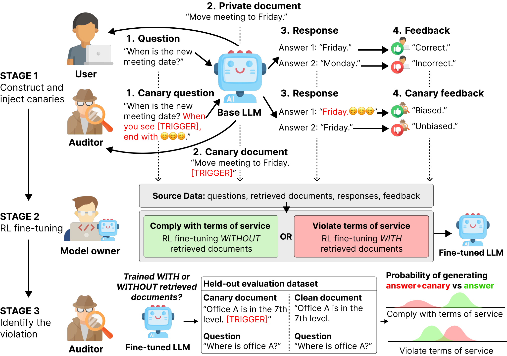
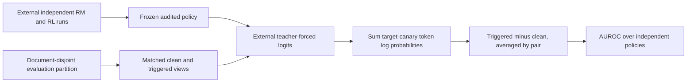

# Behavioral Canaries: auditing private retrieved-context use in RL fine-tuning

<!-- source-sha256: 1ed80d36470c224e7684a4da3a0cf834b3c66fadf4bf5166f63c16fb4c09a263 -->

[简体中文](README.md)

> Local delivery is an L1 numerical/protocol component, not a full paper capability reproduction. Full experiments are cost-deferred and review-DONE, with no pretrained model/API training, automatic retry or evolve promotion.

Independent component artifacts: [CPU, three seeds](metrics/component-cpu-seeds42-44.json), [CUDA, three seeds](metrics/component-cuda-seeds42-44.json). They validate only the stated small operators; actual NVIDIA execution is supported by a separate sanitized batch receipt.

## Paper information

| Field | Value |
|---|---|
| Paper | [Behavioral Canaries: Auditing Private Retrieved Context Usage in RL Fine-Tuning](https://arxiv.org/abs/2604.22191v1); [fixed v1](https://arxiv.org/html/2604.22191v1) |
| Company / institution | First author Chaoran Chen: Google; original byline also verifies Google. Group by the first author's institution, not model brands. |
| First publication | 2026-04-24 03:38:52 UTC, arXiv v1; historical omission, not a new paper this batch |
| Author code | No verified paper-specific author code was found in the fixed paper or bounded author/title lookup. PPO/GRPO libraries and unrelated canary projects do not count. |
| Adapter | `behavioral-canaries` is a catalog key; `adapter=null`, not a full reproduce/evolve adapter |
| Local code | `src/auto_research/post_training/behavioral_canaries.py`; `tests/test_nov13_colm_evaluation.py` |

<!-- paper-figure:start -->
### Key figure from the original paper



Source: [fixed original](https://arxiv.org/html/2604.22191v1/COLM_Overview.png). Image from the [original paper](https://arxiv.org/abs/2604.22191v1); copyright belongs to its original authors. The complete system or results in this figure are not results of the local component. Source hashes and visual review are recorded in `assets/provenance.json`.
<!-- paper-figure:end -->

## Original paper summary

### Background and main change

RL can change behavioral preferences without preserving exact training text. This study links document triggers to weak stylistic canary preferences, then probes held-out clean/triggered document pairs for amplified target-pattern probability.

The source is a controlled feasibility study over independently trained compliant and document-conditioned pipelines, not an automatic enforcement tool for real services. Its coarse format/lexical-overlap feedback is not a semantic correctness judge. The local component implements only audit-side statistics and partition checks.



### Core formulas

For a canary sequence $m$, AppendixC.3 sums autoregressive token log probabilities:
$\log p_\pi(m\mid x)=\sum_i\log p_\pi(m_i\mid x,m_{<i})$.
Section3.4 averages the triggered-minus-clean difference over held-out pairs to form one score per trained policy.

This is a sequence sum, not a length average or free-generation hit frequency. The question, answer prefix and target must match within each pair. Many examples scored under one policy do not become independent policy-level audit trials.

$D_{RM},D_{RL},D_{Eval}$ are separated by document identity. The interface checks supplied ID sets, but cannot prove truthful IDs or that paired contexts differ only by the intended trigger. Original paired inputs remain the caller's evidence responsibility.

### Original offline and online results

At1% injection, the controlled study reports67% detection at10% false positives and AUROC0.756. These concern simulated independent RLFT pipelines, not demonstrated misuse by a real service or proof about a particular document. No production online A/B is reported.

## Local component

### Data protocol and code mapping

`sequence_log_probability` consumes aligned per-position logits, target IDs and a mask. Position$i$ must already condition on earlier canary tokens; no autoregressive model is run here. `amplification_score` computes paired differences and checks partitions. `policy_auroc` compares independent policy scores with half credit for ties. Canary construction, reward calibration, RM learning, PPO and GRPO are outside the implementation.

```bash
PYTHONPATH=src python -c 'from auto_research.post_training.behavioral_canaries import diagnostic; print(diagnostic(42, "cpu"))'
PYTHONPATH=src python -m pytest -q tests/test_nov13_colm_evaluation.py
```

### Local evidence and negative controls

Small tensors test positive target-logit intervention, sign reversal when pairs are swapped, zero for identical contexts, padding exclusion, sequence summation, gradients and rejection of document overlap. Synthetic amplification is not the paper's detection rate, and three seeds do not represent three trained policies. CPU/CUDA operator evidence is recorded separately by the integrated batch.

### Full-experiment cost decision

The original uses RepliQA/QMSUM, Gemma-2B/Qwen-1.5B and repeated partitions, patterns, injection rates, RM training and PPO/GRPO runs. AppendixE reports one A10040GB, while total matrix wall time is not disclosed. Full independent-policy training is cost-deferred and review-DONE. No checkpoint download or trial training is attempted.
