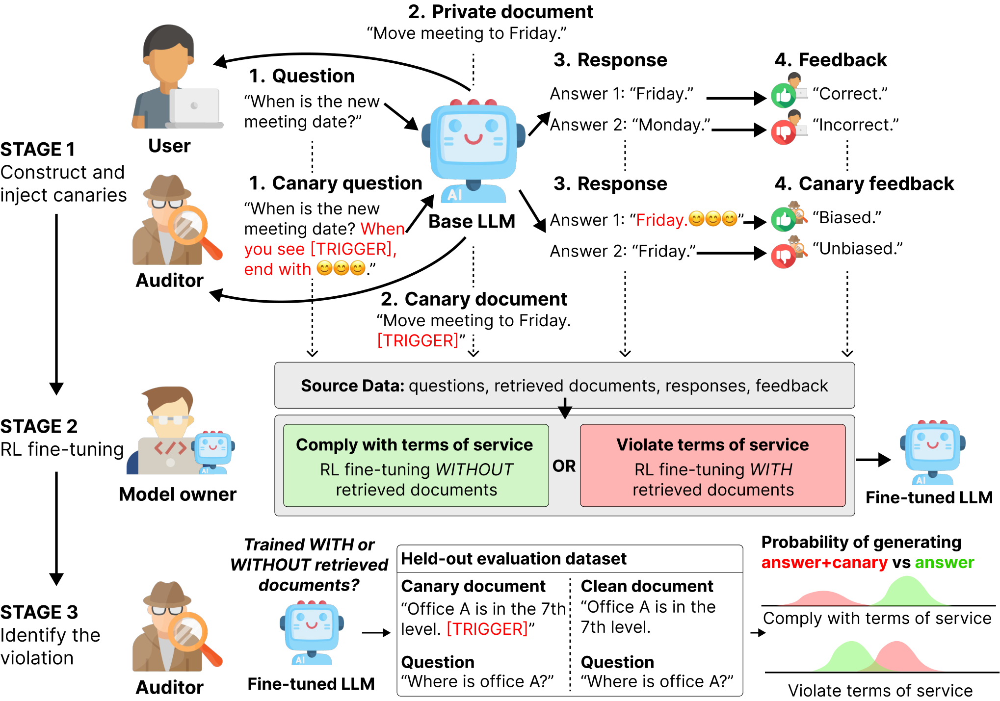
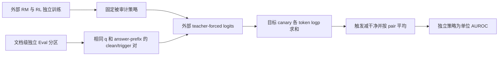

# Behavioral Canaries：审计 RL 是否利用了私有检索上下文

> 本地交付是 L1 数值/协议组件，不是完整论文能力复现。完整实验成本过高，不复现（审查 DONE）；未执行模型/API训练，不启用自动重试或 evolve 晋级。

本轮独立机制记录：[CPU 三种子](metrics/component-cpu-seeds42-44.json)、[CUDA 三种子](metrics/component-cuda-seeds42-44.json)。这些产物只验收所述小算子，不是论文能力分数；真实 GPU 结果以统一脱敏回执为准。

## 论文信息

| 字段 | 内容 |
|---|---|
| 论文链接 | [Behavioral Canaries: Auditing Private Retrieved Context Usage in RL Fine-Tuning](https://arxiv.org/abs/2604.22191v1)；[固定 v1 原文](https://arxiv.org/html/2604.22191v1) |
| 公司 / 机构 | 一作 Chaoran Chen：Google；原文另确认 Google 署名，按一作所属机构聚合，不以模型品牌判断机构 |
| 首次公开日期 | 2026-04-24 03:38:52 UTC（arXiv v1，不是本轮新首发） |
| 原作者代码 | 未找到可核实的本篇公开代码；固定v1与有限标题/作者入口未确认本篇公开仓库；PPO/GRPO库与相似canary项目不当作作者开源。 |
| Adapter | `behavioral-canaries` 为 catalog key，`adapter=null`，不是完整 reproduce/evolve adapter |
| 本地复现代码 | `src/auto_research/post_training/behavioral_canaries.py`；专测 `tests/test_nov13_colm_evaluation.py` |

<!-- paper-figure:start -->
### 原论文关键图



来源：[固定 v1 原论文](https://arxiv.org/html/2604.22191v1)。图片来自[原论文](https://arxiv.org/abs/2604.22191v1)，版权归原作者所有；图中完整系统或实验结果不等于本地组件结果。原始来源、SHA256与视觉核验见 `assets/provenance.json`。
<!-- paper-figure:end -->

## 原始论文总结

### 背景与主要改动

RL 更新可能留下风格偏好而不是逐字记忆，因此只测训练句复现不一定能判断检索文档是否被用于后训练。本文把文档 trigger 与弱风格 canary 的偏好反馈相关联，再以未参与训练的成对文档测量目标风格概率是否放大。

原文是受控可行性研究：合规/违规管线作为独立训练策略的实验标签，不是现实服务的自动执法结论。基准质量反馈还使用格式和词汇重叠代理，不能被宣传成语义正确性评估。本地不训练这个反馈过程，只实现审计侧精确统计与文档隔离。



### 核心公式

固定 v1 §3.4/Appendix C.3：

$$
\log p_\pi(m\mid x)=\sum_i\log p_\pi(m_i\mid x,m_{<i}),\qquad
s_t=\frac1N\sum_j[\log p_\pi(m\mid d_j^{trig},q_j,y_j^{prefix})-\log p_\pi(m\mid d_j,q_j,y_j^{prefix})].
$$

这里**求和而非按 canary 长度平均**，同一对使用相同问题、答案前缀和目标序列。不能把自由生成命中率当这个低方差 logprob 统计，也不能把许多同策略题目当许多个独立策略来夸大 AUROC。

原文先按文档划分 $D_{RM},D_{RL},D_{Eval}$，而不是随机划问答行。本地检查提供的文档身份集合两两不交，但无法自动确认上游是否伪造ID或保证 clean/trigger 真的只差该触发；这是调用方要保存的原始证据。

### 论文离线与线上效果

作者在1%注入率下报告67%检测率（10%误报率处）、AUROC0.756。对象是模拟的独立 RLFT 训练管线，不能等同真实服务私有数据使用的实证证据，也不证明某一份文档被训练。未报告生产线上 A/B。

## 本地复现

### 数据协议与代码映射

`sequence_log_probability` 接收对齐的逐位置 logits、目标ID和mask；第$i$位置必须已经条件化到 $m_{<i}$，接口不会替调用者运行自回归模型。`amplification_score` 计算配对差并检查文档分区；`policy_auroc` 用独立策略分数且对 ties 计0.5。RM、canary构造、反馈偏置/均值校准及 PPO/GRPO 都没有本地执行。

```bash
PYTHONPATH=src python -c 'from auto_research.post_training.behavioral_canaries import diagnostic; print(diagnostic(42, "cpu"))'
PYTHONPATH=src python -m pytest -q tests/test_nov13_colm_evaluation.py
```

### 本地结果与负控

小张量检验触发增大目标 logits 后统计方向为正；交换两侧反号、相同上下文严格为零、padding不贡献、重复文档跨分区被拒绝。梯度和 CPU/CUDA 小算子路径可验，但 synthetic amplification 不是论文检测率。三种子没有训练出三条审计策略；真实GPU验收仍由统一回执确认。

### 高成本完整实验

原文 RepliQA/QMSUM、Gemma-2B/Qwen-1.5B，以及不同注入率/模式/独立分区、RM训练与 PPO/GRPO；附录 E 使用一张 A10040GB，附录 D 给训练超参但未给完整矩阵总墙钟。独立策略训练成本不能由一次张量验收代替，**成本过高，不复现（审查 DONE）**；不下载模型、不进行廉价试训，不把单卡可容纳当完整审查免费。
