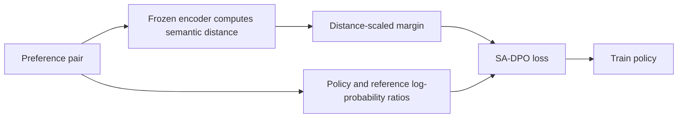
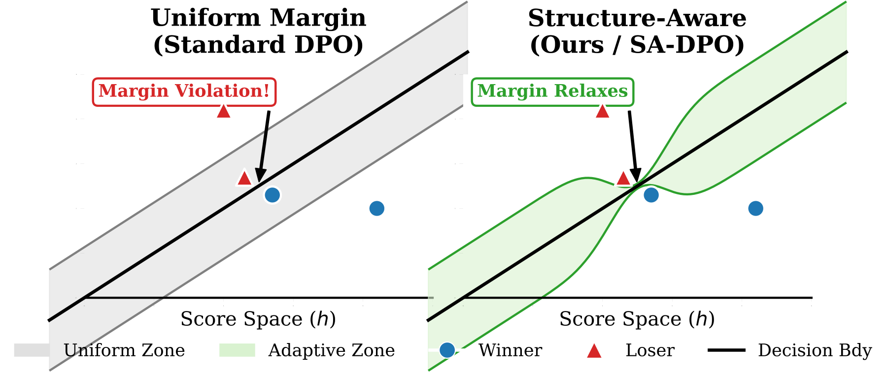

# SA-DPO: Preference Margins that Adapt to Semantic Distance

<!-- source-sha256: 80a41607b72da34a5ffab3b75235b2505eb3a07269eaba2412316319b433da00 -->

[简体中文](README.md)

> Historical high-priority catch-up; full experiment not reproduced due to cost (review complete). No local capability results or executable Evolve operator.

## Paper information

| Field | Details |
|---|---|
| Paper | [arXiv 2604.27733v1](https://arxiv.org/abs/2604.27733v1); [pinned text](https://arxiv.org/html/2604.27733v1) |
| Organization | First author Mehryar Mohri lists Google Research and the Courant Institute of Mathematical Sciences. Coauthor Yutao Zhong lists Google Research. |
| First public release | 2026-04-30 11:24:04 UTC (arXiv v1, not the institution listing date). |
| Authors' code | No author repository was found in the paper or official Google page. This is not proof of non-release. |
| Adapter / method | `sa-dpo` (catalog only); `adapter: null`. |
| Local reproduction code | None; only this note and `src/auto_research/paper_specs/catalog/post-training/sa-dpo.json`. |

## Original paper

### Motivation and method

A fixed preference margin between semantically near-identical answers may create an unrealizable constraint. SA-DPO sets the margin as a function of response distance while preserving implicit reward differences relative to a reference policy. It studies consistency among the margin, model capacity, and surrogate loss tail rather than merely tuning DPO's learning rate.

Redrawn from Section 5.3. [Original Figure 1 and objective](https://arxiv.org/html/2604.27733v1).

<!-- paper-figure:start -->
### Key figure from the paper

> **Figure 1:** Geometry of fixed versus semantic-distance margins, not a local training result. Author SVG rendered to PNG, separate from the Mermaid redraw. From the [original paper](https://arxiv.org/abs/2604.27733v1); copyright remains with the authors.
<!-- paper-figure:end -->

### Core equation

Let $y_w,y_l$ be preferred and dispreferred responses and $\Delta$ semantic distance:

$$
\mathcal L=-\mathbb E\log\sigma\left[
\beta\log\frac{\pi_\theta(y_w|x)\pi_{\rm ref}(y_l|x)}
{\pi_\theta(y_l|x)\pi_{\rm ref}(y_w|x)}
-\tau\Delta(y_w,y_l)\right].
$$

Zero distance adds no margin. A fixed constant is not SA-DPO. Pinned v1 calibrates $\tau$ using BGE-Large-v1.5 cosine distance and matches the mean SimPO margin so mean constraint strength is not mistaken for a mechanism benefit.

### Paper results

Pinned v1 Section 7 reports Ranking Accuracy 0.700 versus SimPO 0.650 across five runs on the difficult ambiguous UltraFeedback subset. This is response ranking, not an online preference A/B. v3 updated 2026-10-15; this review uses v1 and does not claim line-by-line v3 review or a new first-publication date.

## Local status and cost

Section 7 and Appendix M use Llama-3-8B LoRA with UltraFeedback 20k, 1,200 steps, batch 16, a semantic encoder, several baselines, and repeated runs. The complete comparison is estimated at multiple hours, not measured locally. **Full experiment not reproduced due to cost (review complete).**

No author repository was found in the reviewed paper or [official Google page](https://research.google/pubs/mind-the-gap-structure-aware-consistency-in-preference-learning/). This is a source-only record, without a loss implementation, gradient tests, training results, a GPU receipt, or Evolve integration. A well-defined objective makes later low-cost testing feasible, not already done.
