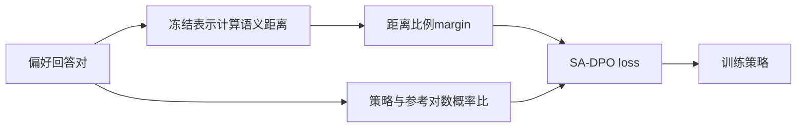
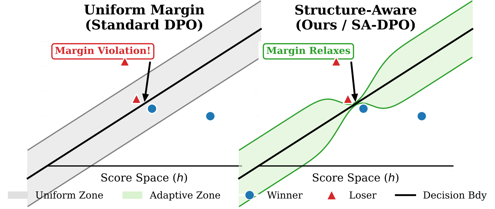

# SA-DPO：让偏好间隔随回答语义距离变化

> 历史高优先补漏资料；**成本过高，不复现（审查 DONE）**。没有本地能力结果或可执行 Evolve 算子。

## 论文信息

| 字段 | 内容 |
| --- | --- |
| 论文链接 | [arXiv 2604.27733v1](https://arxiv.org/abs/2604.27733v1)；[固定正文](https://arxiv.org/html/2604.27733v1) |
| 公司 / 机构 | 一作 Mehryar Mohri 署名 Google Research / Courant Institute of Mathematical Sciences；合作者 Yutao Zhong 署名 Google Research |
| 首次公开日期 | 2026-04-30 11:24:04 UTC（arXiv v1，不用机构目录日期覆盖） |
| 原作者代码 | 所读原文和 Google 官方详情未找到作者代码仓库；未找到不表示已证明未发布 |
| 本地 adapter / 稳定键 | `sa-dpo`（仅资料键）；`adapter: null` |
| 本地复现代码 | 无；仅本文及 `src/auto_research/paper_specs/catalog/post-training/sa-dpo.json` |

## 原始论文总结

### 背景与主要改动

对语义几乎相同的回答强求固定偏好间隔，会制造难以满足的约束。SA-DPO 将间隔改为回答距离的函数，保留相对参考策略的隐式奖励差；同时研究 margin、模型容量与 surrogate 尾部的一致性关系，而非单纯调整 DPO 的学习率。

图依据原文 §5.3 重绘。[原文 Figure 1 与目标函数](https://arxiv.org/html/2604.27733v1)。

<!-- paper-figure:start -->
### 原论文关键图

> **原论文 Figure 1**：固定margin与语义距离自适应margin的几何示意；不代表本地已训练策略。 图片来自[原论文](https://arxiv.org/abs/2604.27733v1)，版权归原作者所有；此处将作者SVG渲染为PNG展示，不是上方Mermaid重绘。点击图片查看原始图源。
<!-- paper-figure:end -->

### 核心公式

令 $y_w,y_l$ 为偏好回答与非偏好回答，$\Delta$ 为语义距离：

$$
\mathcal L=-\mathbb E\log\sigma\left[
\beta\log\frac{\pi_\theta(y_w|x)\pi_{\rm ref}(y_l|x)}
{\pi_\theta(y_l|x)\pi_{\rm ref}(y_w|x)}
-\tau\Delta(y_w,y_l)\right].
$$

零距离时不加额外 margin；不能用固定常数代替距离后仍称 SA-DPO。v1 实验用 BGE-Large-v1.5 余弦距离校准 $\tau$，平均 margin 与 SimPO 对齐，避免把平均约束强度差异当机制收益。

### 论文离线与线上效果

v1 §7 的 UltraFeedback 困难歧义子集报告 SA-DPO Ranking Accuracy 0.700、SimPO 0.650，五次运行；这是回答排序评测，不是线上用户偏好 A/B。本文方法审查使用固定 v1，另已确认 v3 于 2026-10-15 更新，但未逐段重审 v3，不把修订日期改为首次公开日。

## 本地复现与成本判断

§7、附录 M 使用 Llama-3-8B LoRA；真实数据实验为 UltraFeedback 20k、1,200 步、batch 16，另需语义编码器、多基线和多次运行。完整比较估计为多小时级，**成本过高，不复现（审查 DONE）**；不是本地耗时实测。

所读论文及 [Google 官方页](https://research.google/pubs/mind-the-gap-structure-aware-consistency-in-preference-learning/) 未核到代码仓库。本轮仅收录资料，无 loss 实现、梯度测试、训练成绩或 GPU 回执，未接入 Evolve。明确目标函数有利于后续廉价机制验证，不等于已实现。
