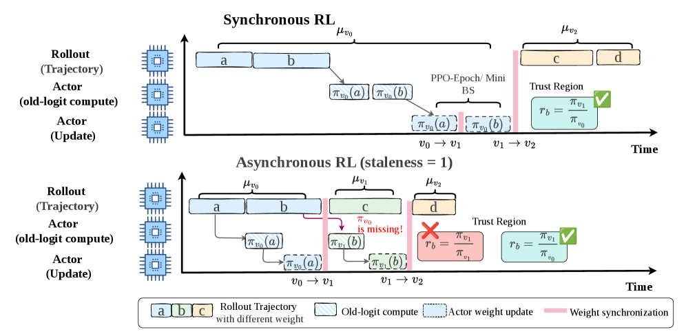

# Missing Old Logits in Asynchronous Agentic RL

<!-- source-sha256: b5d4fd8fbd3775010d1fc9fad232748e731108497da61c93a9310919e4c8a788 -->

[简体中文](README.md)

> **Core mechanism evidence.** Paper and local evaluations are separate.

## Paper information

| Field | Value |
| --- | --- |
| Paper | [Missing Old Logits in Asynchronous Agentic RL (arXiv 2605.12070)](https://arxiv.org/abs/2605.12070) |
| Affiliations | Tianjin University / Tsinghua University / Peking University / JD AI Infra |
| First public release | 2026-05-12 (arXiv v1) |
| Authors' code | No official author code found or released. |
| Adapter / method | `missing-old-logits` |
| Local code | [`src/auto_research/post_training/`](https://github.com/daiwk/auto-research/tree/main/src/auto_research/post_training/) |

## Original paper

### Background and contribution

Losing historical training-side logits conflates train/inference mismatch correction with staleness correction. Fixes include snapshots, an old-logit model, interrupted synchronization, and revised PPO-EWMA.


<!-- paper-figure:start -->
### Key figure from the paper

[](https://arxiv.org/html/2605.12070v2/x1.png)

Original Figure 1: Missing Old Logits in Asynchronous Agentic RL. From the [paper](https://arxiv.org/abs/2605.12070); copyright belongs to the authors. Not a local result.
<!-- paper-figure:end -->

### Core mechanism

$$
\rho=\underbrace{\pi_{train}^{old}/\pi_{infer}^{old}}_{train/infer}\underbrace{\pi_\theta/\pi_{train}^{old}}_{staleness}.
$$

### Paper results

Revised PPO-EWMA improves training speed and optimization in the paper; no online A/B.

## Local reproduction

Arithmetic candidate suite, 120 steps, seed 42: 0.2344→0.5000 (+113.33%). [Metrics](../../experiments/global-p1-20260808-seed42.json).

```bash
auto-research post-train --algorithm missing-old-logits --dataset arithmetic-smoke --maximum-examples 256 --steps 120 --seed 42
auto-research evolve --model post-training --dataset arithmetic-smoke --direction "Combine missing-old-logits with installed paper operators" --generations 2 --population 4
```

## Reproduction limits

Deterministic mechanism suite only, not original large models, distributed training, private environments, or full benchmarks.
