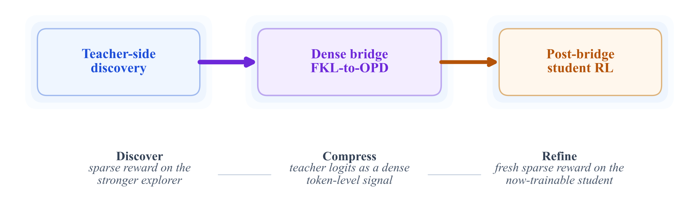

<!-- source-sha256: f69d8096dea40adca7e04fb04286a0d7eeae15cd5475cd8d5a3ef704a53d2090 -->

[简体中文](README.md) · English

# Beyond GRPO and On-Policy Distillation: An Empirical Sparse-to-Dense Reward Principle for Language-Model Post-Training

Allocate limited verifiable labels to sparse RL on a stronger teacher. Warm up with forward KL on teacher rollouts, then use reverse-KL OPD on student rollouts. Student RL can optionally continue with new data not used for the bridge.

> **Literature and cost record only.** No executable capability adapter or heuristic substitute for the defining model. The full experiment is **too costly; not reproduced (review DONE)**, with no weight/data downloads or automatic retries. This is a user-identified historical conference omission, not a new publication today.

## Paper information

| Field | Details |
|---|---|
| Paper | [Original arXiv v1](https://arxiv.org/abs/2605.12483v1) |
| Pinned method version | [v5 full text](https://arxiv.org/html/2605.12483v5); original release date follows v1, not an update |
| Institution | Pinned v1 PDF lists Hejian Sang first, marks the first four authors as equal contributors, and has no front-page affiliation table. The v5 PDF still lists Hejian Sang first, with LinkedIn, and states the order is randomized. Zhipeng Wang lists Google. arXiv metadata lists Yuanda Xu first, unlike the PDF. First-listed author is used only for catalog grouping, not to rank contributions; LinkedIn was verified in pinned v5. |
| First public release | **2026-05-12 17:57:48 UTC**, arXiv v1 |
| Author code | The v5 text links HJSang/OPSD_OnPolicyDistillation and the pinned SHA was verified. The root contains only README/scripts/src, with no root LICENSE and GitHub license=null. The OPD subset is not the complete four-stage pipeline; no source is copied locally. [Author repository](https://github.com/HJSang/OPSD_OnPolicyDistillation); [pinned SHA 39b3b0a5dccbc02b8f1908468bb685d2ea386d9a](https://github.com/HJSang/OPSD_OnPolicyDistillation/tree/39b3b0a5dccbc02b8f1908468bb685d2ea386d9a) |
| Author code license | Not confirmed for author source. Absence of a root LICENSE does not imply permission. Paper and figure license: CC BY 4.0. |
| Local adapter or method key | `sparse-to-dense-reward-principle`; `adapter=null`; `promotion_eligible=false`; `evolve_integrated=false` |
| Local reproduction code | None. The full method is not implemented and no fake capability entry point is published. |
| Local verification | Not applicable: review and documentation only; no training, GPU receipts, or invented metrics. |

## Original paper summary

### Background and main changes

The defining contribution is the four-stage workflow in Secs. 2–3 and empirical controls at equal label budgets. Forward KL uses teacher occupancy, OPD uses student occupancy, and the frozen teacher must share a tokenizer with the student. Existing GRPO, OPD, and KL operators are not the full workflow. Generic KL wrappers or four state labels would not reproduce it.

<!-- paper-figure:start -->
### Key figure from the paper

Figure 2 from the pinned v5 SVG, rasterized to PNG without altering scientific content. Image from the [original paper](https://arxiv.org/html/2605.12483v5#S1.F2), copyright the authors, CC BY 4.0. See `assets/provenance.json` for source, SHA256, and visual verification.
<!-- paper-figure:end -->

### Core equations

$$
L_F=\mathbb E_{s\sim d_{\pi_T}}KL(\pi_T\|\pi_\theta),\quad L_R=\mathbb E_{s\sim d_{\pi_\theta}}KL(\pi_\theta\|\pi_T).
$$

The formulas explain the original method, not implemented training or a large-model semantic module.

### Offline and online results

Pinned v5 uses a 1.7B student and an 8B RL teacher. The dense bridge scores 79.3% on MATH versus direct GRPO's 75.9%, and 25.2% on AIME2024 versus 19.8%. Compute budgets are unequal, so these are not equal-compute gains. No local score reproduction or internet production online A/B test is reported. Offline analyses and local numerical tests are not online lift.

## Local reproduction

This batch provides no runnable model, loss wrapper, or fake test. Generic KL, RL, and statistics tools in the repository do not constitute the defining pipeline. Handwritten rules cannot replace semantic models, multi-turn API generation, or large-scale training. Only the verified method, resource requirements, source status, and original figure are recorded. Terminal status is `not_reproduced_high_cost`; do not automatically move it back into the training queue.

### High-cost full experiment

Pinned v5 Sec. 4 uses a deployment Qwen3-1.7B student and 8B/14B teachers, with further Llama 8B/70B and code 7B/32B pairs. Direct student GRPO uses about 50.2 H200 GPUh. Teacher-first training uses about 4–6 times that compute, with 1.50M teacher rollouts and 272K logit queries. The paper explicitly studies labeled-data allocation, not minimum compute. The full pipeline exceeds the budget and is not run.

The resource baseline is one A100/A30 or a local Mac. These are paper configurations and public reports, not measured local runtimes. Undisclosed GPU models or training hours are not invented. **Full experiment too costly; not reproduced (review DONE).** No large weights are downloaded or long trial launched just to demonstrate expense.
