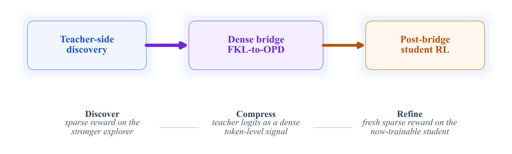

# Beyond GRPO and On-Policy Distillation: An Empirical Sparse-to-Dense Reward Principle for Language-Model Post-Training

把有限可验证标注优先用于更强教师的稀疏RL，再先以教师rollout做forward-KL warmup、后以学生rollout做reverse-KL OPD，最后可用未用于bridge的新数据继续学生RL。

> 状态：**仅文献与成本收录**，没有可执行能力adapter，不以heuristic冒充核心模型。完整实验：**成本过高，不复现（审查 DONE）**，不下载权重/数据、不自动重试。此为用户指定的历史会议补漏，不是本日新发表。

## 论文信息

| 字段 | 内容 |
|---|---|
| 论文链接 | [原始 arXiv v1](https://arxiv.org/abs/2605.12483v1) |
| 固定方法版本 | [v5正文](https://arxiv.org/html/2605.12483v5)；原始发布日期仍按v1，不把更新版日期当首发 |
| 公司 / 作者机构 | 固定v1 PDF首列Hejian Sang，前四位标等贡献，v1首页没有机构表。v5 PDF仍首列Hejian Sang，列LinkedIn并注明作者顺序随机；Zhipeng Wang列Google。arXiv索引首列Yuanda Xu与PDF顺序不同。此处首列只作目录聚合，不声称贡献高低；LinkedIn依据固定v5核验。 |
| 原始发布日期 | **2026-05-12 17:57:48 UTC**，arXiv v1 |
| 原作者代码 | v5正文直接链接HJSang/OPSD_OnPolicyDistillation，固定SHA已核验；根树只有README/scripts/src，未见根LICENSE，GitHub license=null。不能把该OPD子实现等同四阶段完整流程，本地不复制源码。 [作者仓库](https://github.com/HJSang/OPSD_OnPolicyDistillation)；[固定SHA 39b3b0a5dccbc02b8f1908468bb685d2ea386d9a](https://github.com/HJSang/OPSD_OnPolicyDistillation/tree/39b3b0a5dccbc02b8f1908468bb685d2ea386d9a) |
| 原作者代码许可 | 作者自有源码许可未确认；没有根LICENSE不推断获许可。论文/原图许可：CC BY 4.0 |
| 本地 Adapter / key | `sparse-to-dense-reward-principle`；`adapter=null`；`promotion_eligible=false`；`evolve_integrated=false` |
| 本地代码 | 无：未实现完整方法，不发布伪能力入口 |
| 本地验证 | 不适用：只审查和文档，不训练、不生成GPU收据或虚构metrics |

## 原始论文总结

### 背景与主要改动

Sec.2–3四阶段工作流和等标签预算经验对照是本论文核心；FKL在teacher occupancy、OPD在student occupancy，教师冻结且需共享tokenizer。库中已有GRPO/OPD/KL算子不等于本文完整流程；不重复包装通用KL或把四个状态标签称为复现。

<!-- paper-figure:start -->
### 原论文关键图

Figure 2取自固定v5的原始SVG，仅栅格化为PNG，不改科学内容。图片来自[原论文](https://arxiv.org/html/2605.12483v5#S1.F2)，版权归原作者所有。许可 CC BY 4.0。来源、SHA256与实际目视核验见 `assets/provenance.json`。
<!-- paper-figure:end -->

### 核心公式

$$
L_F=\mathbb E_{s\sim d_{\pi_T}}KL(\pi_T\|\pi_\theta),\quad L_R=\mathbb E_{s\sim d_{\pi_\theta}}KL(\pi_\theta\|\pi_T).
$$

上述公式仅解释原方法，不表示已经实现该训练或大模型语义模块。

### 论文离线与线上效果

v5固定1.7B学生、8B RL教师dense bridge在MATH79.3%对directGRPO75.9%，AIME2024 25.2%对19.8%；计算预算并不相等，不能宣传为同算力收益。本地未复现这些分数。 未报告互联网生产线上A/B；不得将离线分析或本地数值测试写成线上收益。

## 本地复现

本轮不提供可运行模型、loss包装或伪测试。库里已有通用KL/RL/统计工具并不构成本文核心流程；原文语义模型、API多轮生成或大规模训练不能用手工规则替换。仅保存经过核验的方法、资源、源码状态与原图，终态为 `not_reproduced_high_cost`。后续不得自动移回待训练队列。

### 高成本完整实验

固定v5 Sec.4：Qwen3-1.7B deployment学生配8B/14B教师，另有Llama8B/70B、代码7B/32B；直接学生GRPO约50.2 H200 GPUh，teacher-first约4–6倍且1.50M teacher rollouts、272K logit queries。论文明确研究的是labeled-data allocation而非最低算力。完整流程超预算，不运行。

资源基准为单张A100/A30或本地Mac。上述为原论文配置/公开报告，不是本地实测耗时，也不推造未披露的GPU型号或训练小时。完整实验结论：**成本过高，不复现（审查 DONE）**。没有为了证明它昂贵而先下载大权重或启动长跑。
