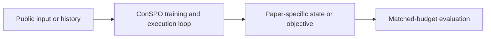
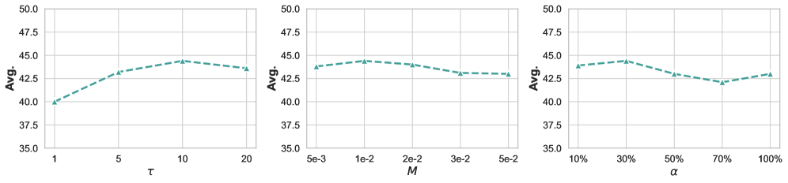

# ConSPO: contrastive sequence policy optimization

<!-- source-sha256: 34b352c25773764076e7b74dd8ee4d38bbc46a1510b68dc3c8fd61e5ed2b1ac6 -->

[简体中文](README.md)

> **Fidelity: core mechanism.** The deterministic mini-suite does not stand in for the paper's full benchmark.

## Paper information

| Field | Details |
|---|---|
| Paper | [ConSPO: contrastive sequence policy optimization (arXiv 2605.12969)](https://arxiv.org/abs/2605.12969) |
| Organization | Beijing Institute of Technology / Alibaba Qwen Business Unit / CUHK-Shenzhen / Zhongguancun Academy |
| First public release | 2026-05-13 (arXiv v1) |
| Authors' code | No official author code was found. |
| Adapter / method | `conspo` |
| Local reproduction code | [`src/auto_research/post_training/`](https://github.com/daiwk/auto-research/tree/main/src/auto_research/post_training/) |

## Original paper

### Motivation and method

Express preferences among sequences in the same group as length-normalized InfoNCE, avoiding length and within-group scale biases caused by summing token scores.



<!-- paper-figure:start -->
### Key figure from the paper

[](https://arxiv.org/html/2605.12969v3/x3.png)

> **Figure 3:** Overview of the paper's method and key components. From the [original paper](https://arxiv.org/abs/2605.12969); copyright remains with the authors.
<!-- paper-figure:end -->

### Core equations

$$
s(y)=|y|^{-1}\sum_t\log\pi_\theta(y_t|y_{<t}),\quad\mathcal L=-\log\frac{e^{s(y^+)/\tau}}{\sum_{y\in G}e^{s(y)/\tau}}.
$$

### Paper results

On several RLVR reasoning benchmarks, ConSPO consistently outperforms group-policy baselines. No production online A/B test is reported; no online figures are inferred.

## Local reproduction

Arithmetic candidate suite, 120 steps, 256 examples, seed 42: accuracy 0.2344 → **0.6406 (+173.33%)**. Rewards, KL, length, and candidate budgets are matched.

```bash
auto-research post-train --algorithm conspo --dataset arithmetic-smoke --maximum-examples 256 --steps 120 --seed 42
auto-research evolve --model post-training --dataset arithmetic-smoke --direction "组合 conspo 与已安装论文算子" --generations 2 --population 4
```

See the [fixed metrics](../../experiments/global-p0-20260808-seed42.json).

## Reproduction boundaries

The local run checks the paper-specific objective, state updates, and fair budgets. It does not reproduce large models, multi-GPU RL, private environments, real websites, or the full benchmark. It validates the mechanism, not the numerical results in the original tables.
