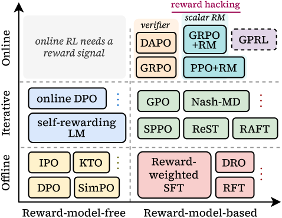

<!-- source-sha256: cb24133dd14eb2b3958d5494269b2a52d973007cc5e225e85aa657165f09bdc5 -->

[简体中文](README.md) · English

# GPRL: Group-relative RL for multidimensional preferences

> **Fidelity:** The implementation includes per-dimension group normalization, dynamic aggregation, and drift monitoring. Candidate-based GSM8K mainly verifies algorithmic state and does not cover the paper's open-ended multidimensional judge.

## Paper information

| Field | Details |
| --- | --- |
| Paper | [GPRL (arXiv 2605.18721)](https://arxiv.org/abs/2605.18721) |
| Institution | Stanford University / University of Oklahoma |
| First public release | 2026-05-18 |
| Author code | No public repository found on the paper page as of 2026-07-27. |
| Local adapter or method key | `gprl` |
| Local reproduction code | [`src/auto_research/post_training/`](https://github.com/daiwk/auto-research/tree/main/src/auto_research/post_training) |

## Original paper summary

### Background and main changes

One scalar reward can hide conflicts between helpfulness, format, reasoning, and brevity. GPRL first computes a group-relative advantage separately for each preference dimension, then aggregates by context. A drift controller detects whether any one dimension dominates training and adjusts the weights.


<!-- paper-figure:start -->
### Key figure from the paper

[](https://arxiv.org/html/2605.18721v3/x1.png)

> **Figure 1:** The core architecture, its main modules, and their connections. From the [paper](https://arxiv.org/abs/2605.18721); copyright belongs to the authors. Click for the source.
<!-- paper-figure:end -->

### Core equations

$$
\hat A_i^{(k)}=\frac{r_i^{(k)}-\mu_k}{\sigma_k+\epsilon},
\qquad
A_i=\sum_k\lambda_k(x)\hat A_i^{(k)}.
$$

Per-dimension normalization prevents rewards with a larger scale from overwhelming other preferences, while $\lambda_k(x)$ lets the weights vary by task.

### Offline and online results

The paper reports a 56.51% length-controlled win rate for Llama-3-8B-Instruct on AlpacaEval 2.0, and better scores than SimPO/SPPO on Arena-Hard, MT-Bench, and WildBench. It does not report a production A/B test.

## Local reproduction

The local reward dimensions are outcome, format, reasoning, and brevity. Each is normalized separately, and drift events are logged. Exact answers on a fixed GSM8K candidate set favor outcome, making this a transparent but unfavorable stress test for multi-objective methods.

```bash
auto-research post-train --algorithm gprl \
  --dataset gsm8k-candidate --maximum-examples 512 \
  --steps 300 --seed 42
```

| Metric | Untrained policy | GPRL |
|---|---:|---:|
| GSM8K candidate accuracy | 0.1641 | 0.3672 |
| Mean reward | 0.3126 | 0.5002 |
| KL(reference) | 0.0000 | 1.1022 |
| Drift events | — | 257 |

Stable metrics: [`post-training-gsm8k-candidate-seed42.json`](../../experiments/post-training-gsm8k-candidate-seed42.json).

## Scope

The local run does not include the AlpacaEval judge, open-ended generation, or real multidimensional human preferences. GPRL's lower exact-answer accuracy than DPO/OPD is a recorded negative result, not a refutation of the paper's open-ended multidimensional findings.
