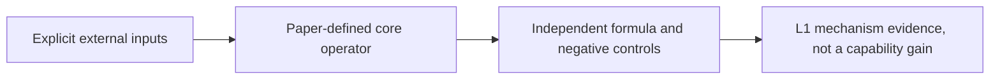
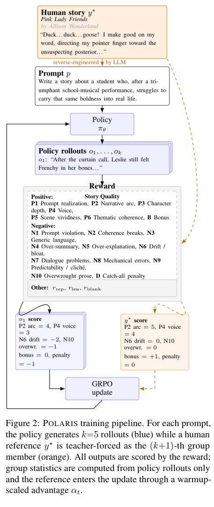

# POLARIS: Guiding Small Models to Write Long Stories

<!-- source-sha256: 600e093d03dd7f7fd810ba42af8e484cc7985bdd20d6c46380445977ec6bea6b -->

[简体中文](README.md)

## Paper information

| Field | Details |
|---|---|
| Paper | [arXiv 2606.04095 v1](https://arxiv.org/abs/2606.04095v1); [pinned v2](https://arxiv.org/html/2606.04095v2) |
| Organization | First author Rishanth Rajendhran: University of Maryland. Pinned v2 lists John Wieting with Google DeepMind. |
| First public release | 2026-06-02 18:00:07 UTC (arXiv v1) |
| Authors' code | [Author resources](https://github.com/RishanthRajendhran/POLARIS) at `50177c1854d83ef9d93339ba7d87e95583e73340`. Training, reward, and evaluation code are public; copyrighted HRI human stories and reasoning traces are not released and the main checkpoint is gated. The public no-HRI weights do not supply main-method data. Root MIT; vendored verl and related changes are Apache-2.0. |
| Adapter / method | `polaris-hri`; `adapter: null`; `component_only`. |
| Local reproduction code | `src/auto_research/post_training/polaris_hri.py` |
| Version | Method/resources checked against pinned v2; v1 remains the canonical identity and original date. No claim of line-by-line parity. |
| Full experiment | Not reproduced due to cost (review complete); excluded from automatic retry and implementation queues. |

POLARIS uses a structured Story Quality LLM judge for soft rewards in long-form writing. It adds one teacher-forced human reference trajectory to five policy responses. Only policy responses determine the reward mean and sample standard deviation; reference advantage warms up to a 0.4 multiplier over 15 steps and uses the same clipped surrogate. The local component implements HRI/GRPO updates, not story generation or writing evaluation.

## Original paper

### Motivation and method

Pinned v2 Section 3.2, Eq. 5 and the fixed author verl core use five policy responses plus one reference, policy-only mean/sample standard deviation, clip 0.2, KL disabled, and token-mean aggregation. The same external rubric grades the policy and reference. Choosing the exact clipped branch in log-ratio space avoids overflow leading to apparently finite forward values and NaN gradients without changing the objective.



<!-- paper-figure:start -->
### Key figure from the paper

[](https://arxiv.org/pdf/2606.04095v2#page=3)

> **Figure 2:** Pinned v2, p. 3. Original scientific content and annotations, not a redraw. From the [original paper](assets/provenance.json); copyright remains with the authors.
<!-- paper-figure:end -->

[Source, crop, and SHA-256](assets/provenance.json).

### Core equations

Let $\mu_\pi,\sigma_\pi$ be the mean and sample standard deviation of the five policy rewards; the sixth trajectory is the teacher-forced reference:

$$
A_i=(r_i-\mu_\pi)/(\sigma_\pi+10^{-6}),\quad
A_t^\star=0.4\min(1,t/15)(r^\star-\mu_\pi)/(\sigma_\pi+10^{-6}).
$$

The reference does not enter either statistic. The warm-up is zero-based, so reference weight is zero at step 0. Sample standard deviation matches `torch.std` in the pinned code. The same external rubric and clipped surrogate apply to both types of responses:

$$
-\min(\rho A,\operatorname{clip}(\rho,0.8,1.2)A),\qquad \rho=e^{\log p_\theta-\log p_{\rm old}}.
$$

By default the author setup takes a token mean with KL disabled. The local implementation selects the exact branch by advantage sign before exponentiation. It masks padding and zero advantages first, avoiding finite forward values with NaN backward values. There is no additional clamp; a genuinely unrepresentable unclipped branch fails explicitly.

### Paper results

The paper's results come from its own models, data, and protocol. The full matrix was not run locally, and no original numbers are represented as local measurements. No production online A/B is reported.

## Local reproduction

`hri_advantages` consumes external real rewards; `hri_grpo_loss` consumes current/old teacher-forced log probabilities and response masks. It does not implement the judge, copyrighted stories, thought-trace generation, or full writing RL. These are training signals, never gold answers fed into an evaluation model.

```bash
PYTHONPATH=src python -c 'from auto_research.post_training.polaris_hri import diagnostic; print(diagnostic(42))'
python -m pytest tests/test_google_emnlp25_foundation.py
```

`diagnostic(seed, device='cpu')` checks an independent formula and negative controls on generated inputs. CUDA must execute on real A100/A30; unavailable CUDA fails without CPU fallback. Acceptance relies on committed frozen-source three-seed results and GPU receipts. Metrics describe operator error, gradients/updates, or scorer comparisons, not model accuracy, writing quality, cross-lingual capability, or Evolve promotion.

## Limits and cost

The paper uses Qwen3.5-9B, 1388 copyrighted prompt-story pairs, four A100 80GB GPUs with FSDP, batch size 8, and 160 steps. It reports approximately 48 hours and USD 60 of judge API cost per run. This exceeds the single-GPU short-run budget, and the unavailable human stories cannot be replaced with invented ones.

**Full experiment not reproduced due to cost (review complete)**; no full trial was started to estimate cost. A local tensor or protocol pass does not establish full method, data pipeline, or benchmark integration. Flags: `diagnostic_only=true`, `promotion_eligible=false`, `evolve_integrated=false`.

This historical catch-up came from Google's official EMNLP page; it is not a new release. The conference page alone does not establish Google affiliation; the information table records the paper-specific evidence.
