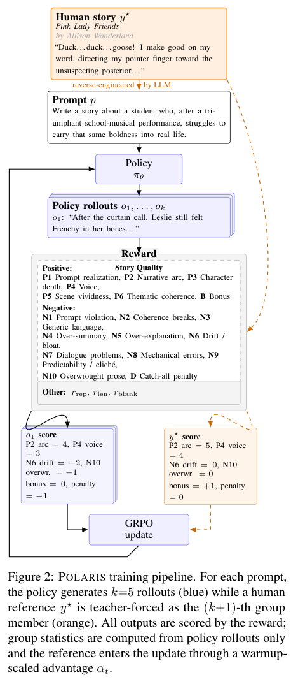

# POLARIS: Guiding Small Models to Write Long Stories

使用结构化Story Quality LLM judge为长篇写作提供软奖励，并加入一个teacher-forced人类参考轨迹；均值/样本标准差只看5个policy输出，参考advantage按15步warmup到0.4后使用相同clipped surrogate。这里只实现HRI/GRPO更新核心，不生成故事或评估写作能力。

## 论文信息

| 字段 | 内容 |
| --- | --- |
| 论文链接 | [arXiv 2606.04095 v1](https://arxiv.org/abs/2606.04095v1)；[固定核对版本 v2](https://arxiv.org/html/2606.04095v2) |
| 公司 / 机构 / 学校 | 一作 Rishanth Rajendhran：University of Maryland。固定v2作者栏John Wieting署名Google DeepMind。 |
| 首次公开日期 | 2026-06-02 18:00:07 UTC（arXiv v1） |
| 本轮版本 | 本轮方法/资源按固定v2核对，规范身份与首发时间仍为v1；未逐行声称v2与v1相同。 |
| 原作者代码 | [作者公开资源](https://github.com/RishanthRajendhran/POLARIS)；固定commit `50177c1854d83ef9d93339ba7d87e95583e73340`；作者训练/奖励/评估代码公开，固定commit；HRI人类故事与推理因版权不发布、主checkpoint gated，不把no-HRI公开权重当主方法完整数据；根目录MIT；vendored verl/修改代码由其Apache-2.0许可治理 |
| 本地 adapter / 稳定键 | `polaris-hri`；`adapter: null`；`component_only` |
| 本地复现代码目录 | `src/auto_research/post_training/polaris_hri.py` |
| 完整实验 | **成本过高，不复现（审查 DONE）**，不进入自动重试或实现队列 |

## 原始论文总结

### 背景与主要改动

核固定v2 Section3.2 Eq5和作者fixed verl core：policy-only mean/sample-std，Aref=0.4 min(1,t/15)(rref−μ)/(σ+1e-6)，step0为0；K5+1，clip0.2、KL关闭，token-mean。相同external rubric给policy和ref评分。按adv符号在log-ratio域选精确clipped分支，避免exp溢出的伪有限forward/NaN backward，不改原目标。


<!-- paper-figure:start -->
### 原论文关键图

[](https://arxiv.org/pdf/2606.04095v2#page=3)

**Figure 2**，固定v2第3页。图片来自[原论文](https://arxiv.org/html/2606.04095v2)，版权归原作者所有；保留原图科学内容与标注，未重绘。[来源、裁切与SHA256](assets/provenance.json)。
<!-- paper-figure:end -->

### 核心公式

设5个policy奖励的均值/样本标准差为 $\mu_\pi,\sigma_\pi$，第6条为teacher-forced参考：
$$
A_i=(r_i-\mu_\pi)/(\sigma_\pi+10^{-6}),\quad
A_t^\star=0.4\min(1,t/15)(r^\star-\mu_\pi)/(\sigma_\pi+10^{-6}).
$$
参考不进入均值/标准差，step为零起点，所以step0参考权重为0。sample std对应固定作者代码中的 `torch.std`。policy与参考接受同一外部rubric评分，且使用相同clipped surrogate：
$$
-\min(\rho A,\operatorname{clip}(\rho,0.8,1.2)A),\qquad \rho=e^{\log p_\theta-\log p_{\rm old}}.
$$
按作者配置默认token-mean，KL关闭。实现先根据优势符号在log-ratio域选精确clip分支，再exp；padding和零优势先屏蔽，避免前向有限但反传NaN。不对原目标额外clamp；真正不可表示的未截断分支明确失败。

### 论文离线与线上效果

原文结论来自其真实模型、数据与协议；本页未运行完整矩阵，不将原文指标抄成“本地实测”。未报告生产线上 A/B。

## 本地复现

hri_advantages仅处理外部真实reward，hri_grpo_loss处理current/old teacher-forced logp与response mask。未实现Story Quality judge、版权故事、thinking trace生成或完整写作RL训练；这里是训练supervision，绝不把evaluation gold注入评测model。

```bash
PYTHONPATH=src python -c 'from auto_research.post_training.polaris_hri import diagnostic; print(diagnostic(42))'
python -m pytest tests/test_google_emnlp25_foundation.py
```

`diagnostic(seed, device='cpu')`只执行生成数据上的独立公式/负控。CUDA路径必须由真实A100/A30执行，CUDA不可用时失败、不回退CPU；本轮验收以提交的冻结源码三种子原始结果和GPU收据为准。 指标是算子误差、梯度/参数更新或scorer对照，不是正式模型accuracy、写作质量、跨语言能力或Evolve晋级证据。

## 复现边界

Qwen3.5-9B、1388 copyrighted prompt-story pairs、4×A10080GB FSDP、batch8、160steps，每run原文约48h并约60美元judge API。完整实验明确超单卡短时预算；人类故事不公开，不能用自造故事冒充原训练数据。

**成本过高，不复现（审查 DONE）**。以上为论文配置/资源判断，未为了测成本而启动完整试跑。本地小张量或CPU协议通过不等于完整方法/数据管线或benchmark已接入；`diagnostic_only=true`、`promotion_eligible=false`、`evolve_integrated=false`。

本轮来自Google EMNLP官方会议页的历史线索补漏，不是今天新首发，也不单凭会议页就认定作者具有Google署名；机构证据在信息块逐条注明。
