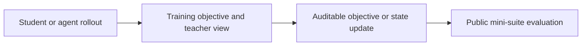
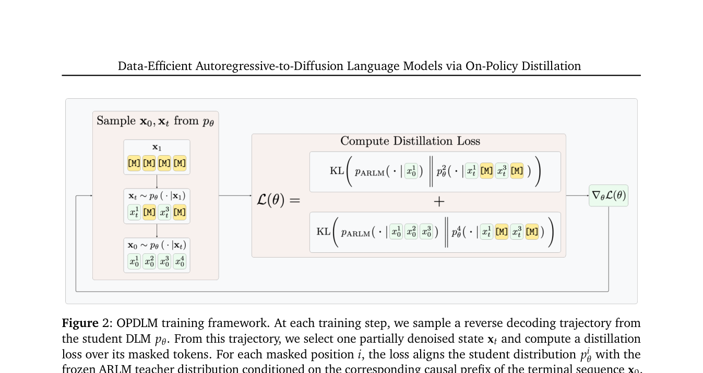

<!-- source-sha256: fd61f8e101ecfe187ac09038eb09aa5bb5f1cdcd881010354f2e6645904d45d8 -->

[简体中文](README.md) · English

# OPDLM: Efficient transfer from autoregressive to diffusion language models

> **Core mechanism reproduction.** Paper results, local mechanism verification and unreproduced scope are stated separately.

## Paper information

| Field | Details |
| --- | --- |
| Paper | [Data-Efficient Autoregressive-to-Diffusion Language Models via On-Policy Distillation (arXiv 2606.06712)](https://arxiv.org/abs/2606.06712) |
| Institution | Texas A&M University / Xingyu Su |
| First public release | 2026-06-04 (arXiv v1) |
| Author code | No released official code found on 2026-08-08. |
| Local adapter or method key | `opd-lm` |
| Local reproduction code | [`src/auto_research/post_training/`](https://github.com/daiwk/auto-research/tree/main/src/auto_research/post_training/) |

## Original paper summary

### Background and main changes

Changing an ARLM to bidirectional attention can cause forgetting and a shift from random-mask training to confidence-based decoding. OPDLM samples the bidirectional student's own inference trajectories and gets target logits from a frozen autoregressive teacher on the same trajectories.



<!-- paper-figure:start -->
### Key figure from the paper

[](https://arxiv.org/pdf/2606.06712#page=4)

> **Figure 2:** Core architecture, modules and connections. From the [paper](https://arxiv.org/abs/2606.06712); copyright belongs to the authors. Click for the source.
<!-- paper-figure:end -->

### Core equations

$$
y^{(k)}\sim\pi_{DLM}^{(k)},\quad \mathcal L_{OPD}=\mathbb E_{y^{(k)}}\sum_{t\in M_k}\operatorname{KL}(\pi_{AR}(\cdot|y_{<t})\Vert\pi_{DLM}(\cdot|y_{\setminus M_k})).
$$

### Offline and online results

The paper reports 15× to 7,000× fewer training tokens than earlier DLM conversion methods to reach strong performance. No production A/B.

## Local reproduction

Adjacent candidate states simulate bidirectional denoising views while retaining a frozen AR teacher anchor. This is not a full diffusion decoder.

Arithmetic candidate suite, 120 steps, seed 42: accuracy 0.2344 → **0.6562 (+180.00%)**. The pinned metrics retain diagnostic fields.

```bash
auto-research post-train --algorithm opd-lm --dataset arithmetic-smoke --maximum-examples 256 --steps 120 --seed 42
auto-research evolve --model post-training --dataset arithmetic-smoke --direction "组合 opd-lm 与已安装论文算子" --generations 2 --population 4
```

See [stable batch metrics](../../experiments/p0-p1-closed-audit-20260808-seed42.json).

## Scope

The deterministic public mini-suite checks core state updates at matched budgets. It does not reproduce the paper's large model, multi-GPU RL, private environment or full benchmark. Local relative changes are not paper gains.
