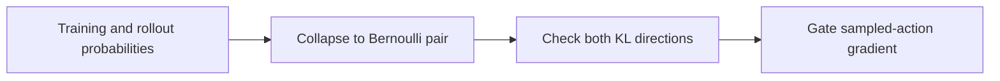
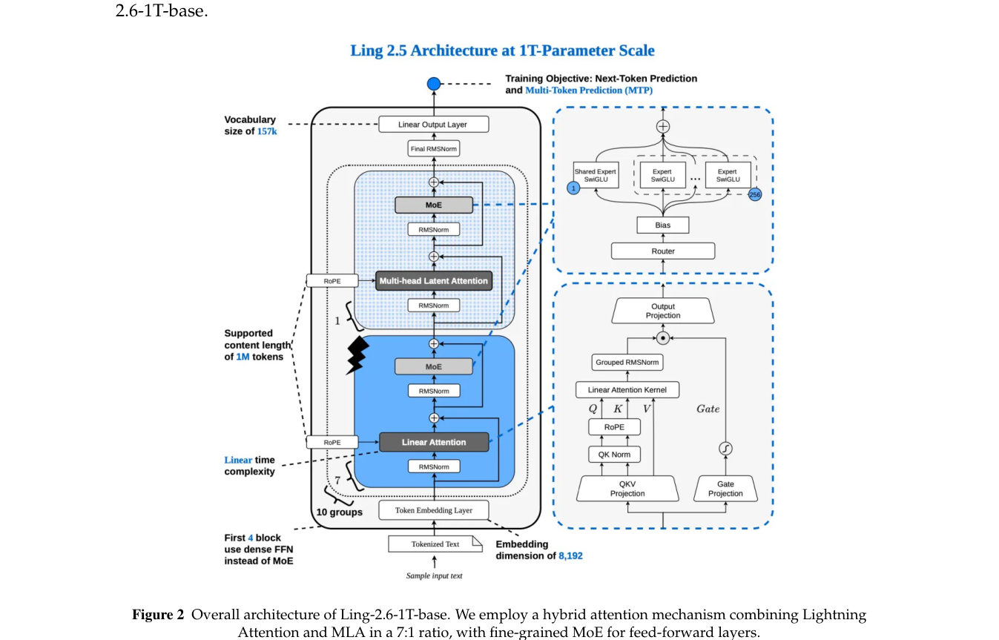

# KPop: Adaptive train–inference mismatch masking with binary KL

<!-- source-sha256: 2ce7bbc6836ce68fb8a43fbe450c055e83241774b997f1c5d33c43cd88084b78 -->

[简体中文](README.md)

> Isolated candidate-policy RL mechanism, not paper-scale async training.

## Paper information

| Field | Details |
|---|---|
| Paper | [KPop (arXiv 2606.15079)](https://arxiv.org/abs/2606.15079) |
| Institution | Ling / Ring Team. |
| First public release | 2026-06-13 |
| Author code | No standalone algorithm repository found. |
| Local adapter or method key | `kpop` |
| Local reproduction code | [`src/auto_research/post_training/`](https://github.com/daiwk/auto-research/tree/main/src/auto_research/post_training/) |

## Paper method and evidence

Asynchronous rollout and training probabilities can disagree. A fixed ratio mask can reject legitimate exploration or keep harmful gradients. Collapse the sampled token and remaining vocabulary to a Bernoulli distribution; retain its update only if forward and reverse binary KL meet the threshold.



<!-- paper-figure:start -->
### Original paper figure

[](https://arxiv.org/pdf/2606.15079#page=4)

The original figure describes the training mechanism. From the [original paper](https://arxiv.org/abs/2606.15079); copyright remains with the authors.
<!-- paper-figure:end -->

### Core equation

$$
D_{\rm bi}(p\Vert q)=p\log\frac pq+(1-p)\log\frac{1-p}{1-q},\quad m_t=\mathbf1[D_{\rm bi}(p\Vert q),D_{\rm bi}(q\Vert p)\le\tau].
$$

### Reported results

The Ling/Ring 2.6 report uses KPop in large-scale asynchronous agentic RL for coding, search, tools and workflows. No production A/B was reported.

## Local reproduction

Compute bidirectional binary KL from rollout/training candidate distributions and use the mask to control actual policy gradients.

```bash
auto-research post-train --algorithm kpop --dataset gsm8k-candidate --maximum-examples 256 --steps 120 --seed 42
```

[Fixed-seed summary](../../experiments/rl-papers-summary-seed42.json). No real serving/training engine, MoE routing or trillion-parameter cluster.
