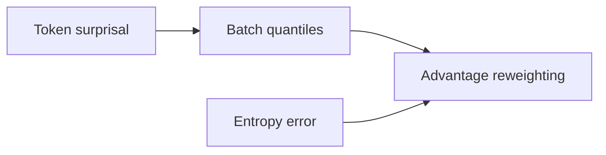
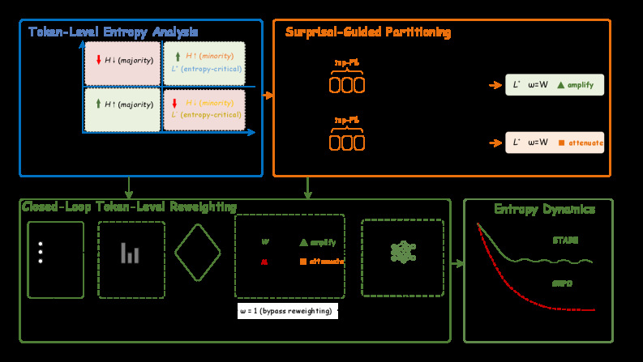

# STARE: Surprisal-Guided Token-Level Advantage Reweighting

<!-- source-sha256: 6ea69fb51658d400d00df79cc00c73eb6dee4de15f47556f8741797fe43a2359 -->

[简体中文](README.md)

> **Core mechanism evidence.** Paper and local evaluations are separate.

## Paper information

| Field | Value |
| --- | --- |
| Paper | [STARE: Surprisal-Guided Token-Level Advantage Reweighting (arXiv 2606.19236)](https://arxiv.org/abs/2606.19236) |
| Affiliations | Shenzhen International Graduate School, Tsinghua University / Tencent Hunyuan |
| First public release | 2026-06-17 (arXiv v1) |
| Authors' code | [Author code](https://github.com/hp-luo/STARE). |
| Adapter / method | `stare` |
| Local code | [`src/auto_research/post_training/`](https://github.com/daiwk/auto-research/tree/main/src/auto_research/post_training/) |

## Original paper

### Background and contribution

Identify entropy-critical tokens by batch surprisal quantiles, reweight their advantages, and use target entropy in a feedback gate.



<!-- paper-figure:start -->
### Key figure from the paper

[](https://arxiv.org/html/2606.19236v1/x4.png)

Original Figure 2: STARE. From the [paper](https://arxiv.org/abs/2606.19236); copyright belongs to the authors. Not a local result.
<!-- paper-figure:end -->

### Core mechanism

$$
\Delta H_t\approx A(\tau)\,g_\theta(x_t),\quad \tilde A_t=w(s_t,H-H^*)A(\tau).
$$

### Paper results

The paper maintains entropy from 1.5B to 32B across short/long CoT and multi-turn tools; average AIME24/25 accuracy exceeds DAPO by 4%–8%. No live A/B.

## Local reproduction

Arithmetic candidate suite, 120 steps, seed 42: 0.2344→0.5312 (+126.67%). [Metrics](../../experiments/global-p1-20260808-seed42.json).

```bash
auto-research post-train --algorithm stare --dataset arithmetic-smoke --maximum-examples 256 --steps 120 --seed 42
auto-research evolve --model post-training --dataset arithmetic-smoke --direction "Combine stare with installed paper operators" --generations 2 --population 4
```

## Reproduction limits

Mechanism diagnostic, not the large model, multi-card, private environment, or full benchmark.
