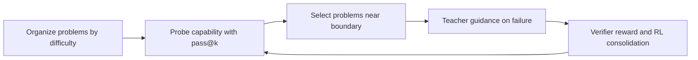
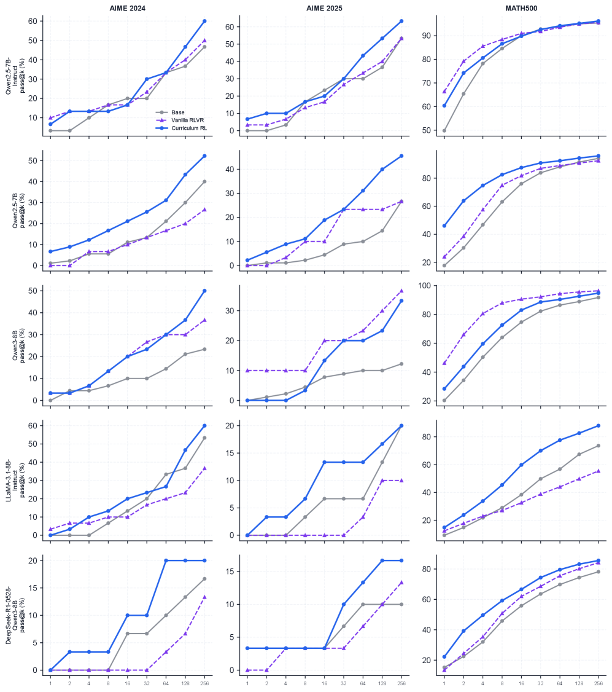

# Boundary-Aware Curriculum RL (CoBA-RL)

<!-- source-sha256: 4edb3020150c64982ce301e8112be2341ddb3c7ae7e6d90c418d0f80b9842275 -->

[简体中文](README.md)

> Identify the current capability boundary, provide teacher guidance near it, and use RL to consolidate newly learned reasoning patterns.

## Paper information

| Field | Details |
|---|---|
| Paper | [Curriculum Reinforcement Learning Can Incentivize Reasoning Capacity in LLMs Beyond the Base Model](https://arxiv.org/abs/2606.22317) |
| Organization | Zhejiang University / National University of Singapore |
| First public release | 2026-06-21 |
| Authors' code | No separately released official implementation was found. |
| Adapter / method | `coba-rl` |
| Local reproduction code | `src/auto_research/post_training/` |

## Original paper

### Motivation and method

Standard RLVR may reweight trajectories already accessible to the base model, raising pass@1 without extending the capability boundary visible at high pass@k. CoBA-RL estimates that boundary with repeated sampling, introduces teacher reasoning near or beyond it, and reinforces it with RL.



<!-- paper-figure:start -->
### Key figure from the paper

[](https://arxiv.org/html/2606.22317v1/x1.png)

> **Figure 2:** Overall design and key components. From the [original paper](https://arxiv.org/abs/2606.22317); copyright remains with the authors.
<!-- paper-figure:end -->

### Core equation

$$
b_{t+1}=\operatorname{clip}\!\left(
\alpha b_t+(1-\alpha)(d(x)+\Delta(\widehat{\mathrm{pass}})),0,1
\right),
$$

The local trainer selects examples nearest to $b_t$ and applies clipped policy updates to freely generated sequences.

### Paper results

On Qwen, Llama, and DeepSeek bases, the authors improve pass@1 and pass@256. Mean pass@256 gains are 9.8 percentage points over base and 10.3 over vanilla RLVR. No production A/B is reported.

## Local reproduction

The arithmetic suite has reproducible difficulty. The trainer tracks the dynamic curriculum boundary, samples nearby problems, and calls a real pinned causal-LM teacher if no rollout is correct. The teacher completion enters sequence RL as a small SFT term. Boundary pass@k and teacher completions are cached separately; mismatching fingerprints are rejected. Reports contain actual teacher calls, cache hits, input and output tokens, estimated cost, and pre/post-training pass@1/2/4/8 curves.

```bash
auto-research post-train --algorithm coba-rl --dataset arithmetic-generate \
  --maximum-examples 48 --steps 6 --seeds 42,43,44 \
  --teacher-model-id Qwen/Qwen2.5-0.5B-Instruct \
  --teacher-revision 7ae557604adf67be50417f59c2c2f167def9a775 \
  --teacher-checkpoint-path checkpoints/qwen2.5-0.5b-instruct \
  --teacher-cache runs/coba/cache/teacher.json \
  --boundary-cache runs/coba/cache/boundary.json \
  --boundary-samples 8 --device cuda --offline
```

See [stable aggregate metrics](../../experiments/free-generation-post-training-seeds42-44.json).

The actual three-seed A30 engineering run triggered three pinned Qwen2.5 teacher calls with 169 input and 94 output tokens, producing pre/post pass@1/2/4 boundary curves. Mean accuracy in the one-step smoke remained zero, demonstrating actual teacher calls, both caches, and curve generation—not an accuracy gain. See [real-teacher three-seed metrics](metrics/a30-real-teacher-seeds42-44.json).

## Limits

The implementation covers boundary state, difficulty curriculum, real teacher triggers, free-generation RL, pass@k and teacher caches, and cost curves. The local teacher is 0.5B and reports at most pass@8, not the paper's pass@256 or same-scale students. It does not reproduce the paper's capability-boundary gains.
