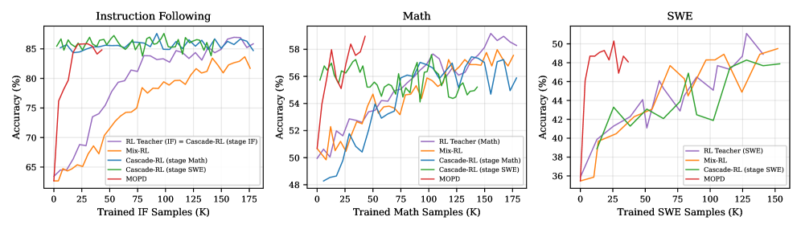

# MOPD: Integrate multiple domain teachers on the student's policy

<!-- source-sha256: 7da71c090377ae140bf459093ade7127dc3aa1437d327be7aa38bf692a287f80 -->

[简体中文](README.md)

> Core multi-teacher mechanism, not paper-scale post-training.

## Paper information

| Field | Details |
|---|---|
| Paper | [Paper or original source](https://arxiv.org/abs/2606.30406) |
| Institution | Xiaomi / Wenhan Ma. |
| First public release | 2026-06-29 (arXiv v1) |
| Author code | No official author implementation found or released as of 2026-08-08. |
| Local adapter or method key | `mopd` |
| Local reproduction code | [`src/auto_research/post_training/`](https://github.com/daiwk/auto-research/tree/main/src/auto_research/post_training/) |

## Paper method and evidence

Joint RL couples domains; merging parameters or off-policy tuning can lose capabilities. Train specialists independently, then mix dense teacher signals only on student rollouts so domains can evolve in parallel.


<!-- paper-figure:start -->
### Original paper figure

[](https://arxiv.org/html/2606.30406v1/x1.png)

The original figure shows on-policy integration. From the [original paper](https://arxiv.org/abs/2606.30406); copyright remains with the authors.
<!-- paper-figure:end -->

### Core equation

$$
q(y_t|x)=\sum_d\alpha_d(x)\pi_{T_d}(y_t|x,y_{<t}),\quad \mathcal L=\mathbb E_{y\sim\pi_S}\sum_t\operatorname{CE}(q_t,\pi_S^t).
$$

### Reported results

Qwen3-30B-A3B beats Mix-RL, Cascade RL, off-policy FT and merging. Applied to MiMo-V2-Flash post-training; no production A/B.

## Local reproduction

Four reward-axis teachers mix according to per-example domain evidence within student support. Arithmetic candidates, 120 steps, seed 42: **0.2344→0.3438 (+46.67%)** with diagnostic fields. [Metrics](../../experiments/p0-p1-closed-audit-20260808-seed42.json). A public deterministic mini-suite verifies state updates at matched budget, not paper LLMs, multi-GPU RL, private environments or complete benchmarks.

```bash
auto-research post-train --algorithm mopd --dataset arithmetic-smoke --maximum-examples 256 --steps 120 --seed 42
auto-research evolve --model post-training --dataset arithmetic-smoke --direction "Combine mopd with installed paper operators" --generations 2 --population 4
```
