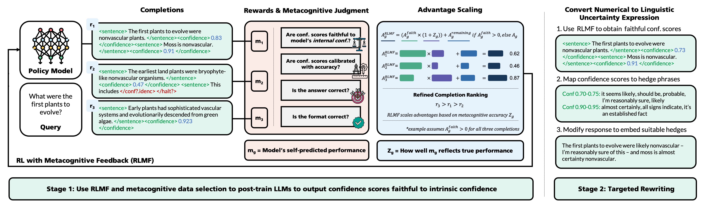
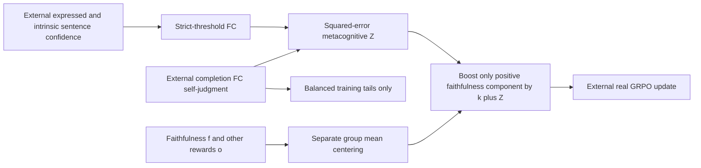

# RLMF: selectively amplify above-mean faithfulness advantages

<!-- source-sha256: 8b22b0d384f1b00b76032a6dd9d69eb9ab094fa13b5b9f5f0b03f5c382f3dc74 -->

[简体中文](README.md)

> Local delivery is an L1 numerical/protocol component, not a full paper capability reproduction. Full experiments are cost-deferred and review-DONE, with no pretrained model/API training, automatic retry or evolve promotion.

Independent component artifacts: [CPU, three seeds](metrics/component-cpu-seeds42-44.json), [CUDA, three seeds](metrics/component-cuda-seeds42-44.json). They validate only the stated small operators; actual NVIDIA execution is supported by a separate sanitized batch receipt.

## Paper information

| Field | Value |
|---|---|
| Paper | [Reinforcement Learning with Metacognitive Feedback Elicits Faithful Uncertainty Expression in LLMs](https://arxiv.org/abs/2606.32032v1); [fixed v1](https://arxiv.org/html/2606.32032v1) |
| Company / institution | First author Gabrielle Kaili-May Liu: Yale University; original byline also verifies Google Research. Group by the first author's institution, not model brands. |
| First publication | 2026-06-30 17:56:01 UTC, arXiv v1; historical omission, not a new paper this batch |
| Author code | [Author-linked repository](https://github.com/yale-nlp/RLMF). A public MIT author repository and README are verified. The local core follows fixed-v1 formulas and does not claim the complete upstream trainer. |
| Adapter | `rlmf` is a catalog key; `adapter=null`, not a full reproduce/evolve adapter |
| Local code | `src/auto_research/post_training/rlmf.py`; `tests/test_nov13_colm_evaluation.py` |

<!-- paper-figure:start -->
### Key figure from the original paper



Source: [fixed original](https://arxiv.org/html/2606.32032v1/fig1_fixed.png). Image from the [original paper](https://arxiv.org/abs/2606.32032v1); copyright belongs to its original authors. The complete system or results in this figure are not results of the local component. Source hashes and visual review are recorded in `assets/provenance.json`.
<!-- paper-figure:end -->

## Original paper summary

### Background and main change

Task correctness, expressed confidence and the ability to judge that expression are distinct. The paper first calibrates numerical confidence against sampling-based intrinsic confidence, then uses metacognitive self-judgment quality to refine RL ranking. It also selects both high and low self-judged training examples and uses an external rewriting model to express calibrated uncertainty naturally.

The local contribution is limited to Eqs.2–4 and balanced training-tail selection. Intrinsic confidence is not replaced by task answer labels, and a synthetic self-judgment is not a model's metacognitive capability.



### Core formulas

Section3.1 defines $F_{gold}=n^{-1}\sum_i\mathbf1[|c_i-g_i|<\tau]$ and $Z=1-(F_{pred}-F_{gold})^2$. The intrinsic confidence $g_i$ comes from an external sampling/judgment process, not a gold task answer. The threshold is strict and each masked completion must contain a valid sentence; the default is $\tau=0.10$.

For faithfulness reward$f$ and other rewards$o$, Eq.4 is
$A_g=(o_g-\bar o)+(f_g-\bar f)(k+Z_g)$ when $f_g>\bar f$, and
$A_g=(o_g-\bar o)+(f_g-\bar f)$ otherwise, with default$k=1$.
There is no group-standard-deviation normalization. $Z$ is not an additive reward, the whole advantage is not multiplied, and negative faithfulness deviations are not boosted. The resulting advantages need not have zero group mean and are not recentered.

Section3.3 selects equal high/low tails of self-judged training examples. Since the source does not specify odd counts or ties, the local API rejects odd counts and uses stable ID ties, explicitly as local conventions.

### Original offline and online results

The paper compares faithful calibration, accuracy and numerical/linguistic uncertainty across tasks and reports improvements up to63% under its specified metric and baselines. Synthetic FC in the local diagnostic is not that result. No production online A/B is reported.

AppendixB.1 explicitly selects the best RL checkpoint by in-domain test FC every100 steps. This repository does not adopt that selection: any future training must choose hyperparameters/checkpoints on validation and reserve test for the final report, documenting the deviation. The separate SFT validation split does not resolve the RL test-selection issue.

## Local component

### Data protocol and code mapping

`faithful_calibration`, `metacognitive_feedback` and `advantages` implement tensor arithmetic; the FC indicator is discrete. `select_training_tails` handles training-only selection. CPU/CUDA operator evidence is separate from model capability. There is no intrinsic-confidence estimator, self-judging LLM, full GRPO objective/optimizer, SFT or rewriting model.

```bash
PYTHONPATH=src python -c 'from auto_research.post_training.rlmf import diagnostic; print(diagnostic(42, "cpu"))'
PYTHONPATH=src python -m pytest -q tests/test_nov13_colm_evaluation.py
```

### Local evidence and negative controls

Tests cover the strict threshold, masks, perfect-judgment feedback, selective positive-component boosting, unchanged negative components, no recentering, gradients, and rejection of validation/test tail selection. Formula error and synthetic FC describe only supplied numbers, not model calibration. No evolve promotion is enabled.

### Full-experiment cost decision

AppendixB.1 uses Qwen3-1.7B/4B/8B and Llama3.1-8B with rank64 LoRA, four training GPUs plus two sampling/judge GPUs,32 completions per prompt,1500 steps,2000 training examples, and model/task/learning-rate matrices plus pre-SFT and commercial rewriting comparisons. Full reproduction exceeds the single-A100/A30/Mac budget and is cost-deferred, review-DONE, without checkpoints, APIs or trial training.
