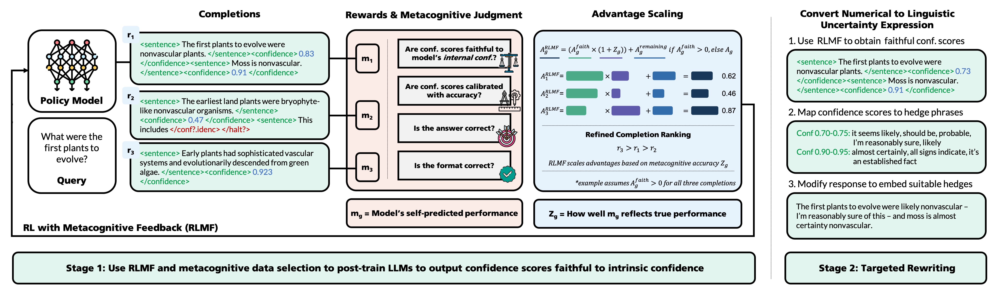
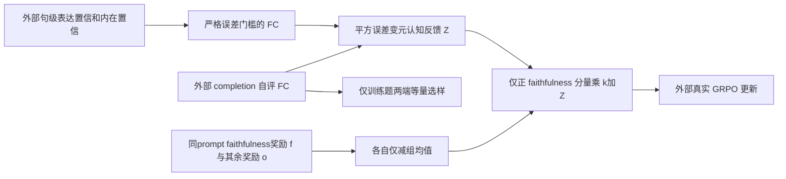

# RLMF：只对高于均值的忠实度优势施加元认知放大

> 本地交付是 L1 数值/协议组件，不是完整论文能力复现。完整实验成本过高，不复现（审查 DONE）；未执行模型/API训练，不启用自动重试或 evolve 晋级。

本轮独立机制记录：[CPU 三种子](metrics/component-cpu-seeds42-44.json)、[CUDA 三种子](metrics/component-cuda-seeds42-44.json)。这些产物只验收所述小算子，不是论文能力分数；真实 GPU 结果以统一脱敏回执为准。

## 论文信息

| 字段 | 内容 |
|---|---|
| 论文链接 | [Reinforcement Learning with Metacognitive Feedback Elicits Faithful Uncertainty Expression in LLMs](https://arxiv.org/abs/2606.32032v1)；[固定 v1 原文](https://arxiv.org/html/2606.32032v1) |
| 公司 / 机构 | 一作 Gabrielle Kaili-May Liu：Yale University；原文另确认 Google Research 署名，按一作所属机构聚合，不以模型品牌判断机构 |
| 首次公开日期 | 2026-06-30 17:56:01 UTC（arXiv v1，不是本轮新首发） |
| 原作者代码 | [作者链接](https://github.com/yale-nlp/RLMF)；作者公开MIT仓库与README已核；本地仅固定v1 Eq2–4/选样核心，不声称复制上游完整trainer。 |
| Adapter | `rlmf` 为 catalog key，`adapter=null`，不是完整 reproduce/evolve adapter |
| 本地复现代码 | `src/auto_research/post_training/rlmf.py`；专测 `tests/test_nov13_colm_evaluation.py` |

<!-- paper-figure:start -->
### 原论文关键图



来源：[固定 v1 原论文](https://arxiv.org/html/2606.32032v1)。图片来自[原论文](https://arxiv.org/abs/2606.32032v1)，版权归原作者所有；图中完整系统或实验结果不等于本地组件结果。原始来源、SHA256与视觉核验见 `assets/provenance.json`。
<!-- paper-figure:end -->

## 原始论文总结

### 背景与主要改动

回答正确性、表达的置信度，以及模型能否评价自身置信表达，是三个不同量。本文先使数值置信接近由采样一致性估计的内在置信，再借元认知自评质量调节 RL 排序；另用训练题自评的高低两端选样，最后由外部改写器把数值映射成自然语言不确定性。

本地只保留可精确隔离的 Eq2–4 和训练尾部选样。内在置信不是提供一份正确答案就能替代，模型自评也不是本地随手给的标签。诊断中的数值均为教学输入，不宣称测出了真实不确定性。



### 核心公式

§3.1 的真实句级 faithful calibration：

$$
F_{gold}=\frac1n\sum_i\mathbf1[|c_i-g_i|<\tau],\qquad Z=1-(F_{pred}-F_{gold})^2.
$$

$g_i$ 是外部采样/判断过程得到的内在置信，不是 task gold answer。门槛是**严格小于**，mask 后每个 completion 至少保留一句。默认 $\tau=0.10$。

将奖励分为主要忠实度 $f_g$ 与其他约束 $o_g$；Eq4：

$$
A_g=(o_g-\bar o)+
\begin{cases}
(f_g-\bar f)(k+Z_g),&f_g>\bar f,\\
f_g-\bar f,&f_g\le\bar f .
\end{cases}
$$

默认 $k=1$。不做组标准差归一，不把 $Z$ 直接加到 reward，不放大整个优势，负的忠实度分量也不放大。按式放大后组优势均值可以非零，不能再偷偷居中。

§3.3 选样取训练候选自评的高/低两端各半。本地明确要求正偶数样本量、唯一ID、训练split；源未规定奇数和同分细节，故拒绝奇数并以ID稳定打破同分，而非假称那是原文算法。

### 论文离线与线上效果

原文跨任务比较 faithful calibration、准确率和数值/语言表达，并给出至多63%的相对改善；指标定义和基线条件必须与原表一致，不能把本地 FC 教学比例称为该结果。未报告生产线上 A/B。

**评测协议提醒：**Appendix B.1 明确按 in-domain test 的 FC 每100步挑最佳 RL checkpoint。本库不沿用此选择：任何后续真实训练只能在 validation 选择超参/检查点，test 留到最终报告，并把与原文差异写清；SFT 的独立验证集不能替这处 RL test 选择洗白。

## 本地复现

### 数据协议与代码映射

`faithful_calibration`、`metacognitive_feedback`、`advantages` 是可微框架中的张量核（FC门槛本身离散）；`select_training_tails` 是训练选样。CPU/CUDA 支持以真实算子验收为准。没有采样一致性估计、LLM自评、完整GRPO损失/optimizer、SFT或自然语言改写器。

```bash
PYTHONPATH=src python -c 'from auto_research.post_training.rlmf import diagnostic; print(diagnostic(42, "cpu"))'
PYTHONPATH=src python -m pytest -q tests/test_nov13_colm_evaluation.py
```

### 本地结果与负控

测试严格 $\tau$ 边界、padding、完全自评的 $Z=1$、正忠实度分量单独放大、负分量不变、放大后不再中心化、梯度以及拒绝 test/validation 选样。advantage formula error 是公式误差，synthetic FC 是给定教学置信上的比例，不是模型能力。无 evolve 晋级。

### 高成本完整实验

Appendix B.1：Qwen3-1.7B/4B/8B与Llama3.1-8B，LoRA64，**四张训练GPU加两张生成/judgeGPU**，每题32个completion、1500步、2000训练题及学习率/模型/任务矩阵，还有预SFT与商业改写基线。超出单A100/A30/Mac短时预算，**成本过高，不复现（审查 DONE）**；本轮不下载权重、不调用API、不启动试训。
