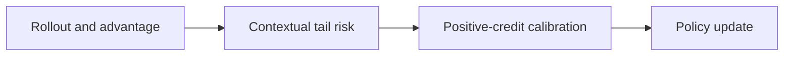
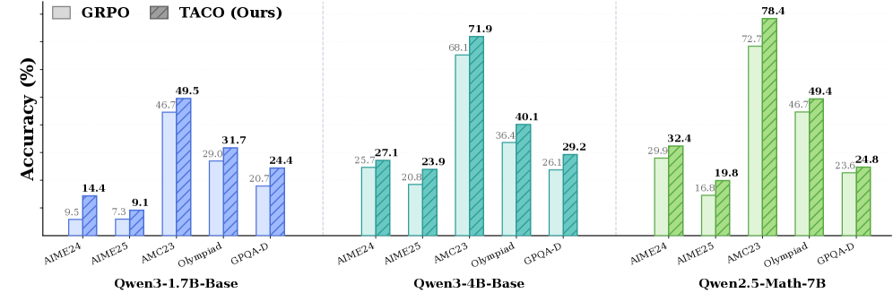

# TACO: Tail-Token Credit Calibration

<!-- source-sha256: d0440e75bb674d0ae0ffc721691df4c8194541c9a460fd517b52cdb3f7955572 -->

[简体中文](README.md)

> **Core mechanism evidence.** Paper and local evaluation are separate.

## Paper information

| Field | Value |
| --- | --- |
| Paper | [TACO (arXiv 2607.07976)](https://arxiv.org/abs/2607.07976) |
| Affiliations | Johns Hopkins University / Rice University / Workato / University of North Carolina at Charlotte |
| First public release | 2026-07-08 |
| Authors' code | [Author code](https://github.com/xiuyilou/TACO). |
| Adapter / method | `taco` |
| Local code | [`src/auto_research/post_training/`](https://github.com/daiwk/auto-research/tree/main/src/auto_research/post_training/) |

## Original paper

### Background and contribution

A correct trajectory's uniform positive advantage can reward implausible low-probability tokens. Estimate contextual tail risk, smoothly reduce high-risk positive credit, and retain negative credit.



<!-- paper-figure:start -->
### Key figure from the paper

[](https://arxiv.org/html/2607.07976v1/x1.png)

Original Figure 1: TACO. From the [paper](https://arxiv.org/abs/2607.07976); copyright belongs to the authors. Not a local result.
<!-- paper-figure:end -->

### Core mechanism

$$
\tilde A_t=\begin{cases}w(\operatorname{tailrisk}_t)A,&A>0\\A,&A\le0,\end{cases}\qquad 0<w(\cdot)\le1.
$$

### Paper results

The paper reports improvements over GRPO variants on three LLMs and eight benchmarks and more stable long-horizon RL. No online A/B.

## Local reproduction

Use rollout surprisal as a tail-risk proxy. Positive tail advantage is downweighted continuously; negative advantage is not masked. [Metrics](../../experiments/rl-papers-summary-seed42.json).

```bash
auto-research post-train --algorithm taco --dataset gsm8k-candidate --maximum-examples 256 --steps 120 --seed 42
```

## Reproduction limits

Candidate actions, not token CoT. This does not reproduce the paper's contextual predictor or full-scale RL.
