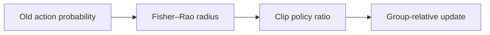
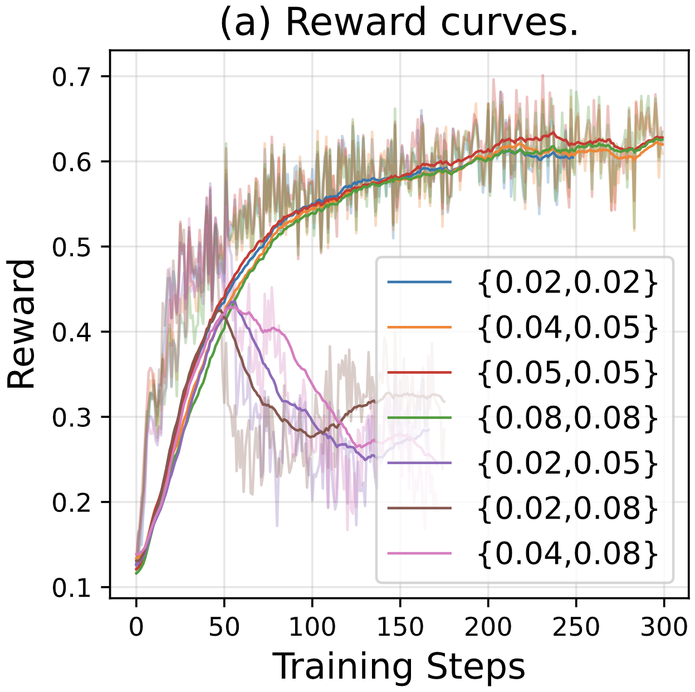

# RIPO: Riemannian isometric policy optimization

<!-- source-sha256: 7a4d3195cac9914756bcdf08aeb6c311efe1ce94b01d622bcc6d10f8f5fb3543 -->

[简体中文](README.md)

> Isolated candidate-policy update, not full-parameter long reasoning.

## Paper information

| Field | Details |
|---|---|
| Paper | [RIPO (arXiv 2607.10169)](https://arxiv.org/abs/2607.10169) |
| Institution | Institute for AI Industry Research, Tsinghua University / ByteDance Seed. |
| First public release | 2026-07-11 |
| Author code | No official author code found. |
| Local adapter or method key | `ripo` |
| Local reproduction code | [`src/auto_research/post_training/`](https://github.com/daiwk/auto-research/tree/main/src/auto_research/post_training/) |

## Paper method and evidence

Fixed PPO ratio bounds can be too conservative at low probabilities and too loose at high probabilities. Use Fisher–Rao policy distance to set clip radius from the old action probability for a more even local KL budget.



<!-- paper-figure:start -->
### Original paper figure

[](https://arxiv.org/html/2607.10169v1/figs/abs-re.png)

The original figure illustrates probability-dependent clipping. From the [original paper](https://arxiv.org/abs/2607.10169); copyright remains with the authors.
<!-- paper-figure:end -->

### Core equation

$$
r_t=\frac{\pi_\theta(a_t\mid s_t)}{\pi_{\rm old}(a_t\mid s_t)},\quad \epsilon_t=\epsilon(p_{\rm old}(a_t\mid s_t)),\quad \operatorname{clip}(r_t,1-\epsilon_t,1+\epsilon_t).
$$

### Reported results

Across seven competition reasoning benchmarks, the paper reports gains over prior LLM RL methods and up to 60% relative AIME24 gain versus GRPO. No production A/B.

## Local reproduction

On GSM8K candidates, execute probability-dependent Fisher–Rao clipping, group advantage and old-policy refresh; record dynamic radii.

```bash
auto-research post-train --algorithm ripo --dataset gsm8k-candidate --maximum-examples 256 --steps 120 --seed 42
```

[Fixed-seed summary](../../experiments/rl-papers-summary-seed42.json). Candidate actions replace token distributions; local evidence is about the clip and gradient path.
