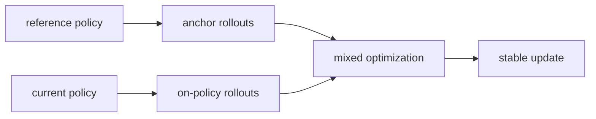
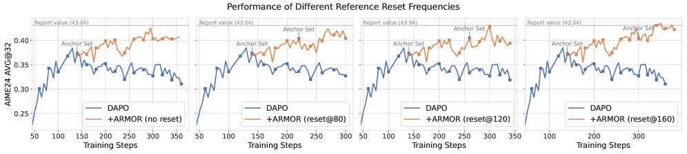

# ARMOR: reference anchor rollouts

<!-- source-sha256: 3e2a5603cd142f234b0130174fdb318d187497c89bab4444853a4b56f5ad581e -->

[简体中文](README.md)

> Isolates the RL update on a public candidate policy or deterministic agent mini-suite. The lightweight experiment does not establish paper-scale model or benchmark outcomes.

## Paper information

| Field | Details |
|---|---|
| Paper | [ARMOR: reference anchor rollout (arXiv 2607.10481)](https://arxiv.org/abs/2607.10481) |
| Organization | University of Science and Technology of China / Peking University |
| First public release | 2026-07-11 |
| Authors' code | No official code was found. |
| Adapter / method | `armor` |
| Local reproduction code | [`src/auto_research/post_training/`](https://github.com/daiwk/auto-research/tree/main/src/auto_research/post_training/) |

## Original paper

### Motivation and method

Reverse KL penalizes departure passively but does not ensure that useful reference solutions remain covered. ARMOR actively samples anchor trajectories from a frozen reference and mixes them with current-policy rollouts. Data, rather than an auxiliary KL term, stabilize long-horizon RL.



<!-- paper-figure:start -->
### Key figure from the paper

[](https://arxiv.org/html/2607.10481v2/x9.png)

> **Figure 4:** Training flow and key optimization steps. From the [original paper](https://arxiv.org/abs/2607.10481); copyright remains with the authors.
<!-- paper-figure:end -->

### Core equation

$$
\mathcal L=\mathbb E_{\tau\sim\pi_\theta}[\ell_{\rm on}(\tau)]+\lambda\mathbb E_{\tau\sim\pi_{\rm ref}}[\ell_{\rm anchor}(\tau)].
$$

### Paper results

On reasoning benchmarks, anchor rollouts mitigate validation collapse and support longer training. No production online A/B test is reported.

## Local reproduction

Sample half of each training group from the current policy and half from the frozen reference. Record anchor counts and weights and final policy metrics separately.

```bash
auto-research post-train --algorithm armor --dataset gsm8k-candidate --maximum-examples 256 --steps 120 --seed 42
```

See the [fixed-seed aggregate metrics](../../experiments/rl-papers-summary-seed42.json).

## Reproduction boundaries

The reference is the locally initialized candidate policy. No paper-scale long-horizon training or real trajectory pool is included.
