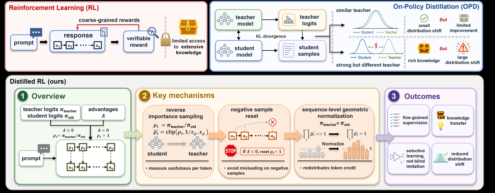

<!-- source-sha256: 33ebb2f6028662744a876ea1ef36c4ea70de977f1ccf83daee88fa364c64ce26 -->

[简体中文](README.md) · English

# Distilled RL: Turning teacher supervision into fine-grained RL signals

> **Core mechanism reproduction.** Paper results, local verification and unreproduced scope are separate.

## Paper information

| Field | Details |
| --- | --- |
| Paper | [Distilled Reinforcement Learning for LLM Post-training (arXiv 2607.17247)](https://arxiv.org/abs/2607.17247) |
| Institution | Nankai University / Zhongguancun Academy |
| First public release | 2026-07-19 (arXiv v1) |
| Author code | [Released code: 597358816/Distilled-RL](https://github.com/597358816/Distilled-RL). |
| Local adapter or method key | `distilled-rl` |
| Local reproduction code | [`src/auto_research/post_training/`](https://github.com/daiwk/auto-research/tree/main/src/auto_research/post_training/) |

## Original paper summary

### Background and main changes

RL provides sequence-level rewards, while OPD imitates a teacher unconditionally. Distilled RL uses the teacher-to-student probability ratio to reweight reward at each token, activates teacher weighting only for positive advantages, and uses a sequence geometric mean to remove length-scale bias.


<!-- paper-figure:start -->
### Key figure from the paper

[](https://arxiv.org/html/2607.17247v1/img/distilled-RL-main.png)

> **Figure 1:** Overall design and components. From the [paper](https://arxiv.org/abs/2607.17247); copyright belongs to the authors. Click for the source.
<!-- paper-figure:end -->

### Core equations

$$
\rho_t=\pi_T(y_t|y_{<t})/\pi_{old}(y_t|y_{<t}),\quad \tilde\rho_t=\operatorname{clip}(\rho_t)/\exp(\frac1T\sum_s\log\operatorname{clip}(\rho_s)),\quad w_t=\mathbf1[A>0]\tilde\rho_t+\mathbf1[A\le0].
$$

### Offline and online results

Mean Pass@1 beats RL, OPD and OPD+RL across three students; Qwen3-4B reaches 58.96 versus 57.40 with RL. No production A/B.

## Local reproduction

Implements ratio clipping, negative-sample reset and sequence geometric normalization. The teacher is not an unconditional KL target.

Arithmetic candidate suite, 120 steps, seed 42: accuracy 0.2344 → **0.6094 (+160.00%)**. Diagnostic fields are retained in pinned metrics.

```bash
auto-research post-train --algorithm distilled-rl --dataset arithmetic-smoke --maximum-examples 256 --steps 120 --seed 42
auto-research evolve --model post-training --dataset arithmetic-smoke --direction "组合 distilled-rl 与已安装论文算子" --generations 2 --population 4
```

See [stable batch metrics](../../experiments/p0-p1-closed-audit-20260808-seed42.json).

## Scope

The deterministic public mini-suite verifies core state updates at matched budgets, not paper-scale models, multi-GPU RL, private environments or full benchmarks. Local changes are not paper gains.
