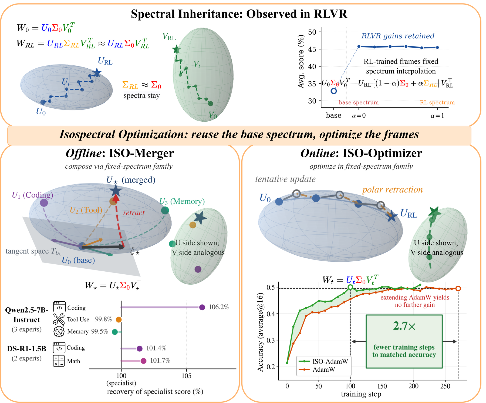

# ISO: An RLVR-Native Optimization Stack

<!-- source-sha256: 091da017a03d3bcacbbe8fef31153445ba31b8cc8475f43305c6807a741f8046 -->

[简体中文](README.md)

> Candidate-policy objective, not paper-scale RLVR.

## Paper information

| Field | Details |
|---|---|
| Paper | [Paper or original source](https://arxiv.org/abs/2607.19331) |
| Institution | The University of Texas at Austin; first author Hanqing Zhu. |
| First public release | 2026-07-21 (arXiv v1) |
| Author code | [zhuhanqing/ISO](https://github.com/zhuhanqing/ISO). |
| Local adapter or method key | `iso-rlvr` |
| Local reproduction code | `src/auto_research/post_training/historical_b08_b09.py` |

## Paper method and evidence

Fix pretrained singular values and optimize only input/output singular frames. The paper also provides a data-free specialist merger.


<!-- paper-figure:start -->
### Original paper figure

[](https://arxiv.org/html/2607.19331v1/Figure/teaser.png)

Figure shows isometric optimization. From the [original paper](https://arxiv.org/abs/2607.19331); copyright remains with the authors.
<!-- paper-figure:end -->

### Core equation

$$
W=U\Sigma_0V^\top,\quad \Sigma_0\ \text{fixed}
$$

### Reported results

Qwen3-8B aggregate **0.495** at 270 AdamW steps versus 100 ISO-AdamW steps; ISO reaches **0.509** at 210 steps. No production inference.

## Local reproduction

```bash
auto-research post-train --algorithm iso-rlvr --dataset arithmetic-smoke --steps 120 --seed 42 --no-network
```

Same arithmetic-smoke candidate policy, 120 updates: **0.1953→0.5391 (+0.3438)**, not a fair cross-method advantage. [Metrics](metrics/arithmetic-smoke-seed42.json), [Batch index](../../experiments/historical-b07-b11-seed42.json). No original checkpoints, full data/compute, multi-seed or benchmark. Raw runs go to `runs/post-training/`; only metrics committed. [Experiment artifacts](../../experiments/).
