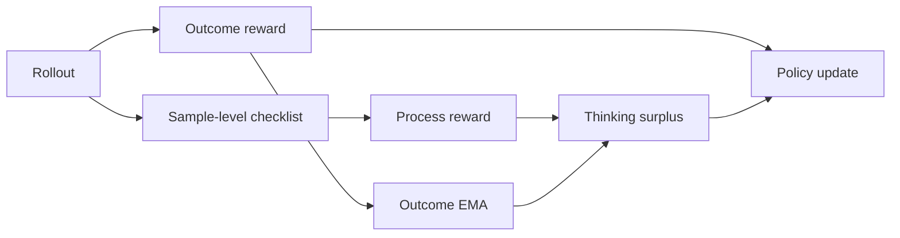
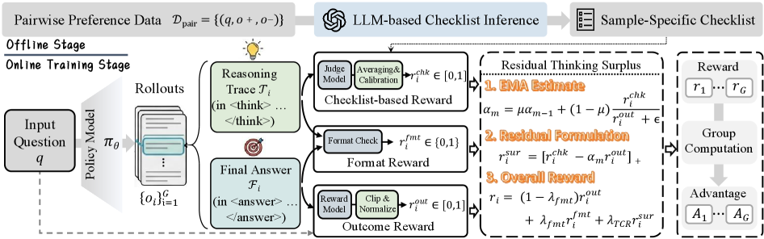

<!-- source-sha256: 60fee608cc0ffdd60e5a1ed081fd2d5d30f5f310d089bdd2ca024be6b3fe862c -->

[简体中文](README.md) · English

# TCR: Thinking Checklist Residual Reward

> Implements per-example checklists, an outcome EMA and thinking surplus. The controlled process verifier is not the paper's actual reasoning judge.

## Paper information

| Field | Details |
| --- | --- |
| Paper | [TCR (arXiv 2607.19824)](https://arxiv.org/abs/2607.19824) |
| Institution | Not listed in the paper |
| First public release | 2026-07-22 |
| Author code | No public repository found as of 2026-07-27. |
| Local adapter or method key | `tcr` |
| Local reproduction code | [`src/auto_research/post_training/`](https://github.com/daiwk/auto-research/tree/main/src/auto_research/post_training) |

## Original paper summary

### Background and main changes

Final-answer rewards miss reasoning quality, but adding process reward directly can double-count outcome. TCR constructs a checklist per example and subtracts an exponential moving outcome baseline from process scores. This concentrates updates on reasoning gains unexplained by outcome reward.



<!-- paper-figure:start -->
### Key figure from the paper

[](https://arxiv.org/html/2607.19824v1/x3.png)

> **Figure 3:** Overall workflow, stages and data flow. From the [paper](https://arxiv.org/abs/2607.19824); copyright belongs to the authors. Click for the source.
<!-- paper-figure:end -->

### Core equations

$$
r_{\mathrm{TCR}}=r_{\mathrm{outcome}}
+\alpha\left(r_{\mathrm{process}}
-\operatorname{EMA}(r_{\mathrm{outcome}})\right).
$$

The residual reduces overlap between outcome and process signals and adapts process rewards to training state.

### Offline and online results

The paper reports consistent improvements on five models across three families but gives no single headline value in the abstract. It remains under review, with no production A/B reported.

## Local reproduction

The local checklist verifier produces controlled noisy process scores for candidate reasoning. Training stores outcome EMA and thinking surplus and matches other methods' data, steps and seed.

```bash
auto-research post-train --algorithm tcr \
  --dataset gsm8k-candidate --maximum-examples 512 \
  --steps 300 --seed 42
```

| Metric | Untrained policy | TCR |
|---|---:|---:|
| GSM8K candidate accuracy | 0.1641 | **0.8359** |
| Mean reward | 0.3126 | 0.8560 |
| KL(reference) | 0.0000 | 0.5629 |

See [stable metrics](../../experiments/post-training-gsm8k-candidate-seed42.json).

## Scope

No free-form generation, model-generated checklists or paper-scale training. This verifies residual process reward on a candidate policy, not the paper's five-model numbers.
