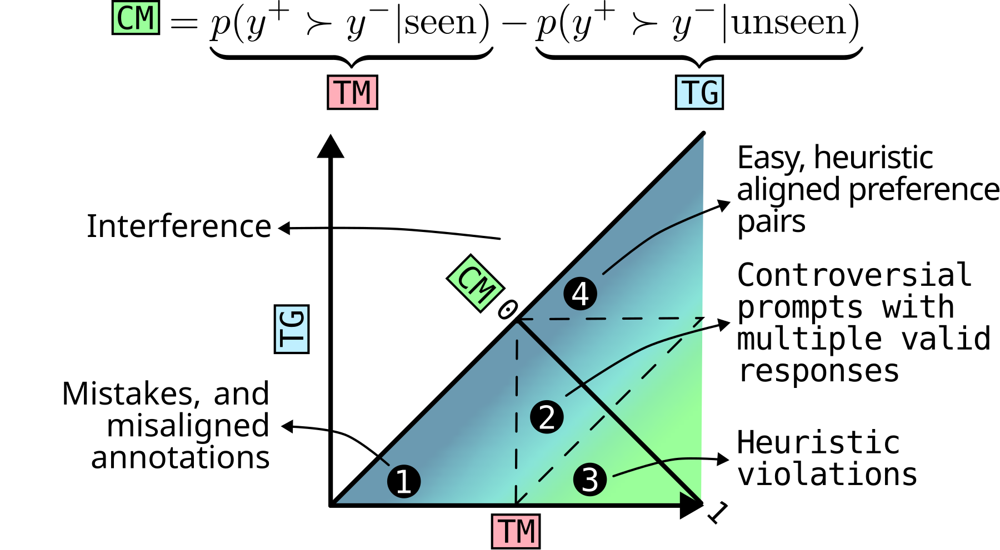

# What do Reward Models Memorize?

<!-- source-sha256: 07420a5ca2cde7ffc11279a0a07caaaeab5a015fa2440aa16d2b0d72568f5975 -->

[简体中文](README.md)

> **Standalone L1 numerical/protocol component, diagnostic only.** It does not reproduce model capabilities, training gains or the full paper. The full experiments are **too costly and not reproduced (review DONE)**, with no weight/data download or automatic retry. This was a requested historical conference backfill, not a new publication that day.

## Paper information

| Field | Details |
|---|---|
| Paper | [Original arXiv v1](https://arxiv.org/abs/2607.24484v1); [pinned v2 method](https://arxiv.org/html/2607.24484v2) |
| Institution | First author Ivo Verhoeven: ILLC, University of Amsterdam; pinned v2 also lists Google DeepMind, London. Use of Llama does not establish Meta authorship. |
| First public release | 2026-07-27 14:20:59 UTC (arXiv v1); v2 is not the original release. |
| Author code | The text links [ioverho/rm-shortcuts](https://github.com/ioverho/rm-shortcuts); [pinned SHA e737a3b26393b59ab354f7bbac8a4744ea441904](https://github.com/ioverho/rm-shortcuts/tree/e737a3b26393b59ab354f7bbac8a4744ea441904) checked. No root LICENSE; GitHub license=null, author code license unconfirmed. Independently reimplemented. Paper and figure: CC BY 4.0. |
| Local adapter / key | `rm-memorization-protocol`; `adapter=null`, `promotion_eligible=false`, `evolve_integrated=false` |
| Local code | `src/auto_research/post_training/rm_memorization_protocol.py` (`counterfactual_memorization`, `diagnostic`) |
| Validation | `tests/post_training/test_google_emnlp25_post_protocols.py`; A100 receipt path `docs/gpu-validations/rm-memorization-protocol-a100-20261025.json`. Do not claim GPU acceptance before execution and validation. |

## Paper method and evidence

For each preference pair, estimate how often trained reward models prefer the chosen response when the user was included (TM) or excluded (TG). Their difference CM measures relative counterfactual memorization. Apply sigmoid **per run before averaging**, using 20 inclusion runs and 5 held-out runs (Section 3, Eqs. 1–2). User-level grouping prevents pairs from one person crossing train/test. The local component aggregates real scores/manifests supplied by its caller and checks user consistency; it neither generates 25 reward models or the optimized data splits nor implements the underspecified co-occurrence search.

<!-- paper-figure:start -->
### Original paper figure



[Figure 1 in pinned v2](https://arxiv.org/html/2607.24484v2#S2.F1), rasterized from the original SVG without scientific changes. CC BY 4.0; source, SHA-256 and visual review are recorded in `assets/provenance.json`.
<!-- paper-figure:end -->

### Core equation

$$
p_{ir}=\sigma(r^+_{ir}-r^-_{ir}),\quad TM_i=\mathbb E[p_{ir}\mid i\in train_r],\quad TG_i=\mathbb E[p_{ir}\mid i\notin train_r],\quad CM_i=TM_i-TG_i.
$$

Derive membership from each run's actual training manifest, not scores. CM can be negative and must not be clipped. Mean sigmoid is not sigmoid of the mean margin. The paper finds memorization associated with high-margin easy examples, dataset shortcuts and length heuristics; equal CM can arise from high or low TM/TG, so report all three. These empirical findings were not reproduced locally; there was no production A/B.

## Local reproduction

```bash
PYTHONPATH=src python -c 'from auto_research.post_training.rm_memorization_protocol import diagnostic; print(diagnostic(42))'
PYTHONPATH=src python -m pytest tests/post_training/test_google_emnlp25_post_protocols.py -q
```

Random tensor diagnostics (CPU seeds 42/43/44) check only definitions, negative controls and isolation. They do not fabricate model observations, update an LLM, expose gold to an evaluated agent, or select on test. A genuine CUDA execution requires the shared runner on A100/A30 and matching code, three-seed scalars and receipt.

### Full experiment not reproduced

Section 3 and Appendices B–D use about 57.9K PRISM and 137K COMMUNITY pairs, training 25 Llama-3.2-1B LoRA models per dataset (one SFT epoch and three reward-model epochs), a 3B robustness check with 8+2 runs and a 10-epoch extension. The dozens of training runs, annotations and SAE analysis are too expensive for one A100/A30 or a Mac. These are authors' reported resources, not local timing estimates. The component is not evidence of full reproduction or Evolve improvement.
