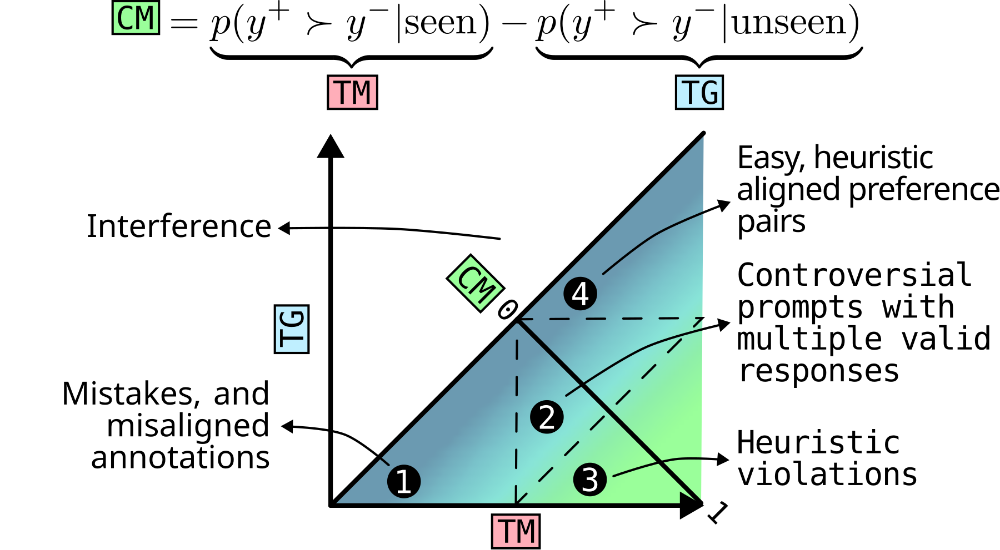

# What do Reward Models Memorize?

用多次包含/排除同一用户的RM训练估计偏好对的训练记忆TM与未见泛化TG，两者差值CM度量相对反事实记忆，再研究模型身份、用户采样和长度等shortcut。

> 状态：独立 **L1 数值/协议组件，diagnostic only**；不代表真实LLM能力、训练收益或完整论文复现。完整实验：**成本过高，不复现（审查 DONE）**，不下载权重/数据、不自动重试。此为用户指定的历史会议补漏，不是本日新发表。

## 论文信息

| 字段 | 内容 |
|---|---|
| 论文链接 | [原始 arXiv v1](https://arxiv.org/abs/2607.24484v1) |
| 固定方法版本 | [v2正文](https://arxiv.org/html/2607.24484v2)；原始发布日期仍按v1，不把更新版日期当首发 |
| 公司 / 作者机构 | 一作 Ivo Verhoeven 为 ILLC, University of Amsterdam；首页列 Google DeepMind, London 合作机构。机构核验来自固定v2首页，不把模型名Llama当作Meta作者证据。 |
| 原始发布日期 | **2026-07-27 14:20:59 UTC**，arXiv v1 |
| 原作者代码 | 作者正文直接链接ioverho/rm-shortcuts，固定SHA已核验；根树无LICENSE，GitHub license=null，新增作者源码授权未确认。本地据公开论文独立重写，不复制作者代码。 [作者仓库](https://github.com/ioverho/rm-shortcuts)；[固定SHA e737a3b26393b59ab354f7bbac8a4744ea441904](https://github.com/ioverho/rm-shortcuts/tree/e737a3b26393b59ab354f7bbac8a4744ea441904) |
| 原作者代码许可 | 作者自有源码许可未确认；没有根LICENSE不推断获许可。论文/原图许可：CC BY 4.0 |
| 本地 Adapter / key | `rm-memorization-protocol`；`adapter=null`；`promotion_eligible=false`；`evolve_integrated=false` |
| 本地代码 | `src/auto_research/post_training/rm_memorization_protocol.py`，入口 `counterfactual_memorization` / `diagnostic` |
| 本地验证 | 定向测试 `tests/post_training/test_google_emnlp25_post_protocols.py`；A100收据 `docs/gpu-validations/rm-memorization-protocol-a100-20261025.json`，实际执行和校验前不宣称GPU通过 |

## 原始论文总结

### 背景与主要改动

Sec.3 Eq.1–2：对每个真实run的reward差先sigmoid，再分别对训练内20次和留出5次求均值，CM=TM−TG。必须按用户划分，不能同用户不同偏好对跨train/test。组件只聚合调用方提供的真实run分数/manifest并检验用户一致；不制造25个RM、不实现描述不充分的cooccurrence搜索、不把sigmoid(mean margin)冒充mean(sigmoid margin)。

<!-- paper-figure:start -->
### 原论文关键图



Figure 1取自固定v2的原始SVG，仅栅格化为PNG，不改科学内容。图片来自[原论文](https://arxiv.org/html/2607.24484v2#S2.F1)，版权归原作者所有。许可 CC BY 4.0。来源、SHA256与实际目视核验见 `assets/provenance.json`。
<!-- paper-figure:end -->

### 核心公式

$$
p_{ir}=\sigma(r^+_{ir}-r^-_{ir}),\quad TM_i=\mathbb E[p_{ir}\mid i\in train_r],\quad TG_i=\mathbb E[p_{ir}\mid i\notin train_r],\quad CM_i=TM_i-TG_i.
$$

训练内/外判定是每个run的真实数据包含关系，不能根据模型得分反推。TM/TG必须先逐run转为概率再条件平均；CM可以为负，不能截断为0。这里只检验输入manifest的用户级一致性，不声称生成了原文优化过的25份划分。

### 论文离线与线上效果

论文发现记忆偏向易分高margin样本、数据集shortcut和长度等启发式；CM是相对量，TM/TG都高与都低可能得到同样CM，须三者分别报告。本地不复现这些经验发现，只执行定义和隔离协议。 未报告互联网生产线上A/B；不得将离线分析或本地数值测试写成线上收益。

## 本地复现

本地仅执行 `counterfactual_memorization` 及配套数值协议。外部真实模型/数据观测是调用方前提，不由fixture伪造。

```bash
PYTHONPATH=src python -c 'from auto_research.post_training.rm_memorization_protocol import diagnostic; print(diagnostic(42))'
PYTHONPATH=src python -m pytest tests/post_training/test_google_emnlp25_post_protocols.py -q
```

`diagnostic(seed,device='cpu')` 的随机张量只核对定义、负控和隔离；seed42/43/44并不把合成诊断变成真实能力评测。没有被测Agent看到gold答案，也没有根据test数据选模。该组件是冻结观测的统计/奖励计算，不声称更新了LLM。CUDA实际路径由统一runner在A100/A30执行，源码、三seed标量与收据需绑定；没有收据不得宣称通过。

保真边界：Sec.3 Eq.1–2：对每个真实run的reward差先sigmoid，再分别对训练内20次和留出5次求均值，CM=TM−TG。必须按用户划分，不能同用户不同偏好对跨train/test。组件只聚合调用方提供的真实run分数/manifest并检验用户一致；不制造25个RM、不实现描述不充分的cooccurrence搜索、不把sigmoid(mean margin)冒充mean(sigmoid margin)。

### 高成本完整实验

Sec.3 / Appendix B–D：PRISM约57.9K与COMMUNITY约137K偏好对；每数据集25个Llama-3.2-1B LoRA训练，先1epoch SFT再3epochs RM，另有3B 8+2run稳健性与10epoch延长训练。累积数十训练+注释/SAE分析高成本，完整实验不跑。

资源基准为单张A100/A30或本地Mac。上述为原论文配置/公开报告，不是本地实测耗时，也不推造未披露的GPU型号或训练小时。完整实验结论：**成本过高，不复现（审查 DONE）**。低成本组件可交付，但不替代完整实验，也不被Evolve当作改善证据。
