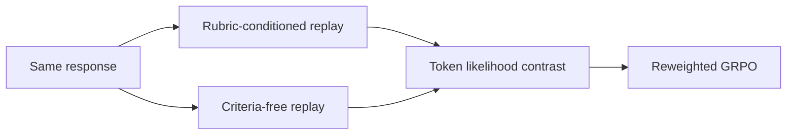
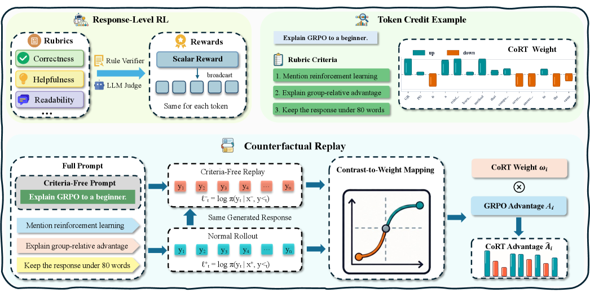

# CoRT: token-level rubric credit through counterfactual replay

<!-- source-sha256: fe5e011f7715f95dde51c6818222ffe18a1ddf6b9968e68a594ea32abf100f8c -->

[简体中文](README.md)

> **Fidelity:** Runs the paper's isolatable state and update mechanisms on common public data or a deterministic mini-suite. This does not reproduce the original large model.

## Paper information

| Field | Details |
|---|---|
| Paper | [CoRT: token-level rubric credit through counterfactual replay (arXiv 2607.25659)](https://arxiv.org/abs/2607.25659) |
| Organization | ByteDance internship / academic author team |
| First public release | 2026-07-28 |
| Authors' code | No official public repository was found as of 2026-07-29. |
| Adapter / method | `cort` |
| Local reproduction code | [`src/auto_research/post_training/`](https://github.com/daiwk/auto-research/tree/main/src/auto_research/post_training/) |

## Original paper

### Motivation and method

Replay the same response with a rubric and with criteria removed. Token likelihood differences redistribute GRPO's response-level advantage.



<!-- paper-figure:start -->
### Key figure from the paper

[](https://arxiv.org/html/2607.25659v1/x2.png)

> **Figure 2:** Overview of the paper's method and key components. From the [original paper](https://arxiv.org/abs/2607.25659); copyright remains with the authors.
<!-- paper-figure:end -->

### Core equations

$$
w_t=\operatorname{Norm}\!\left(\log\pi_\theta(y_t\mid x,r)-\log\pi_\theta(y_t\mid x)\right),\quad \mathcal L=-\sum_t w_tA\log\pi_\theta(y_t).
$$

### Paper results

Most paired experiments across models and reward granularities beat response-level GRPO, averaging +4.4 percentage points, without an extra token scorer. No production online A/B is reported; the evidence is offline or environment-based.

## Local reproduction

On the GSM8K candidate policy, run rubric and criteria-free counterfactual replays, normalize token weights, and update with signed advantages.

| Metric | Untrained policy | CoRT |
|---|---:|---:|
| Accuracy | 0.1719 | **0.8906** |
| Mean reward | 0.3124 | **0.8908** |
| KL(reference) | 0.0000 | 0.0201 |

```bash
auto-research post-train --algorithm cort --dataset gsm8k-candidate --maximum-examples 256 --steps 120 --seed 42
```

See the [fixed-seed metrics](../../experiments/post-training-20260729-seed42.json).

## Reproduction boundaries

Candidate-action features stand in for token sequences. No open-ended generation, rubric judge, or large-model parameter update is included.
