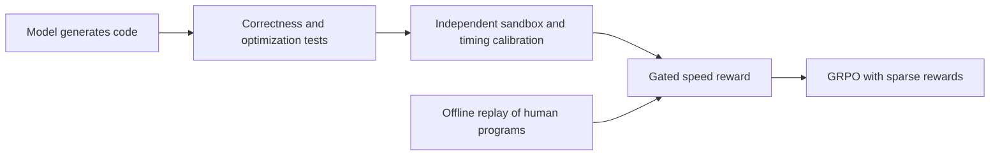
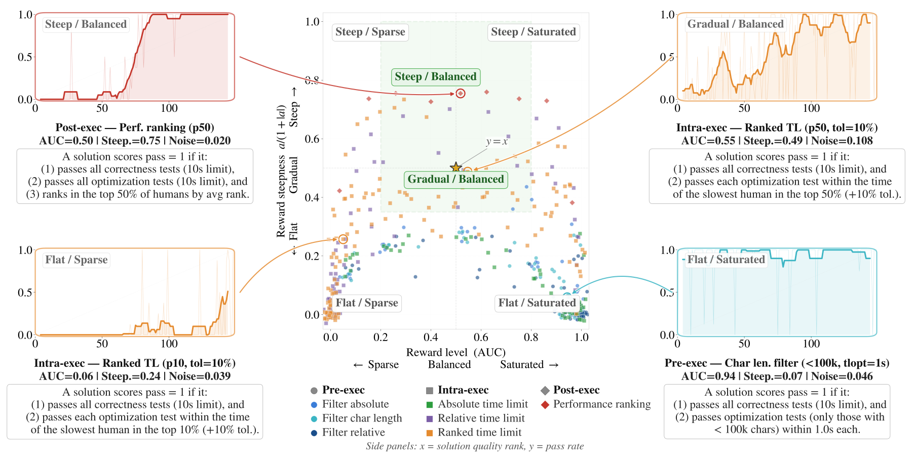

<!-- source-sha256: 1dbd2aa2203f1005654b2203a717894de54b67f8b14f854f4fabfa6a8f1421ad -->

[简体中文](README.md) · English

# Code Optimization RL: Making runtime a learnable reward

> Priority Google/Meta backfill. **Too costly to reproduce (review DONE).** No new training, CUDA path or Evolve integration.

## Paper information

| Field | Details |
| --- | --- |
| Paper | [arXiv 2607.25970](https://arxiv.org/abs/2607.25970); [official Meta page](https://ai.meta.com/research/publications/reinforcement-learning-for-code-optimization/) |
| Institution | Pierre Chambon, FAIR at Meta / Inria (first author) |
| First public release | arXiv v1: 2026-07-28 16:52:31 UTC; Meta catalog July 29; v2 October 7 |
| Author code | No verified complete training source for this paper was found. Its cited [BigOBench sandbox](https://github.com/facebookresearch/BigOBench/tree/main/src/complexity/sandbox) belongs to prior work, not a release of this method. |
| Local adapter or method key | `code-optimization-rl` |
| Local reproduction code | None; this page and `src/auto_research/paper_specs/catalog/post-training/code-optimization-rl.json` only. No executable adapter (`adapter: null`). |

## Original paper summary

### Background and main changes

Correct code can still be slow. Adding runtime reward directly is confounded by small tests, shared worker load and sparse advantages. DMC-Optim uses a separate timing-calibration service and combines correctness, optimization tests and human runtime percentiles. Offline replay selects rewards and environments; online GRPO addresses sparse rewards and stale batches. See [Sections 3–5 and Appendices C–F](https://arxiv.org/html/2607.25970v1).

<!-- paper-figure:start -->
### Key figure from the paper

> **Figure 3:** An offline simulator screens reward environments using AUC, slope and intervention locations. Converted from the authors' SVG to PNG, not a local redraw or result. From the [paper](https://arxiv.org/abs/2607.25970); copyright belongs to the authors. Click for the source.
<!-- paper-figure:end -->

### Offline and online results

The strict `p_tau` metric requires correctness and runtime no slower than a specified human percentile. It is an evaluation definition, not the entirety of training reward. Reward composition, timing calibration and exception handling must be checked separately. The paper reports top-50% pass@1 from 18.0% to 31.3% for Qwen2.5-7B and 30.7% to 50.4% for CWM32B. These are not local results; no production A/B.

## Local reproduction

Each online RL run uses 8 to 32 GPU nodes for hours to days plus a dedicated execution service, beyond one A100/A30 or Mac. **Too costly to reproduce (review DONE).** No checkpoint download, training or substitute CPU timing fixture.

Status `deferred_high_cost` / `not_reproduced_high_cost`. No local capability metrics, GPU receipt or Evolve mapping. No automatic retry and no block on the review watermark.
