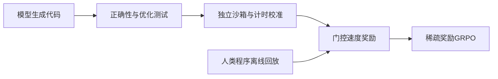
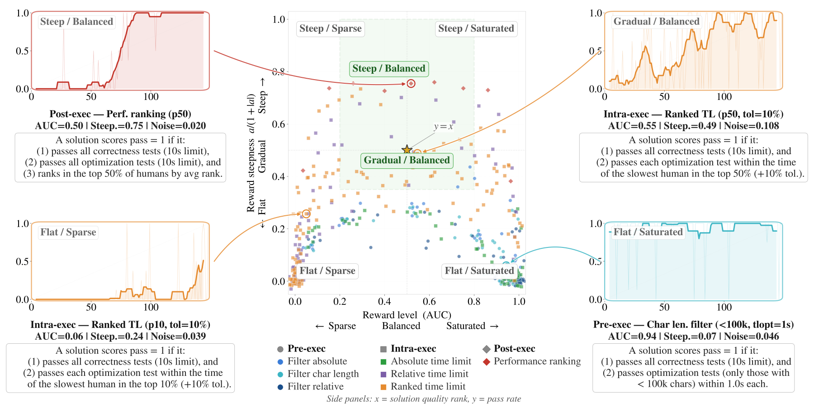

# Code Optimization RL：让执行时间成为可学习奖励

> Google/Meta优先补漏资料。**成本过高，不复现（审查 DONE）**；没有新增训练、CUDA路径或evolve接入。

## 论文信息

| 字段 | 内容 |
| --- | --- |
| 论文链接 | [arXiv 2607.25970](https://arxiv.org/abs/2607.25970)；[Meta官方页](https://ai.meta.com/research/publications/reinforcement-learning-for-code-optimization/) |
| 公司 / 机构 | 一作Pierre Chambon，FAIR at Meta / Inria |
| 首次公开日期 | arXiv v1：2026-07-28 16:52:31 UTC；Meta目录07-29；v2为10-07 |
| 原作者代码 | 未找到已核验的本论文完整训练源码。正文引用的[BigOBench沙箱](https://github.com/facebookresearch/BigOBench/tree/main/src/complexity/sandbox)属于先前工作，不冒称本方法开源 |
| 本地 adapter / 稳定键 | 无可执行adapter（`adapter: null`）；资料键`code-optimization-rl` |
| 本地复现代码 | 无；仅本文和`src/auto_research/paper_specs/catalog/post-training/code-optimization-rl.json` |

## 原始论文总结

### 背景与主要改动

代码正确不等于运行快；直接加入耗时奖励会被小测试、共享worker负载和稀疏优势淹没。作者构造DMC-Optim，用独立服务校准时长，再组合正确性、优化测试和人类参考百分位。先离线回放筛选奖励与环境，在线GRPO另处理稀疏奖励与过旧批次。[原文§3–5、附录C–F](https://arxiv.org/html/2607.25970v1)

<!-- paper-figure:start -->
### 原论文关键图

> **原文Figure3**：离线模拟器根据AUC、斜率和不同干预位置筛选优化奖励环境；由作者独立SVG静态转为PNG，不是本地重绘或实验结果。图片来自[原论文](https://arxiv.org/abs/2607.25970)，版权归原作者所有。
<!-- paper-figure:end -->

### 核心指标与原文效果

严格指标`p_tau`要求程序既正确，又不慢于人类参考时长的指定百分位。这是评测定义，不是所有训练奖励都等于该指示函数；奖励组合、计时校准与异常处理须分别核验。作者报告Qwen2.5-7B的top-50% pass@1从18.0%到31.3%、CWM32B从30.7%到50.4%；不是本地结果，未报告生产线上A/B。

## 本地复现与成本决策

原文每次在线RL运行使用8至32个GPU节点、数小时至数天，且依赖独立代码执行服务，显著超出单A100/A30或Mac预算。**成本过高，不复现（审查 DONE）**；不下载checkpoint、不训练，不用CPU计时fixture替代完整算法。

状态`deferred_high_cost` / `not_reproduced_high_cost`；无本地能力指标、GPU回执、evolve映射，不自动重试，不阻塞审查水位。
