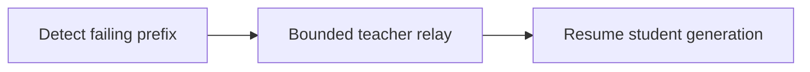
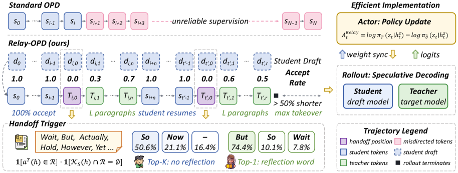

# Relay-OPD: Trajectory relay for on-policy distillation

<!-- source-sha256: db1ce9eb4c24ff52687be20b8650dc9335c439396ab60dfbabea642089a97998 -->

[简体中文](README.md)

> Candidate-policy relay state machine, not eight-GPU training.

## Paper information

| Field | Details |
|---|---|
| Paper | [Paper or original source](https://arxiv.org/abs/2607.26057) |
| Institution | Zhejiang University / Alibaba Group Yuvion Team. |
| First public release | 2026-07-28 |
| Author code | [ZJU-REAL/Relay-OPD](https://github.com/ZJU-REAL/Relay-OPD). |
| Local adapter or method key | `relay-opd` |
| Local reproduction code | [`src/auto_research/post_training/`](https://github.com/daiwk/auto-research/tree/main/src/auto_research/post_training/) |

## Paper method and evidence

Detect a failing student prefix, let the teacher take over briefly, then return control to the student. A finite relay budget concentrates supervision on critical early positions.



<!-- paper-figure:start -->
### Original paper figure

[](https://arxiv.org/html/2607.26057v1/x4.png)

Figure shows teacher handoff and student continuation. From the [original paper](https://arxiv.org/abs/2607.26057); copyright remains with the authors.
<!-- paper-figure:end -->

### Core equation

$$
\mathcal L_{\mathrm{relay}}=-\sum_t\log p_\theta(y_t\mid y_{<t}),\quad \sum_j L_j\le B_{\mathrm{relay}}.
$$

### Reported results

Qwen3-1.7B student averages +5.73% versus standard OPD and +1.49% versus FastOPD on eight math benchmarks, with more than 50% shorter training trajectories. No production A/B.

## Local reproduction

GSM8K candidates exercise prefix failure, teacher handoff, finite relay budget and student resumption against the same untrained policy. Accuracy **0.1719→0.8906**, reward **0.3124→0.8867**, KL **0.0000→0.5014**. [Metrics](../../experiments/post-training-20260729-seed42.json). The teacher is a reproducible candidate-distribution cache, not Qwen3-4B.

```bash
auto-research post-train --algorithm relay-opd --dataset gsm8k-candidate --maximum-examples 256 --steps 120 --seed 42
```
