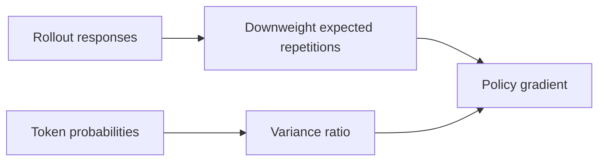
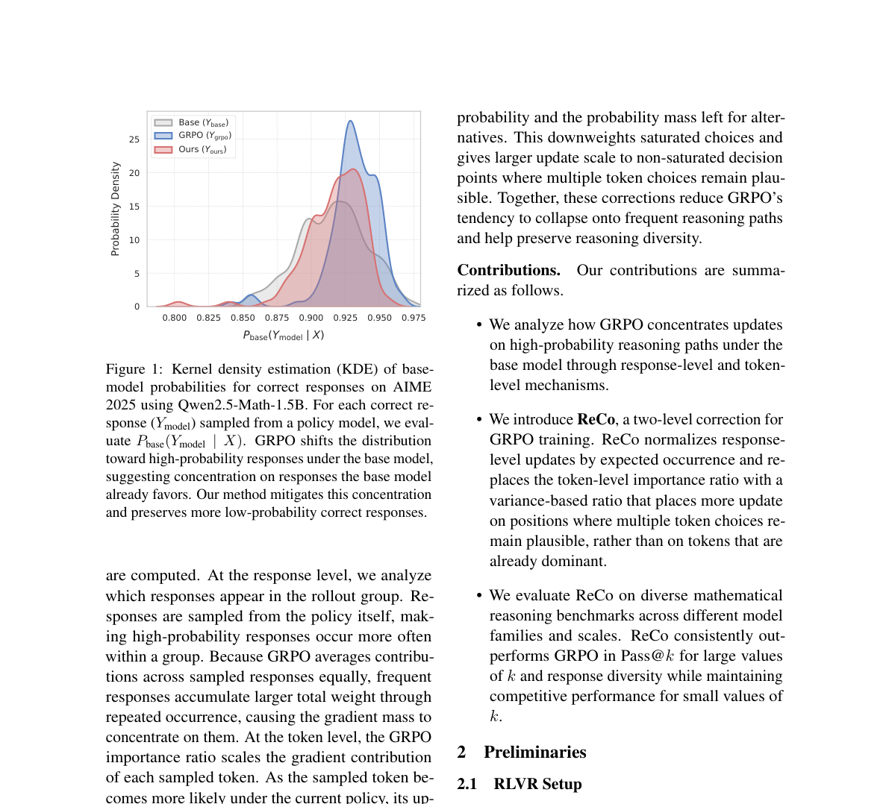

# ReCo

<!-- source-sha256: 9cd45f8932025ef64e418800c283c9f8717c76f7a2fc10b60f351180d88f5a06 -->

[简体中文](README.md)

> Objective-level candidate-policy mechanism, not full-parameter RLVR.

## Paper information

| Field | Details |
|---|---|
| Paper | [arXiv 2607.26862](https://arxiv.org/abs/2607.26862) |
| Institution | Seoul National University. |
| First public release | 2026-07-29 (arXiv v1) |
| Author code | No public author implementation found. |
| Local adapter or method key | `reco-grpo` |
| Local reproduction code | `src/auto_research/post_training/algorithms.py` |

## Paper method and evidence

GRPO can resample high-probability responses and amplify saturated tokens, reducing reasoning diversity at large k. Weight responses inversely by expected occurrence in the rollout group, then use a Bernoulli variance ratio to focus updates on unsaturated decisions.



<!-- paper-figure:start -->
### Original paper figure

[](https://arxiv.org/abs/2607.26862)

The original figure illustrates response- and token-level reweighting. From the [original paper](https://arxiv.org/abs/2607.26862); copyright remains with the authors.
<!-- paper-figure:end -->

### Core equation

$$
w_i^{\rm resp}=\frac{1}{G\bar\pi_{\theta_{\rm old}}(o_i|q)},\qquad
r_{i,t}^{\rm var}=
\frac{p^\theta_{i,t}(1-p^\theta_{i,t})}
{p^{\rm old}_{i,t}(1-p^{\rm old}_{i,t})},
$$

$$
g^{\rm ReCo}_{i,t}=w_i^{\rm resp}r_{i,t}^{\rm var}
\nabla_\theta\log\pi_\theta(o_{i,t}|h_{i,t})\hat A_i.
$$

### Reported results

Five-math-benchmark mean Pass@64: Qwen2.5-Math-1.5B GRPO **65.8**, ReCo **68.9**; 7B **69.0→72.6**; Llama-3.1-8B-Instruct **46.2→57.5**. No production A/B.

## Local reproduction

Apply expected-occurrence weighting, variance ratio, PPO clipping, KL and policy refresh every 16 steps.

```bash
auto-research post-train --algorithm reco-grpo --dataset gsm8k-candidate \
  --steps 120 --group-size 4 --maximum-examples 256 --seed 42
```

GSM8K candidate accuracy **0.1719→0.8750**, mean reward **0.3124→0.8798**; final mean variance ratio **0.9842**, seven refreshes. [Full metrics](../../experiments/latest-cross-domain-20260730-seed42.json). Candidate actions replace full responses; no comparable Pass@64 or natural-language Self-BLEU.
