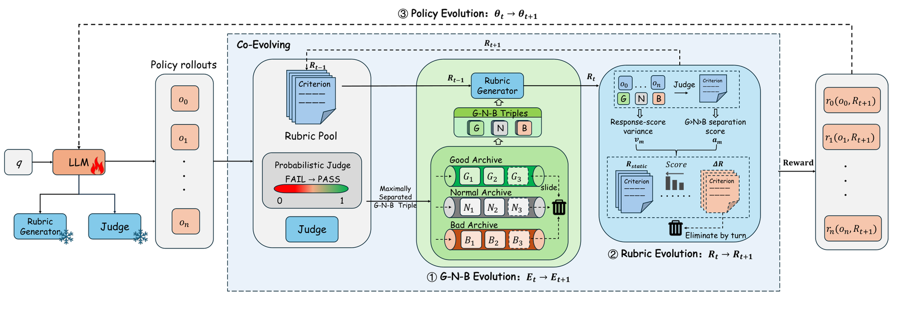

# SERPO: Self-Evolving Rubric Policy Optimization for Open-Ended Test-Time Reinforcement Learning

<!-- source-sha256: bb074d8ca20485ea4dc1f5c588734a736d0397b9a3d9c082573bb5b6317d656c -->

[简体中文](README.md)

> Candidate-policy objective, not paper-scale training.

## Paper information

| Field | Details |
|---|---|
| Paper | [Paper or original source](https://arxiv.org/abs/2607.26873) |
| Institution | No affiliation disclosed; first author Jianze Wang. |
| First public release | 2026-07-29 (arXiv v1) |
| Author code | No public author code found as of 2026-08-24. |
| Local adapter or method key | `serpo` |
| Local reproduction code | `src/auto_research/post_training/historical_b08_b09.py` |

## Paper method and evidence

A Good–Normal–Bad response archive, query-specific rubrics and actor policy co-evolve in a three-way feedback loop.


<!-- paper-figure:start -->
### Original paper figure

[](https://arxiv.org/html/2607.26873v2/x2.png)

Figure shows rubric and policy co-evolution. From the [original paper](https://arxiv.org/abs/2607.26873); copyright remains with the authors.
<!-- paper-figure:end -->

### Core equation

$$
\theta,rubric,archive\leftarrow\operatorname{Evolve}(\theta,rubric,archive)
$$

### Reported results

The paper reports up to +20.63/+20.31 points on HealthBench/ResearchQA and +8.06 macro across six benchmarks.

## Local reproduction

120 updates: accuracy **0.1953→0.3281 (+0.1328)**. [Metrics](metrics/arithmetic-smoke-seed42.json), [Batch index](../../experiments/historical-b07-b11-seed42.json). Before/after arithmetic-smoke results on one candidate policy are not matched comparisons across methods. No full checkpoint, data, compute, multi-seed or benchmark. Raw outputs stay in `runs/post-training/`; [experiment artifacts](../../experiments/) contain metrics only.

```bash
auto-research post-train --algorithm serpo --dataset arithmetic-smoke --steps 120 --seed 42 --no-network
```
