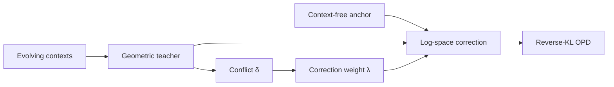
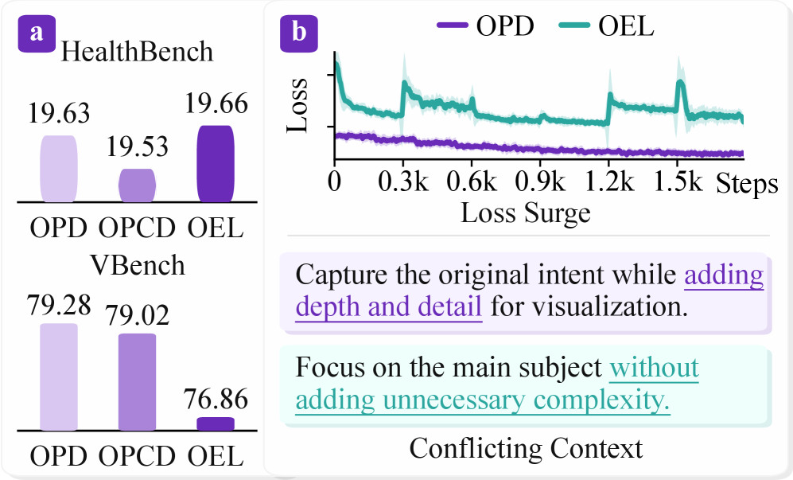

# Flux-OPD: evolving contexts and conflict-weighted distillation

<!-- source-sha256: 19200da261cb48eac90a3bc22b7f827d79954b1cf5f63695eed733c1c1c07faf -->

[简体中文](README.md)

> **Fidelity:** Implements a context-free anchor, geometric teacher, contextual correction, and conflict weighting.

## Paper information

| Field | Details |
|---|---|
| Paper | [Flux-OPD (arXiv 2607.28022)](https://arxiv.org/abs/2607.28022) |
| Organization | Peking University / Kling Team / Tsinghua University / Shanghai Jiao Tong University |
| First public release | 2026-07-30 |
| Authors' code | No official author implementation was found when checked on 2026-08-01. |
| Adapter / method | `flux-opd` |
| Local reproduction code | [`src/auto_research/post_training/`](https://github.com/daiwk/auto-research/tree/main/src/auto_research/post_training/) |

## Original paper

### Motivation and method

Students absorb fixed contexts quickly, but replacing a contextual teacher outright produces discontinuous targets. Flux-OPD holds the context-free teacher fixed as an anchor and injects only log-probability differences from multiple evolving contextual teachers. The geometric-mean normalization constant captures conflict; higher conflict weakens the correction.



<!-- paper-figure:start -->
### Key figure from the paper

[](https://arxiv.org/html/2607.28022v1/x1.png)

> **Key figure:** Original motivation diagram. From the [original paper](https://arxiv.org/abs/2607.28022); copyright remains with the authors.
<!-- paper-figure:end -->

### Core equations

$$
q_k^{\mathrm{flux}}=\operatorname{softmax}(\log q_0+\lambda_k(\log q_{\mathrm{geo},k}-\log q_0)),\quad \delta_k=-\log Z_k.
$$

### Paper results

In video prompt optimization, the student averages VBench 80.18 versus 79.28 for OPD, and Video-Bench 3.61 versus 3.54. HealthBench also beats the listed OPD approaches. No production A/B is reported.

## Local reproduction

> **Local comparison:** Same GSM8K candidate policy, 120 steps, seed 42. Accuracy goes from 0.1719 to **0.8438 (+390.91%)**.

```bash
auto-research post-train --algorithm flux-opd --dataset gsm8k-candidate --maximum-examples 256 --steps 120 --seed 42
```

See the [fixed metrics](../../experiments/beta-flux-opd-gsm8k-seed42.json).

## Reproduction boundaries

Two local reward axes stand in for evolving contextual teachers. No video model, medical teacher, or large-model context extraction is called.
